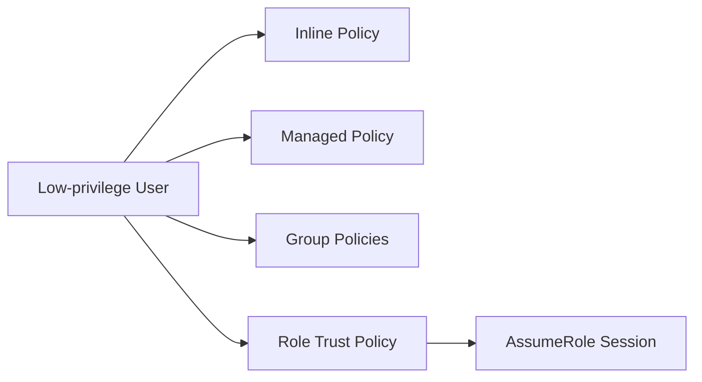

# 01. IAM Enum Basics

- 난이도: Easy
- 핵심: IAM User에 직접·간접으로 연결된 권한과 전환 가능한 Role을 체계적으로 조사합니다.

## Attack Path



## 1. 현재 신원 확인

```bash
PROFILE=<PROFILE>

aws sts get-caller-identity --profile "$PROFILE"
```

ARN에서 User 이름과 Account를 확인합니다. 조사 결과를 다른 계정의 Resource와 섞지 않도록 가장 먼저 실행합니다.

## 2. User의 직접 권한

```bash
USER_NAME=<USER_NAME>

# Inline Policy
aws iam list-user-policies \
  --user-name "$USER_NAME" \
  --profile "$PROFILE"

aws iam get-user-policy \
  --user-name "$USER_NAME" \
  --policy-name <INLINE_POLICY_NAME> \
  --profile "$PROFILE"

# Managed Policy
aws iam list-attached-user-policies \
  --user-name "$USER_NAME" \
  --profile "$PROFILE"
```

관리형 Policy의 실제 Document는 한 단계 더 조회해야 합니다.

```bash
POLICY_ARN=<POLICY_ARN>

aws iam get-policy \
  --policy-arn "$POLICY_ARN" \
  --profile "$PROFILE"

aws iam get-policy-version \
  --policy-arn "$POLICY_ARN" \
  --version-id <DEFAULT_VERSION_ID> \
  --profile "$PROFILE"
```

`list-*`는 이름·ARN을 찾는 단계이고 `get-*`는 실제 Policy 내용을 읽는 단계입니다.

## 3. Group을 통한 간접 권한

```bash
aws iam list-groups-for-user \
  --user-name "$USER_NAME" \
  --profile "$PROFILE"

GROUP_NAME=<GROUP_NAME>

aws iam list-group-policies \
  --group-name "$GROUP_NAME" \
  --profile "$PROFILE"

aws iam list-attached-group-policies \
  --group-name "$GROUP_NAME" \
  --profile "$PROFILE"
```

User에 직접 연결된 Policy만 보면 Group을 통해 얻은 권한을 놓칠 수 있습니다.

## 4. Role과 Trust Policy

```bash
aws iam list-roles \
  --profile "$PROFILE" \
  --query 'Roles[].{Name:RoleName,Arn:Arn}' \
  --output table

aws iam get-role \
  --role-name <ROLE_NAME> \
  --profile "$PROFILE"
```

`AssumeRolePolicyDocument`에서 현재 Principal이 신뢰되는지 확인하고, Role에 연결된 Inline·Managed Policy도 조회합니다.

```bash
aws sts assume-role \
  --role-arn <ROLE_ARN> \
  --role-session-name cloudgoat-enum \
  --profile "$PROFILE"
```

## Root Cause

민감한 정보가 Policy의 Description, SID, Tag와 Resource 이름에 남아 있고, 저권한 User가 IAM 구조를 광범위하게 열거할 수 있었습니다.

## Defense

- Policy와 Tag에 Secret을 저장하지 않습니다.
- `iam:List*`, `iam:Get*`도 필요한 Resource 범위로 제한합니다.
- Role Trust와 호출자의 `sts:AssumeRole` 권한을 함께 검토합니다.
- IAM Access Analyzer와 CloudTrail로 예상하지 않은 Trust·Role Session을 확인합니다.
