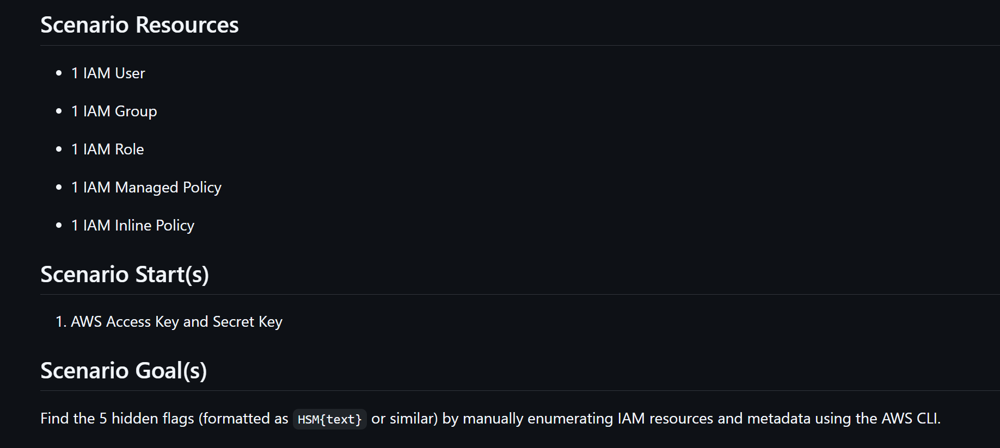

# 1st Scenario: iam_enum_basics

[← CloudGoat 시나리오 목록](../README.md)

난이도 : Easy

command : cloudgoat create iam_enum_basics --profile cloudgoat-lab



# 진행


먼저 iam으로 계정 등록이 되어있는 bob의 명의로 작업을 하려기 config profile에 bob이 없다라고 출력된다.

이유는 아직 bob을 등록하지 않아서고, 이에 따라 configure 명령어를 통해 bob을 등록한다.

aws configure —profile bob 

이후 list를 확인하면은 profile에 등록된 것을 볼 수 있다. 

좋습니다. 첫 시나리오는 `iam_enum_basics`로 시작하세요. 이 시나리오의 핵심은 AWS의 IAM 구조와 AWS CLI의 기본 조사 순서를 배우는 것입니다. 목표는 저권한 사용자 `Bob`으로 IAM 사용자, 그룹, 정책, 역할을 조사해 총 5개의 플래그를 찾는 것입니다. [CloudGoat 공식 설명](https://github.com/RhinoSecurityLabs/cloudgoat#iam_enum_basics-easy)

가장 중요한 점은 AWS 프로필 두 개를 구분하는 것입니다.

- `cloudgoat-lab`: 실습 환경을 만들고 삭제하는 관리자
- `bob`: 생성된 환경을 공격자 관점에서 조사하는 저권한 사용자

시나리오를 풀 때는 항상 `--profile bob`을 붙입니다. 관리자 프로필로 조사하면 권한 제한을 경험할 수 없어 실습 의미가 없어집니다.

## 1. AWS CLI 명령 구조 이해하기

AWS CLI 명령은 보통 다음 구조입니다.

```
aws [서비스] [동작] [옵션]
```

예를 들면:

```
aws iam list-users --profile bob
```

각 부분의 의미는 다음과 같습니다.

```
aws            AWS CLI 프로그램
iam            사용할 AWS 서비스
list-users     IAM 사용자 목록 조회 동작
--profile bob  Bob의 자격 증명 사용
```

AWS CLI에서 자주 보는 동사는 다음과 같습니다.

- `list-*`: 여러 리소스의 목록 조회
- `get-*`: 특정 리소스 하나의 상세 정보 조회
- `describe-*`: 리소스의 상세 상태 조회
- `create-*`: 리소스 생성
- `delete-*`: 리소스 삭제

첫 시나리오에서는 조회 명령만 사용하면 됩니다.

## 2. 시나리오 배포 상태 확인

```
cloudgoat list deployed
```

`iam_enum_basics`가 없다면 생성합니다.

```
cloudgoat create iam_enum_basics --profile cloudgoat-lab
```

생성이 완료되면 CloudGoat이 새로운 시나리오 디렉터리를 만들고 그 안에 `start.txt`를 저장합니다.

찾아봅니다.

```
find . -name start.txt -print
```

결과 예시:

```
./iam_enum_basics_cgid123456/start.txt
```

파일을 읽습니다.

```
cat ./iam_enum_basics_cgid123456/start.txt
```

실제 디렉터리 이름은 출력된 경로로 바꿔야 합니다.

이 파일에는 보통 Bob의 다음 정보가 들어 있습니다.

```
Access Key ID
Secret Access Key
```

시나리오 디렉터리와 `start.txt`는 수정하거나 삭제하지 마세요. Terraform 상태 파일도 들어 있어 나중에 리소스를 제거할 때 필요합니다.

## 3. Bob의 AWS 프로필 만들기

다음 명령을 실행합니다.

```
aws configure --profile bob
```

`start.txt`에 나온 Bob의 키를 입력합니다.

```
AWS Access Key ID: start.txt의 Bob Access Key
AWS Secret Access Key: start.txt의 Bob Secret Key
Default region name: ap-northeast-2
Default output format: json
```

프로필을 확인합니다.

```
aws configure list-profiles
```

대략 다음 두 개가 보여야 합니다. 

```
cloudgoat-lab
bob
```

## 4. 첫 번째 기본 점검: “나는 누구인가?”

클라우드 환경을 점검할 때 가장 먼저 확인해야 하는 정보입니다.

```
aws sts get-caller-identity --profile bob
```

출력 예시:

```
{
    "UserId": "AIDA...",
    "Account": "123456789012",
    "Arn": "arn:aws:iam::123456789012:user/cg-bob-..."
}
```

여기서 확인할 것은 세 가지입니다.

- `Account`: 현재 접근 중인 AWS 계정
- `Arn`: 현재 사용 중인 IAM 사용자 또는 Role
- `UserId`: AWS 내부 식별자

ARN은 AWS 리소스의 전체 주소입니다.

```
arn:aws:iam::계정ID:user/사용자이름
```

Bob의 실제 사용자 이름을 기록해두세요. 예를 들어 ARN이 다음과 같다면:

```
arn:aws:iam::123456789012:user/cg-bob-abcd
```

사용자 이름은:

```
cg-bob-abcd
```

입니다.

셸 변수로 저장하면 이후 명령이 편해집니다.

```
BOB_USER="여기에_실제_Bob_사용자이름"
```

예:

```
BOB_USER="cg-bob-abcd"
```

확인:

```
echo "$BOB_USER"
```

## 5. IAM의 기본 구조

이번 시나리오에서는 다음 관계를 이해하면 됩니다.

```
Bob(IAM 사용자)
 ├─ Bob에게 직접 붙은 인라인 정책
 ├─ Bob에게 직접 붙은 관리형 정책
 └─ Bob이 속한 그룹
      ├─ 그룹의 인라인 정책
      └─ 그룹의 관리형 정책

Role
 ├─ 권한 정책
 └─ 신뢰 정책: 누가 이 Role을 사용할 수 있는가?
```

### IAM 사용자

Bob처럼 장기간 자격 증명을 가진 신원입니다.

### 정책 Policy

무엇을 허용하거나 거부할지 적은 JSON 문서입니다.

```
{
  "Effect": "Allow",
  "Action": "iam:ListUsers",
  "Resource": "*"
}
```

의미:

- `Effect`: 허용인지 거부인지
- `Action`: 가능한 AWS API 동작
- `Resource`: 그 권한을 사용할 수 있는 대상

### 그룹 Group

여러 IAM 사용자에게 같은 권한을 묶어서 부여하는 단위입니다.

### 역할 Role

필요할 때 다른 신원으로 전환해서 사용하는 임시 권한 집합입니다. 네트워크 관점으로 비유하면 “다른 권한 영역으로 들어가기 위한 임시 세션”에 가깝습니다.

### 신뢰 정책 Trust policy

일반 정책이 “무엇을 할 수 있는가?”를 정의한다면, 신뢰 정책은 “누가 이 Role을 사용할 수 있는가?”를 정의합니다.

## 6. Bob 자신의 상세 정보 조사

```
aws iam get-user --user-name "$BOB_USER" --profile bob
```

다음 정보를 확인합니다.

- `UserName`
- `Arn`
- `Tags`
- `Path`
- 특이한 문자열이나 `flag`

출력이 길면 파일로 저장해도 됩니다.

```
aws iam get-user \
  --user-name "$BOB_USER" \
  --profile bob \
  --output json | tee bob-user.json
```

플래그 형태를 검색합니다.

```
jq . bob-user.json
grep -i flag bob-user.json
```

`AccessDenied`가 나오더라도 실패라고 생각하지 마세요. 저권한 사용자가 어떤 API를 사용할 수 없는지 확인하는 것도 권한 열거의 일부입니다.

실제로 나오는 모습 


## 7. Bob에게 직접 붙은 정책 조사

IAM 정책은 두 종류로 나눠서 확인해야 합니다.

### 7-1. 인라인 정책 - flag2 발견

인라인 정책은 특정 사용자 안에 직접 들어 있는 정책입니다.

목록 확인:

```
aws iam list-user-policies \
  --user-name "$BOB_USER" \
  --profile bob
```

출력 예:


일단 flag2가 나온 것을 볼 수 있다. 이제 아래 정책 자세히 보기를 통해 저 flag2 정책을 읽어볼 예정이다. 

정책 이름이 나오면 내용을 읽습니다.

```
aws iam get-user-policy \
  --user-name "$BOB_USER" \
  --policy-name "실제_정책_이름" \
  --profile bob
```


flag가 HSM{text} 형식으로 나온다고 되어있는데, 저 Sid 부분에 "HSM1nl1n3p0l1cyd1sc0v3r3d”로 있는 것을 볼 수 있었다. 

일단 여기서 flag2를 찾았다. 


다만, 이 간단한 명령어를 치면서도 좀 곡절이 있었는데, 위에서는 list-user-policies 였다가 명령어를 get-user-policy로 바꿔야 한다는 것과 저 단수 복수형을 제대로 안해주어서 몇 번 틀리면서 왜 안되지 이러고 있었다. 

### 7-2. 관리형 정책 - flag1 및 flag5 발견

관리형 정책은 독립적인 정책 객체를 사용자에게 연결하는 방식입니다.

```
aws iam list-attached-user-policies \
  --user-name "$BOB_USER" \
  --profile bob
```

여기서는 `PolicyName`과 `PolicyArn`을 확인합니다.


이번에는 flag1이 나온 것을 볼 수 있다. 이를 자세히 보면 flag2 처럼 나올 것 같다. 아래를 계속 따라가 보자. 

정책 ARN을 변수에 넣습니다.

```
POLICY_ARN="출력된_실제_PolicyArn"
```

저 ARN은 PolicyArn으로 나온 arn:aws:iam~ 으로 나오는 것 전부 넣으면 된다. 

정책 메타데이터 확인:

```
aws iam get-policy \
  --policy-arn "$POLICY_ARN" \
  --profile bob
```


일단 flag1을 찾은 것을 볼 수 있다. Description으로 "HSM{m4n4g3d_p0l1cy_m4st3r}” 가 적혀져 있는 것을 볼 수 있다.

여기서 중요한 값은:

```
DefaultVersionId
```

입니다. 예를 들어 `v1`이면 실제 정책 내용을 다음처럼 읽습니다.

```
aws iam get-policy-version \
  --policy-arn "$POLICY_ARN" \
  --version-id "v1" \
  --profile bob
```


이걸 정확히 어떻게 하는지 몰라서 안했다가 결국 여기서 추가적인 flag를 발견할 수 있었다. 

유저에게 적용된 정책을 찾고, 그 정책을 골라서 기본 버전을 확인한 후, 저렇게 버전을 같이 입력해서 실제 json 파일을 확인해야 하는 것이었다. 

아무튼, flag5인 HSM{s3cr3t_js0n_str1ng} 을 발견할 수 있었다. 

관리형 정책 조회 순서는 항상 다음과 같습니다.

```
정책 ARN 찾기 -> list-attached-user-policies
→ get-policy로 기본 버전 확인
→ get-policy-version으로 실제 JSON 읽기
```

## 8. Bob의 그룹 조사 - flag3 발견

Bob이 속한 그룹을 확인합니다.

```
aws iam list-groups-for-user \
  --user-name "$BOB_USER" \
  --profile bob
```

출력에서 `GroupName`을 기록합니다.

```
GROUP_NAME="출력된_실제_그룹명"
```


보면은 flag3이 나온 것을 볼 수 있다. 아래의 그룹 자체 상세정보로 가면 HSM flag가 나올 것 같기도 하고, 설정된 Path를 보면 HSM_group_membership_found라고 적혀져 있기도 하다. 


음 보니 저 HSM_gr0up_m3mb3rsh1p_f0und 자체가 flag3인 것 같다. 상세보기가 그룹의 사용자 정보를 추가적으로 알려주는 것을 볼 수 있다. 

그룹 자체의 상세 정보:

```
aws iam get-group \
  --group-name "$GROUP_NAME" \
  --profile bob
```

그룹에도 사용자와 마찬가지로 인라인 정책과 관리형 정책이 존재합니다.

### 그룹 인라인 정책

```
aws iam list-group-policies \
  --group-name "$GROUP_NAME" \
  --profile bob
```


아쉽게도 그룹 인라인 정책은 없는 것으로 보인다. 

정책 이름이 나오면:

```
aws iam get-group-policy \
  --group-name "$GROUP_NAME" \
  --policy-name "실제_정책_이름" \
  --profile bob
```

### 그룹 관리형 정책

```
aws iam list-attached-group-policies \
  --group-name "$GROUP_NAME" \
  --profile bob
```


동일하게 그룹 관리형 정책 또한 없는 것을 볼 수 있다. 

정책 ARN이 나오면 앞에서 했던 것과 동일하게 조사합니다.

```
aws iam get-policy \
  --policy-arn "실제_PolicyArn" \
  --profile bob
```

기본 버전을 확인한 뒤:

```
aws iam get-policy-version \
  --policy-arn "실제_PolicyArn" \
  --version-id "실제_DefaultVersionId" \
  --profile bob
```

## 9. Role 조사 - flag4 발견, query 관련 설명

접근 가능한 Role 목록을 확인합니다.

```
aws iam list-roles --profile bob
```


일단은 AWS 관련한 Role들이 나오지만, flag 관련, cloudgoat 관련 role은 없었다. 근데 기본 역할만해도 엄청 많은 것을 보고 만약 Role을 다룰 일이 있다면 무조건 라벨링을 해야겠다는 생각이 든다. 

…인 줄 알았으나 아래의 쿼리하는 명령어를 치니까 flag4가 나왔다.

CloudGoat 리소스 이름은 보통 `cg-` 같은 접두사가 포함됩니다. `jq`를 이용해 보기 쉽게 정리할 수 있습니다.

```
aws iam list-roles \
  --profile bob \
  --query 'Roles[].{Name:RoleName,Arn:Arn}' \
  --output table
```


저 query 옵션을 정확히 몰라서 그냥 넘어갔던 명령어였는데, 이걸 입력하니까 flag4 관련 내용이 나오는 것을 볼 수 있었다. 

[query 관련 설명](notes/aws-cli-query.md)

의심스러운 Role 이름을 찾았다면 상세 정보를 봅니다.

```
ROLE_NAME="실제_Role_이름"
```

```
aws iam get-role \
  --role-name "$ROLE_NAME" \
  --profile bob
```


Role 상세정보를 확인하니, Tags부분에 Flag로 HSM-r0l3_trus1_f0und 가 있는 것을 볼 수 있었다. 

여기서 특히 중요한 것은:

```
AssumeRolePolicyDocument
```

입니다. 다음과 같은 구조를 찾습니다.

```
{
  "Effect": "Allow",
  "Principal": {
    "AWS": "..."
  },
  "Action": "sts:AssumeRole"
}
```

확인할 질문:

- `Principal`에 Bob 또는 Bob의 계정이 포함되어 있는가?
- `Action`이 `sts:AssumeRole`인가?
- Role의 태그나 설명에 특이한 정보가 있는가?

Role에 연결된 정책도 조사합니다.

```
aws iam list-role-policies \
  --role-name "$ROLE_NAME" \
  --profile bob
```

인라인 정책 이름이 나오면:

```
aws iam get-role-policy \
  --role-name "$ROLE_NAME" \
  --policy-name "실제_정책_이름" \
  --profile bob
```

관리형 정책 목록:

```
aws iam list-attached-role-policies \
  --role-name "$ROLE_NAME" \
  --profile bob
```

관리형 정책이 나오면 다시 `get-policy`와 `get-policy-version` 순서로 읽습니다.

## 10. Role을 실제로 맡아보기

Role의 신뢰 정책이 Bob에게 `sts:AssumeRole`을 허용하는 것으로 보이면 다음을 시도할 수 있습니다.

```
aws sts assume-role \
  --role-arn "실제_Role_ARN" \
  --role-session-name bob-session \
  --profile bob
```

성공하면 임시 자격 증명 세 개가 나옵니다.

```
AccessKeyId
SecretAccessKey
SessionToken
```

이 단계는 먼저 신뢰 정책과 Bob의 정책을 충분히 읽은 뒤 진행하세요. 첫 목표는 무작정 명령을 던지는 것이 아니라 “왜 이 Role을 맡을 수 있는가?”를 정책으로 설명하는 것입니다.

## 11. 플래그를 찾는 실용적인 방법

각 명령의 JSON을 저장하면서 조사하면 편합니다.

```
mkdir -p iam-notes
```

예:

```
aws iam list-user-policies \
  --user-name "$BOB_USER" \
  --profile bob \
  --output json | tee iam-notes/user-inline-policies.json
```

저장된 결과 전체에서 검색:

```
grep -RniE 'flag|secret|credential|assume|admin' iam-notes
```

다만 정책 이름만 조회해서는 플래그가 나오지 않을 수 있습니다. 반드시 다음 단계의 상세 조회까지 해야 합니다.

```
list-* → 이름이나 ARN 발견 → get-* → 실제 내용 확인
```

## 12. 입문자를 위한 기본 점검 순서

앞으로 다른 AWS 환경을 조사할 때도 다음 순서를 기본 골격으로 사용하면 됩니다.

### 1단계: 현재 신원

```
aws sts get-caller-identity --profile bob
```

확인:

- 어느 계정인가?
- IAM 사용자인가, Role인가?
- 정확한 ARN은 무엇인가?

### 2단계: 기본 설정

```
aws configure list --profile bob
```

확인:

- 어떤 프로필인가?
- 어느 리전인가?
- 자격 증명을 어디서 읽는가?

키 값은 출력하거나 기록하지 않습니다.

### 3단계: 직접 권한

```
aws iam list-user-policies ...
aws iam list-attached-user-policies ...
```

### 4단계: 간접 권한

```
aws iam list-groups-for-user ...
aws iam list-group-policies ...
aws iam list-attached-group-policies ...
```

### 5단계: 전환 가능한 신원

```
aws iam list-roles ...
aws iam get-role ...
```

### 6단계: 상세 정책 해석

각 정책에서 다음을 확인합니다.

```
Effect
Action
Resource
Condition
Principal
```

### 7단계: 결과 정리

간단한 표 형태로 메모하세요.

| 출처 | 정책 | Effect | Action | Resource | 특이사항 |
| --- | --- | --- | --- | --- | --- |
| Bob 직접 | 정책명 | Allow | IAM 동작 | 대상 | 플래그 여부 |
| 그룹 | 정책명 | Allow | IAM 동작 | 대상 | 플래그 여부 |
| Role | 정책명 | Allow | IAM 동작 | 대상 | AssumeRole 여부 |

## 13. 가장 먼저 실행할 명령 묶음

지금은 아래 순서까지만 먼저 실행해도 좋습니다.

```
cloudgoat list deployed
find . -name start.txt -print
cat "실제_start.txt_경로"

aws configure --profile bob
aws sts get-caller-identity --profile bob
aws configure list --profile bob
```

Bob의 사용자 이름을 확인한 다음:

```
BOB_USER="실제_Bob_사용자명"

aws iam get-user \
  --user-name "$BOB_USER" \
  --profile bob

aws iam list-user-policies \
  --user-name "$BOB_USER" \
  --profile bob

aws iam list-attached-user-policies \
  --user-name "$BOB_USER" \
  --profile bob

aws iam list-groups-for-user \
  --user-name "$BOB_USER" \
  --profile bob

aws iam list-roles \
  --profile bob \
  --query 'Roles[].{Name:RoleName,Arn:Arn}' \
  --output table
```

여기서 나오는 결과를 보고 다음 조사 대상을 정하면 됩니다. `AccessDenied`가 발생해도 정상적인 실습 결과일 수 있으며, 오류 메시지의 `not authorized to perform: ...` 부분이 Bob에게 없는 권한을 알려줍니다.

마지막으로 실습을 완전히 끝낸 뒤에만 관리자 프로필로 제거합니다.

```
cloudgoat destroy iam_enum_basics --profile cloudgoat-lab
```

조사 중에는 `cloudgoat-lab`과 `bob`을 혼동하지 않는 것이 가장 중요합니다. 조회 명령마다 `--profile bob`이 있는지 확인하는 습관부터 들이면 좋습니다.