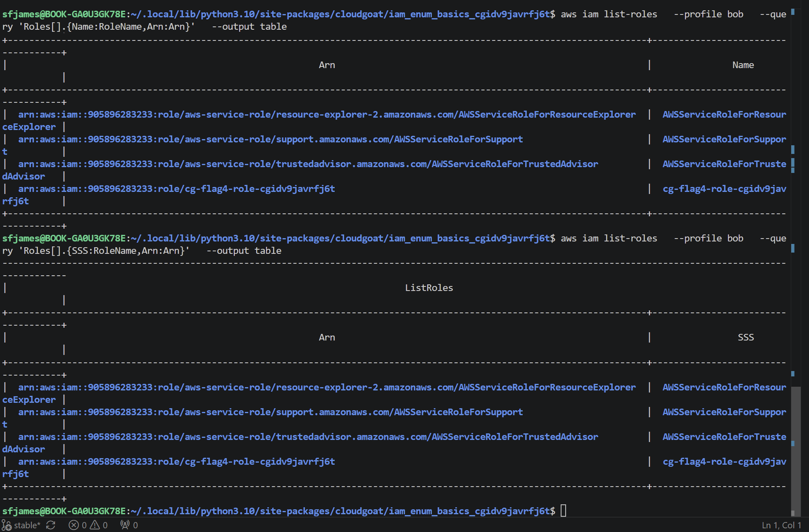

# query 관련 설명

[← 시나리오 본문](../README.md)

네, 넓게 보면 `grep`처럼 “필요한 결과만 골라서 본다”는 용도입니다. 다만 `grep`은 문자열을 검색하고, AWS CLI의 `--query`는 JSON의 구조를 이해해서 원하는 필드를 선택합니다.

AWS CLI의 `--query`는 JMESPath라는 JSON 질의 문법을 사용합니다.

## 원본 출력 먼저 보기

쿼리 없이 실행하면:

```
aws iam list-roles --profile bob
```

대략 이런 JSON이 나옵니다.

```
{
  "Roles": [
    {
      "Path": "/",
      "RoleName": "example-role",
      "RoleId": "AROA...",
      "Arn": "arn:aws:iam::123456789012:role/example-role",
      "CreateDate": "2026-07-23T01:00:00Z",
      "AssumeRolePolicyDocument": {
        "Version": "2012-10-17",
        "Statement": []
      }
    },
    {
      "Path": "/aws-service-role/",
      "RoleName": "another-role",
      "RoleId": "AROA...",
      "Arn": "arn:aws:iam::123456789012:role/another-role"
    }
  ]
}
```

여기서 최상위 JSON 객체 안에 `Roles`라는 배열이 있습니다.

## `Roles[]`의 의미

```
aws iam list-roles \
  --profile bob \
  --query 'Roles[]'
```

의미는:

```
Roles 배열 안의 모든 항목
```

입니다.

아래 JSON에서:

```
{
  "Roles": [
    {"RoleName": "role-a"},
    {"RoleName": "role-b"}
  ]
}
```

`Roles[]`는 배열 안의 두 객체를 선택합니다.

## Role 이름만 출력

```
aws iam list-roles \
  --profile bob \
  --query 'Roles[].RoleName'
```

의미:

```
Roles 배열의 모든 항목에서 RoleName만 선택
```

결과:

```
[
  "role-a",
  "role-b"
]
```

텍스트 형태로 보고 싶다면:

```
aws iam list-roles \
  --profile bob \
  --query 'Roles[].RoleName' \
  --output text
```

결과:

```
role-a    role-b
```

입문 단계에서는 이 명령부터 사용하면 이해하기 쉽습니다.

## 여러 필드만 선택

제가 앞서 제시한 명령은 다음과 같습니다.

```
aws iam list-roles \
  --profile bob \
  --query 'Roles[].{RoleName:RoleName,Arn:Arn,Path:Path}' \
  --output table
```

쿼리를 분해하면:

```
Roles[]
```

모든 Role을 순회합니다.

```
{RoleName:RoleName, Arn:Arn, Path:Path}
```

각 Role에서 `RoleName`, `Arn`, `Path`만 골라 새로운 객체를 만듭니다.

왼쪽은 출력할 열 이름이고, 오른쪽은 원본 JSON 필드입니다.

```
출력명 : 원본필드
RoleName : RoleName
Arn      : Arn
Path     : Path
```

그래서 다음처럼 표가 나옵니다.

```
-----------------------------------------------------------
|                        ListRoles                        |
+----------------+--------------------------------+-------+
| RoleName       | Arn                            | Path  |
+----------------+--------------------------------+-------+
| example-role   | arn:aws:iam::...:role/example  | /     |
+----------------+--------------------------------+-------+
```

다음처럼 출력 열 이름을 마음대로 바꿔도 됩니다.

```
aws iam list-roles \
  --profile bob \
  --query 'Roles[].{Name:RoleName,Address:Arn}' \
  --output table
```

여기서:

```
Name:RoleName
```

은 “원본의 `RoleName`을 `Name`이라는 열로 보여줘”라는 뜻입니다.



보면은 Name 대신 SSS를 넣으니 Name 칸에 SSS가 목록으로 들어간 것을 볼 수 있다. 

## 조건으로 필터링

여기부터가 `grep`과 가장 비슷한 부분입니다.

이름이 정확히 일치하는 Role:

```
aws iam list-roles \
  --profile bob \
  --query 'Roles[?RoleName==`example-role`]'
```

이름에 `cg`가 들어간 Role:

```
aws iam list-roles \
  --profile bob \
  --query 'Roles[?contains(RoleName, `cg`)]'
```

그중 이름만 출력:

```
aws iam list-roles \
  --profile bob \
  --query 'Roles[?contains(RoleName, `cg`)].RoleName' \
  --output text
```

문법을 읽으면:

```
Roles[
  ? contains(RoleName, `cg`)
]
.RoleName
```

즉:

```
Roles 중에서
RoleName에 cg가 포함된 항목을 찾고
그 항목의 RoleName을 출력
```

입니다.

## grep과 비교

### grep 사용

```
aws iam list-roles --profile bob | grep RoleName
```

`grep`은 출력된 문자열에서 `RoleName`이라는 글자가 들어간 줄을 찾습니다.

단점은 JSON의 구조를 이해하지 못한다는 것입니다.

```
"RoleName": "example-role",
```

같은 줄은 찾지만, 그 Role과 연결된 ARN이나 Path를 구조적으로 가져오기는 어렵습니다.

### AWS `-query` 사용

```
aws iam list-roles \
  --profile bob \
  --query 'Roles[].RoleName'
```

JSON에서 실제 `RoleName` 필드만 가져옵니다. 따라서 JSON 출력의 들여쓰기나 줄바꿈이 바뀌어도 제대로 동작합니다.

### jq 사용

같은 일을 `jq`로도 할 수 있습니다.

```
aws iam list-roles --profile bob |
jq '.Roles[].RoleName'
```

관계는 다음처럼 볼 수 있습니다.

| 도구 | 처리 방식 |
| --- | --- |
| `grep` | 일반 문자열 검색 |
| `--query` | AWS CLI 결과의 JSON 구조 선택 |
| `jq` | JSON 구조 선택 및 가공 |
| AWS `--filter` | 해당 AWS 서비스 API에 필터 조건 전달 |

특히 `--query`와 `--filter`는 다릅니다.

- `-filter`: AWS 서버에 “조건에 맞는 것만 보내줘”
- `-query`: 받아온 결과에서 AWS CLI가 “이 필드만 보여줘”

단, 모든 AWS 명령이 `--filter`를 지원하는 것은 아닙니다.

## 지금은 쿼리 없이 해도 됨

학습 초반에는 먼저 전체 JSON을 보는 게 오히려 좋습니다.

```
aws iam list-roles --profile bob
```

출력을 읽고 구조를 확인한 다음:

```
aws iam list-roles \
  --profile bob \
  --query 'Roles[].RoleName'
```

로 범위를 줄여보세요.

이후 필요하면:

```
aws iam list-roles \
  --profile bob \
  --query 'Roles[].{Name:RoleName,Arn:Arn}' \
  --output table
```

순서로 발전시키면 됩니다.

가장 먼저 기억할 문법은 세 개면 충분합니다.

```
Roles[]                         모든 Role
Roles[].RoleName                모든 Role의 이름
Roles[?contains(RoleName, `cg`)] 이름에 cg가 포함된 Role
```

그러므로 “grep 느낌이냐?”라는 질문에는 **목적은 비슷하지만, 문자열이 아니라 JSON 필드를 대상으로 하는 더 정확한 grep**이라고 이해하면 좋습니다.