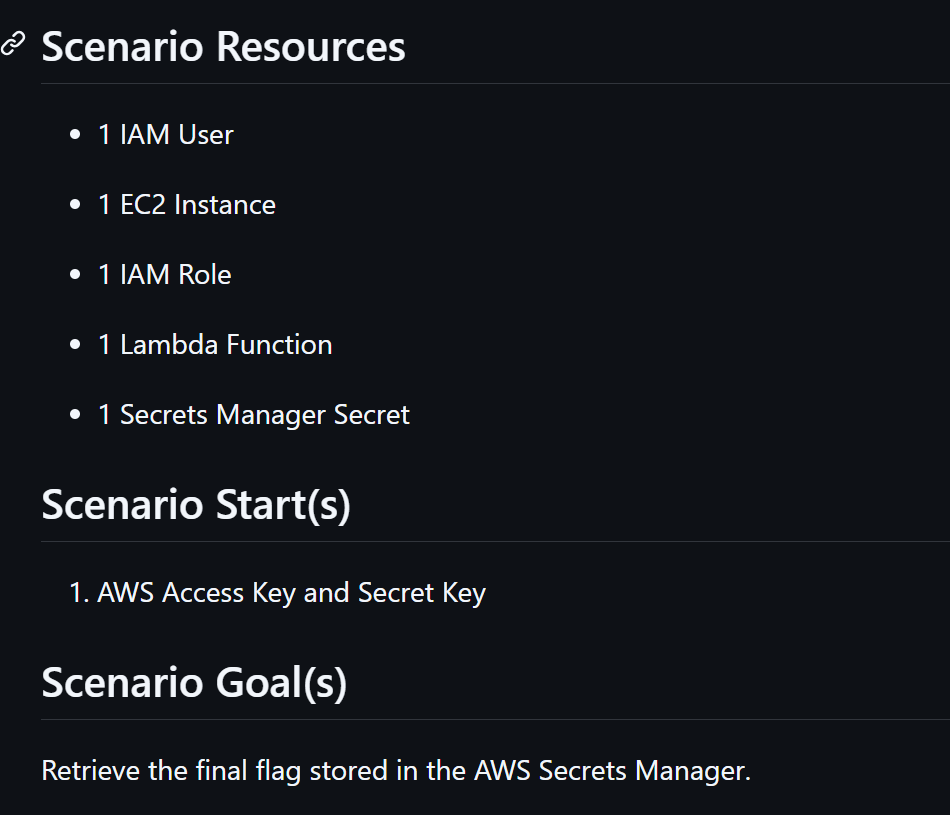

# 2nd Scenario: Data Secrets

[← CloudGoat 시나리오 목록](../README.md)

난이도 : Easy

[이 각 정보들이 가지는 보안적 의미](notes/security-meaning.md)

[User Data 사용의 맥락](notes/ec2-user-data-context.md)

[IMDS에서 찾은 것과 Lambda에서 찾은 것 ](notes/imds-vs-lambda.md)

[AWS에서 Lambda란?](notes/aws-lambda.md)

[내가 무엇을 한 것인가](notes/walkthrough-summary.md)

command : cloudgoat create data_secrets —profile cloudgoat-lab

이번에는 EC2 instance와 람다 함수? 그리고 숨겨진 정보가 제공이 된다. 느낌이 저수준 유저로 관리자의 비밀을 탈취하는 느낌으로 판단이 된다. 



요약과 하는 방법은 다음과 같다.


뭐 대충 저권한 유저의 아이디로 EC2에 SSH로 접근할 수 있는 권한이 있어야 하는 것 같다. 

또한 최종적으로는 secrets manager라는 비밀 정보 보관 서비스에 접근하는 것이다. 

# 진행


일단 제공되는 start_user의 ID와 SID를 start.txt에서 확인을 하고, aws에 등록을 해주었다. 


그리고 앞에서 사용했던 명령어들 get-user 라던가 policy 관련이라던가 등의 명령어가 권한이 없어서 안먹히는 것을 볼 수 있었다. 이것도 전부 권한이 있어야 했던거구나…

start_user로 aws ec2 describe-instances 명령어를 통해 접근할 수 있는 EC2가 있는지 확인을 했는데, 일단 아무것도 없는 것을 볼 수 있었다.


먼저 한국 서울 지역의 EC2를 스캔했는데 안떠서 전체로 했는데도 뜬게 없다. 일단 start_user에서는 EC2로 접근할 수가 없는 상황이다. 

일단 EC2에 대한 조회 권한도 없는 것을 알 수 있다…


인 줄 알았으나! 알고보니 옵션을 뺀 거는 그냥 시도하는 계정의 default 지역으로 진행을 하는데, 내가 ap-northeast-2로 설정해두어서 역시 동일하게 진행한 것이었다.

그래서 region을 us-east-1으로 설정해서 하니 ec2가 조회되는 것을 볼 수 있다. 

"IamInstanceProfile": {
"Arn": "arn:aws:iam::905896283233:instance-profile/cg-ec2-instance-profile-cgid0xo9gsc5or",
"Id": "AIPA5F25AJRQTAG6SHTCH"

이런 cg(cloudgoat)의 ec2가 조회되는 것을 볼 수 있다. 

위 나열된 정보의 활용은 아래 페이지에서 확인할 수 있다.

[정보의 의미와 사용 ](notes/information-meaning-and-use.md)

일단 지금 중요한 것은 InstanceId를 이용해서 User를 찾아보는 것인데, 내역중에


이렇게 존재하는 것을 볼 수 있다. 이 InstanceId를 사용할 예정이다. 

여기서 저장된 Userdata를 확인하여보니 먼저 그냥 했을 때는 Value가 encode되어있는 것을 볼 수 있다.

그래서 base64로 decode를 진행하니 원문이 보이는 것을 볼 수 있고, 내용이 ssh를 연결하는 셸 스크립트인 것을 볼 수 있다. 


User Data는 EC2가 최초 부팅될 때 시행되는 스크립트인데, 현재 그곳에 한 사용자의 ID와 PW가 들어있던 상황이다. 
그리고 User Data는 기본적으로 Base64로 인코딩되는 곳이라 그냥 Base64로 디코딩하면 된다. 

User Data는 서버를 만들 때마다(ex EC2 10대를 같은 사양과 기능으로 구성한다면) 자동으로 알아서 세팅되도록 진행하는 것이다. 

[User Data 사용의 맥락](notes/ec2-user-data-context.md) 


그리고 Public IP는 조회권한이 있다면 볼 수 있으니 18.205.3.63 이라는 IP를 얻었고 위에서 ec2-user / CloudGoatInstancePassword! 라는 해당 인스턴스의 ID와 PW를 얻었다. 이제 접속이 가능한 것이다. 

```
aws ec2 describe-instances \
  --profile start_user \
  --region us-east-1 \
  --query 'Reservations[].Instances[].PublicIpAddress' \
  --output text
```

이걸로 Public IP만 뜨게할 수도 있다. 


이제 접속을 하려고 했는데, nc와 ping 전부 그냥 아아아무런 반응이 없이 대기하는 것을 볼 수 있었다. 그냥 안된다면 몰라도 ping이 반응 없이 그냥 대기하는 것을 보아, 상대방쪽에서 DROP하고 있는 것 같았다. 연결이 안되는 상황이다.

근데 생각해보니 학교 강의실에서 진행하다가 지금은 기숙사에서 하고 있는 것이기 때문에 공인 IP가 달라졌다는 것이다. 즉 지금 IP는 AWS 보안그룹에 할당이 되어있지 않을 것이다. 그래서 이 IP도 할당해주었다. 

가장 아래쪽을 보면은 재시도하니 정상적으로 연결인식이 되는 것을 볼 수 있다. 


ssh ID@IP 로 진입요청, 알아낸 PW로 진입에 성공하였다. 


일단 대충 기본적인 내가 누구인지 작업을 친다. 


그리고 여기가 내가 원하는 대상 instance가 맞는지 확인하는 명령어고, 저 169.254.169.254는 EC2 내부에서만 접근가능한 Instance MetaData Service(IMDS) 서비스 주소다. 


아까 외부에서 봤을 때와 동일한 instance인 것을 볼 수 있다. 

지금은 크게 의미없어도, 만약 내부이동을 하게된다면 또 다른 의미를 가지게 될 것 같다. 


위에서 instance-id도 meta-data에 포함되어 있는 것을 볼 수 있는데, 그냥 meta-data 파일까지만 접근하면 어떤 정보를 볼 수 있는지 목록들이 나온다. 

이번에는 iam 항목을 확인할 것이다.


먼저 iam 목록을 보면은 info와 security-credentials가 있는 것을 확인할 수 있고, 각각 정보는 다음과 같다. 

info에서 

이 security-credentials에 있는 이 ec2-iam-role은 linux 접속권한과 달리 AWS API 권한으로 서로 다르다.

Linux 사용자
→ 운영체제 파일과 프로세스 권한

EC2 IAM Role
→ AWS API 권한


한 번 더 붙여넣으면 상세정보가 나오는 것을 볼 수 있다. 

또한 AccessKeyID와 SecretAccessKey 조차 전부 나온 것을 볼 수 있고 세션 토큰 또한 발급되어있다.
근데 만료시간이 금일 16시 53분인데… 음 지금 적고 있는 시간이 20시 11분이다. 왠지 라업이 조금 더 길어질 것 같다는 생각이 든다. → 상관없었다! 

이 내용이 무슨 내용인지 잘 이해가 안갔었는데, 그냥 lambda 사용권한이 있다는 것을 확인한 것이었다. 자세한 것은 다른 세부 페이지에 있다. 

[IMDS에서 찾은 것과 Lambda에서 찾은 것 ](notes/imds-vs-lambda.md) 


아무튼, 이 서버에 aws가 깔려있는지 확인을 한뒤, 다운이 되어 있어서 현재 신원을 확인하였다. 

위에 비밀 권한에서의 ID와 내 신원 ID를 비교하면은 서로 다른 것을 볼 수 있다. 

[AWS에서 Lambda란?](notes/aws-lambda.md) 

이제 Lambda를 이용해서 정보를 더 찾아볼 건데, 자세한 거는 위의 페이지를 참조하면 된다.


일단 aws lambda list-functions를 하니 뭔가 생각보다 더 자세하게 나왔다.

특히 중간 아래에 KEY들이 노출되어 있는 것을 볼 수 있다. 

정상적인 목적으로는 코드와 환경설정을 분리하는 용도지만, 지금은 개발자가 편의상 민감정보를 적어둔 상태인 것이고, 이에 따라 노출이 된 것이다. 

지금 우리는 노출되어 있는 민감정보들로 점점 더 많은 권한을 얻고 있는 상황인 것이고, 이번 노출로 더 높은 권한의 자격 증명을 찾은 것이다. 


노출된 function의 상세정보이다. 

보니까 결국 같은 정보를 요구하는 것이었다. 다른 높은 권한으로 예상되는 유저의 자격증명.
지금 보면은 Access Key와 Secret Key가 있으니 자격증명이 가능할 것이다. 

"Variables": {
"DB_USER_SECRET_KEY": "<REDACTED_AWS_SECRET_ACCESS_KEY>",
"DB_USER_ACCESS_KEY": "<REDACTED_AWS_ACCESS_KEY_ID>"
}


다시 로컬로 돌아와 유저 등록을 진행해보았다. 


start_user 대신 lambda_user의 프로필을 설정하는데 성공하였다. 


현재 보관되어 있는 비밀목록은 하나가 보이고, 이름은 cg-final-flag-cgid0xo9gsc5or인 것을 볼 수 있다. 

이제 이것에 대해 상세보기를 진행해보자. 


SecretString에 flag가 있는 것을 볼 수 있다. 

 "SecretString": "{\"flag\":\"d4t4_s3cr3ts_4r3_fun\"}

[내가 무엇을 한 것인가](notes/walkthrough-summary.md) 

그리고 처음에 할 때는 내가 뭘하는지 몰랐는데, secretmanager가 일종의 서비스(명령어 사용)인 것을 보고, 만약 그렇다면 start_user로는 해당 서비스에 접근할 수 없을 것이라고 생각하고 secret list를 불러오는 것에서 실행주체만 lambda_user → start_user로 바꾸었는데 권한부족으로 실행이 되지 않았다. 


근데 이제 IMDS에서 찾은 것과 lambda에서 찾은 것이 뭔 차이인지 모르겠어서 추가로 찾아보았다.

분명 찾은 것은 서로 다른 Access Key와 Secret Key인데, 난 IMDS에서 찾은 것은 활용을 한 적이 없다. 

→ 일단 요약하면, IMDS에서는 이 EC2 계정이 lambda를 사용할 수 있는 권한이 있다는 것을 확인한 것이다. 

[IMDS에서 찾은 것과 Lambda에서 찾은 것 ](notes/imds-vs-lambda.md)