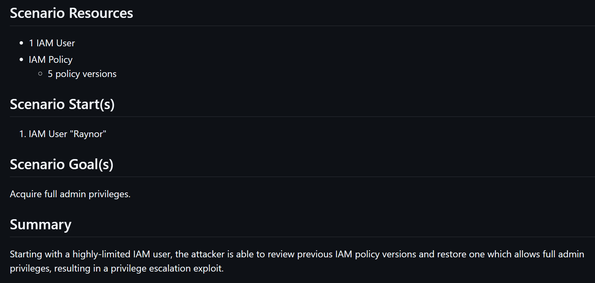

# 6th Scenario: iam_privesc_by_rollback

[← CloudGoat 시나리오 목록](../README.md)

난이도: Easy



Summary를 확인하였을 때, 정책을 rollback해서 LPE를 진행하는 것으로 판단된다. 

일단 정책 확인 등을 위주로 진행하면 될 것으로 보인다. 


# 진행


일단 언제나처럼 start.txt에 있는 계정 등록부터 시작하였다. raynor라는 단어가 무슨 다른 뜻이 있나 찾아봤는데, 나오는 거는 짐 레이너 밖에 없었다… 그냥 레이너씨의 계정을 내가 어떤 경로로든 얻었다라고 생각하련다. 


Role도 따로 커스텀 Role이 있어보이지는 않는다. 


개별 유저정책은 없고, 관계형 정책은 하나 존재하는 것을 확인하였다. 


관계형 정책의 상세 정보를 확인하려고 했는데, 권한이 없다고 한다. 


다른 역할도 없는데 말이다… 

## 유저 관리형 정책 확인

아 찾아보니 고객 관리형 정책의 상세정보를 보는 것은 get-policy 였다. 근 4일만에 해서 헷갈렸다. 

내가 썼던 attach-user-policy는 사용자에게 managed policy를 붙히는 명령어였다. 즉 관리형 정책을 추가하는 것이었다. 
왜 명령어에 —user-name이 필요한 건지에 대한 의문이 이제야 해소되었다. 분명 특정 관리형 정책을 조회할 때는 user-name이 필요 없던 걸로 기억했었는데 말이다. 


```
get-policy
├── 정책 이름
├── 정책 ARN
├── 현재 기본 버전
├── 연결된 대상 개수
└── 생성·변경 시간
```

아무튼 조회에 성공했다. 이어서 version까지 포함된 걸로 더 조회를 한다. 

지난 문제에서 보았던 Tag들도 있는 것을 볼 수 있다. 


이 raynor 계정에 대한 정책은 get으로 시작하는 명령어들, list로 시작하는 명령어들, 그리고 set-default-policy-version 명령어가 가능한 것을 볼 수 있다. 

아마 저 version을 set하는 명령어가 이 문제를 푸는 키일 것으로 보인다. 하지만 어떤 version들이 있는지 알 필요가 있다. 

### 정책 버전이란?

IAM 고객 관리형 정책에는 최대 5개의 버전을 보관할 수 있다. 이 중 한 버전만 `Default`, 즉 활성 상태가 된다.

```
정책
├── v1 ← 현재 Default, 실제 권한으로 적용
├── v2 ← 보관만 됨
├── v3 ← 보관만 됨
├── v4 ← 보관만 됨
└── v5 ← 보관만 됨
```

코드나 문서의 Git 버전처럼 생각할 수 있지만 차이점이 있다.

> IAM 정책에서는 특정 과거 버전을 Default로 지정하는 순간 그 버전의 권한이 다시 실제로 적용된다.
> 

현재 버전 목록은 다음 명령으로 확인한다.

```
aws iam list-policy-versions \
  --policy-arn "$POLICY_ARN" \
  --profile "$PROFILE" \
  --output table
```

현재 실제 상태는 다음과 같다.

| 버전 | Default | 의미 |
| --- | --- | --- |
| v1 | Yes | 현재 적용 중 |
| v2 | No | 과거 버전 |
| v3 | No | 과거 버전 |
| v4 | No | 과거 버전 |
| v5 | No | 과거 버전 |


실제로 동일하게 적용 및 저장되어 있는 것을 볼 수 있다. 

이제 여기서 과거 버전들의 상세 내용들을 확인하며 full admin 권한을 가진 버전을 확인하면 될 것으로 예상된다. 

## 정책 버전별 권한 확인

- v1


v1은 아까 살펴보았던 것과 동일하다. 애초에 지금 적용되어 있는 정책이 이 버전의 정책이다. 

- v2


일단 가장 눈에 띄는 것은 Deny와 Action이 “*” 와일드카드 되어있는 것이다. 그리고 NotIpAddress는 지금 Deny에 붙어있으니 이 ip 대역을 제외하고는 모든 행동을 제한한다는 의미가 된다.

즉, 이걸로 Set해버리면 계정 자체가 막혀버린다. 

- v3


이 v3가 Allow에 action도 * 이걸로 설정되어 있다. 완전한 모든 권한을 가지게 되는 것을 알 수 있다. 

- v4


이 v4는 Get 관련한 권한을 허용하는데, 기간이 2017년 7월 1일~12월 31일까지로 되어 있다. 

이미 지금은 26년 8월 1일이므로 아무런 권한도 주어지지 않을 것이다. 

근데 이렇게 정책적으로 주는 권한을 저렇게 기간을 설정해서 줄 수 있다는 것은 신기하다. 당연히 운영자가 해당 기간이후 권한을 직접 빼거나 그런 걸 생각했는데, 기간을 설정해두면은 되게 관리하기 편할 것 같다는 생각이 든다. 

- v5


S3 관련해서 조회권한을 준다. 뭐… 그것 말고는 없다. 

## v3 버전 정책 적용


확인했던 set-default-policy-version을 이용해 v3로 set 해주었다. list 확인 시 v3가 true로 변경된 것을 확인할 수 있다. 

이제 슬슬 어떻게 exploit을 진행하는지 감이 잡히는 것 같다. 물론 사용가능한 명령어의 그 의미를 알아야 겠지만… 이런 계정 정책 미스 상에서의 익스 진행은 어떻게 진행되는지 감이 잡히는 것 같다. 

# v3를 v1으로 돌려놓는 것으로 속일 수 있을까?

위에 v3로 바꿔서 모든 권한을 확보하고, 악의적 공격을 한 뒤 다시 v1으로 돌려놓음으로써 지금 했던 행위들을 감춘다라고 하고 있다. 이것이 이 서버의 관리자를 속일 수 있을 것이라고는 생각하지만, AWS와 연계하여 CERT가 꾸려져 있다면 힘들 것 같다. 또한 그래서 로그 자체를 위변조하면 안되나 했는데, 아예 다른 곳으로 가는 것 같다. 이는 후에 더 조사해볼 생각이다. 

결론부터 말하면:

- 정책을 `v1`으로 되돌리는 것은 가능
- IAM 정책 버전의 생성 시각이나 CloudTrail 이벤트 시각을 과거로 바꾸는 것은 불가능
- `v1`으로 복구한 행위 자체도 `SetDefaultPolicyVersion` 이벤트로 새롭게 기록됨
- 감사 로그를 삭제하거나 타임스탬프를 위조하는 작업은 로그 회피에 해당하므로 방법을 안내할 수 없음

## 서로 다른 세 종류의 시간

이번 문제에서는 시간을 구분해서 봐야 해.

### 1. 정책 버전의 `CreateDate`

```
aws iam list-policy-versions \
  --policy-arn "$POLICY_ARN" \
  --profile raynor
```

여기 나오는 `CreateDate`는 각 버전이 처음 생성된 시각이다.

```
v1 생성 시각
v2 생성 시각
v3 생성 시각
...
```

`v3`를 활성화했다가 다시 `v1`으로 돌려도 기존 버전의 `CreateDate`는 바뀌지 않는다. 사용자가 임의의 과거 시각을 지정할 수도 없다.

### 2. 정책 메타데이터의 `UpdateDate`

```
aws iam get-policy \
  --policy-arn "$POLICY_ARN" \
  --profile raynor
```

여기 표시되는 `UpdateDate`는 정책에 마지막 변경이 일어난 시간을 나타낸다. 기본 버전 변경처럼 AWS가 변경으로 취급하는 작업에 의해 갱신될 수 있지만, 원하는 값으로 직접 입력하는 필드는 아니다.

로컬 시스템 시간을 바꿔도 소용없다. AWS CLI가 보내는 요청의 처리 시각과 리소스 메타데이터는 AWS 서버 측에서 결정한다.

### 3. CloudTrail의 `eventTime`

`SetDefaultPolicyVersion`을 호출하면 CloudTrail에는 다음과 같은 정보가 기록될 수 있다.

```
eventName: SetDefaultPolicyVersion
eventTime: AWS가 API 요청을 처리한 시각
userIdentity: Raynor
sourceIPAddress: 요청을 보낸 공인 IP
requestParameters:
  policyArn: ...
  versionId: v3
```

`v1`으로 복구하면 기존 `v3` 이벤트가 수정되는 것이 아니라 새로운 이벤트가 하나 더 생긴다.

```
10:00  Raynor: v1 → v3
10:10  Raynor: v3 → v1
```

즉 최종 상태만 보면 v1이지만 감사 기록에는 두 작업이 모두 남는다. CloudTrail Event history는 최근 90일의 관리 이벤트를 변경 불가능한 기록으로 제공한다. [AWS CloudTrail Event history 설명](https://docs.aws.amazon.com/awscloudtrail/latest/userguide/view-cloudtrail-events.html)

## 예약 작업을 걸면 달라질까?

예를 들어 나중에 자동으로 v1로 복구하는 예약 작업을 만든다고 해도 흔적을 없애지는 못해.

```
예약 작업 생성 이벤트
→ 예약 작업이 Role을 사용한 기록
→ SetDefaultPolicyVersion(v1) 기록
```

오히려 조사할 객체가 추가된다. 실행 주체만 Raynor에서 Lambda Role이나 EventBridge가 사용하는 Role로 표시될 수 있을 뿐이야.

또한 예약 작업에 과거 타임스탬프를 지정해서 이미 일어난 것처럼 기록하게 만들 수는 없다. 이벤트 시간은 AWS 서비스가 API 요청을 수신·처리한 시점을 기준으로 생성한다.

## 실습에서 안전하게 확인할 수 있는 부분

현재 버전을 v1으로 복구:

```
aws iam set-default-policy-version \
  --policy-arn "$POLICY_ARN" \
  --version-id v1 \
  --profile raynor
```

상태 확인:

```
aws iam get-policy \
  --policy-arn "$POLICY_ARN" \
  --profile raynor \
  --query 'Policy.{DefaultVersion:DefaultVersionId,UpdateDate:UpdateDate}'
```

CloudTrail 조회 권한이 있다면 방어·감사 목적으로 최근 변경 기록을 검색할 수 있다.

```
aws cloudtrail lookup-events \
  --lookup-attributes \
    AttributeKey=EventName,AttributeValue=SetDefaultPolicyVersion \
  --region us-east-1 \
  --profile cloudgoat-lab \
  --query 'Events[].{Time:EventTime,User:Username,Event:EventName}' \
  --output table
```

CloudTrail Event history는 리전별로 조회되므로 안 나오면 CloudGoat가 사용한 리전과 IAM 글로벌 서비스 이벤트가 기록된 리전을 확인해야 한다.

## 실무에서는 어떻게 변조를 탐지할까?

CloudTrail 로그를 S3에 장기 보관하면서 로그 파일 무결성 검증을 활성화할 수 있다. AWS는 해시와 서명된 digest chain을 이용해 로그 파일의 변경 또는 삭제 여부를 탐지한다. [AWS CloudTrail 로그 무결성 검증](https://docs.aws.amazon.com/awscloudtrail/latest/userguide/cloudtrail-log-file-validation-intro.html)

방어 구조는 보통 다음과 같다.

```
운영 계정의 CloudTrail
      │
      ▼
별도 로그 보관 계정의 S3
      ├─ Object Lock
      ├─ 제한된 삭제 권한
      ├─ 무결성 검증
      └─ SIEM 경보

SetDefaultPolicyVersion 발생
      │
      ▼
EventBridge / Security Hub / SIEM 경보
```

따라서 이번 시나리오의 “다시 v1로 돌려 은폐한다”는 말은 현재 정책만 보는 관리자를 속일 가능성이 있다는 뜻이지, AWS 감사 흔적을 완전히 지우거나 과거 시간을 조작할 수 있다는 뜻은 아니야.