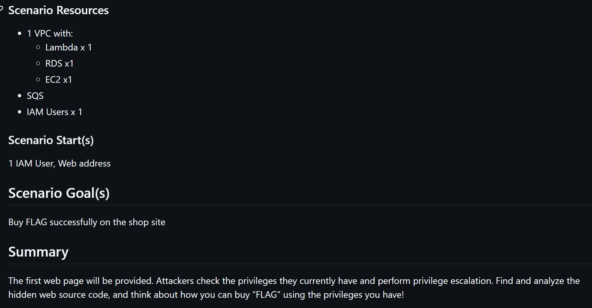

# 8th Scenario: SQS_Flag_Shop

[← CloudGoat 시나리오 목록](../README.md)

난이도: Easy 



이번에 RDS와 SQS 같은 처음보는 키워드가 또 나왔다. 이것들부터 확인하고 넘어가야 할 것 같다. 

[구성 설명](notes/architecture.md)


# 진행


ip 설정하고 start.txt를 볼려고 했는데, txt가 아니라 .sh 파일이다. 그리고 내용을 보니 ras키를 만드는 스크립트가 들어가 있다. 이거 참… 갑자기 다른게 나오니까 곤란하다. 

일단 이번에는 codex를 이용해 전부 아는 상태에서 따라는 것이 아닌, 그때그때 구글 검색을 대신하는 느낌으로 공부해보려고 한다. 

일단 아래는 해당 명령어에 대한 설명이다. 

ssh-keygen      SSH 공개키·개인키 생성 프로그램
-t rsa          RSA 방식 사용
-b 4096         RSA 키 길이를 4096비트로 지정
-f ./cloudgoat  현재 디렉터리에 cloudgoat라는 이름으로 저장
-q              불필요한 출력 최소화
-N ""           개인키 암호를 빈 문자열로 설정


그냥 구성이 덜 된 것이었다… 다시 destroy라고 create하여 만들었어. 공인IP가 등록이 되지 않아 생긴 서버 생성오류였다. 

이번에는 웹사이트 하나가 제공이 되고 그 아래에서 VPC 영역이 돌아가고 있는 것으로 보인다. 


일단 유저 등록을 하고 셸 변수를 등록해주었다. 


그리고 ip를 따라 접속하니 price 관련한 shop 페이지가 나오는 것을 볼 수 있다. 그리고 flag의 가격이 끝내주는 것을 보니 어떠한 방법으로 Asset을 저 가격 이상으로 올리거나 그냥 권한을 이용해 깡으로 flag을 얻어야 할 것 같다.

근데 웹페이지의 UI를 보니 절로 오버나 언더플로우를 시도해보고 싶긴하다. 


기능을 보니 이렇게 돈을 추가로 대출받을 수 있다. 10을 눌러보니 돈이 추가되는 것을 볼 수 있었다.


(2번해서 20원이 추가되었다.) 


사과와 바나나를 하나씩 담아서 Receipt Page로 가니 저렇게 item과 price, 그리고 data가 나오는 것을 볼 수 있었다. 아마 flag를 담고 receipt를 확인하면 flag가 출력될 것으로 보인다. 


이제 권한을 확인해야하는데, 이번에는 관리형 정책이 아닌 인라인 정책에 역할이 할당되어 있는 것을 볼 수 있다. 


sqsuser는 Get과 List로 시작하는 모든 권한과 sqs-send-message role에 대해서 AssumeRole을 사용할 수 있게 되어있다. 

다음 행동으로는 일단 Role을 확인해야할 것 같다. 


가장 아래에 지금 sqsuser에서 할당받을 수 있는 sqs-send-message Role과 그 위에 sqs-lambda Role이 있는 것을 볼 수 있다. 

일단 sqsuser에 저 send Role을 할당시켜야 할 것 같다. 


대상이 되는 Role의 세부정보도 확인한다. 

저 Role 도 sqsuser를 허용하고 있는 것을 볼 수 있다. (유저 → Role, Role → 유저 전부 허용해야 Assume Role이 된다.) 


또한 Role에 붙은 정책도 확인한다. 이번에도 역시 인라인정책으로 정책이 할당되어 있는 것을 볼 수 있었다.

그리고 sqs에 대해서 GetQueueUrl과 SendMessage를 할 수 있는 것을 볼 수 있다. 

이제 저 Role을 통해서 SQS를 이용해 Lambda 관련한 Role을 확보, 이후 Lambda 배포를 통해 웹페이지를 조작하거나 RDS를 조작할 것으로 생각된다. 


자 이제 Role을 할당 받아보자. sqsuser에 정책으로 MaxSessionTime이 3600으로 되어있으므로 나에게 3600초 = 1시간이 주어지는 것으로 판단된다. 뭐 이후에도 할당을 받을 수는 있지만… 귀찮을 가능성이 높으므로 1시간 안에 끝내려고 한다. 


sqsms라는 이름으로 등록하였고, 정상적으로 Role에 연결하였다. 

아까 기능으로는 sqs 서비스에서 get-queue-url과 send-message 커맨드가 있었다.


get-queue-url을 했는데, queue-name 옵션이 필수라고 한다…! 일단 난 queue에 대해서 알고 있는 정보가 없다. 찾아봐야 한다. 


일단 당연히 권한이 없으므로 queue 조회는 안된다. codex가 다른 방법도 알려주었다. 


아까 내가 확보했던 이 정책 중에서 아래 Resource부분의 가장 끝 저 cash_charging_queue가 Queue의 이름이라는 것이다. 그냥 안보고 지나쳤는데, 정책 정보도 생각보다 더 중요하구나 싶었다. 


캬 나왔다. 

근데 이제 url까지 확보하였고, 구체적 동작을 위한 Message를 보내고 해야할 것 같은데…


아까 예상만했지 lambda 역할에 대해 자세히 찾아보지 않은 것 같다. 다시 확인해보자. 


딱히 제한없이 AssumeRole이 허용되어 있는 것으로 보인다. 그럼 SQS로 가능하지 않을까 생각이 든다. 


Lambda 역할에는 SQS와 VPC에 관한 Role이 있는 것을 볼 수 있다. 아마 저 VPC Role을 통해서 RDS로 접근할 수 있지 않을까 싶다. 

아래는 SQS 관련 Policy다.


다음은 VPC 관련 Policy다.


라고 생각하면서 하고 있었지만… 그게 아니었다. 

알고 보니 SQS → Lambda 역할을 타고 가면서 비인가 인원이 서버를 조작하는 것이 아닌, SQS를 통해 frontend의 필터링을 우회, 직접 메세지를 보내는 것이었다…! 


시험삼아 1, 5, 10 중 10으로 메세지를 보내보았고, 실제로 되었다. 


그리고 엄청 큰 숫자를 보내보니 2,147,483,647인 것을 보니 4바이트 signed int로 변수지정되어 있고 오버플로우 방지도 되어 있는 것으로 보인다. 하하 뭔가 갑자기 김이 식은 느낌이긴하다.

아무래도 저 SQS를 Lambda처럼 오해해서 생긴 착오가 있었던 것 같다. 


FLAG{sqs-shop-super-secret-item}

플래그를 확보하였다! 

# 이번 문제의 핵심 취약점

이번 공격은 SQS 자체를 해킹한 것이 아니야. 허용된 API를 정상적으로 사용했지만, 권한과 메시지 검증 설계가 잘못된 것이다.

```
문제 1:
낮은 권한 사용자가 SQS 전송 Role을 맡을 수 있음

문제 2:
그 Role이 금전 처리 Queue에 SendMessage 가능

문제 3:
Lambda가 메시지 발신자의 업무적 신뢰 수준을 구분하지 않음

문제 4:
charge_amount의 허용 범위나 상한을 검증하지 않음

결과:
공격자가 임의 잔액 충전 가능
```