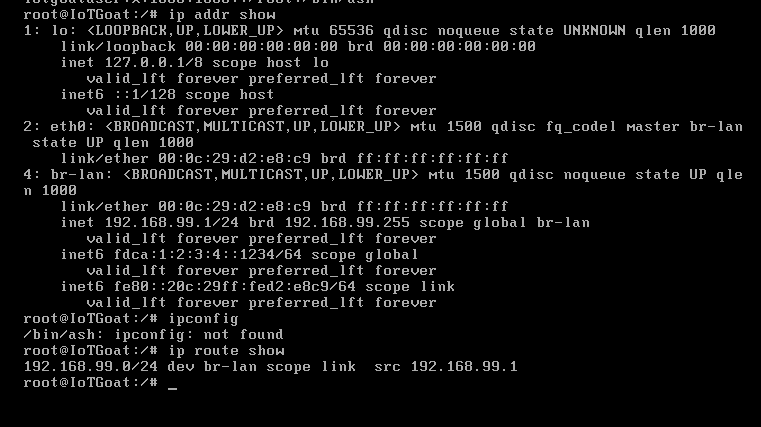

# 환경 구성: VM–Host 통신 실패 해결

[← IoTGoat 목록](README.md)

환경을 설정하는 과정에서 너무 많은 시간과 의지가 갈려나갔고, 결국 연결에 성공하기는 하였다. 그러나, 나를 헷갈리게 하였던 과정은 다음과 같았다.

1. 분명 IoTGOAT 설명란에서는 IoTGOAT_x86.vmdk에 인터넷이 연결이 되어야 하는 상황인데 내 환경에서는 그렇지 못하였었다. 그래서 내가 지금 잘못된 파일을 올린건지 아니면 그냥 vmware에 올리는게 아이었는지 혼동이 오게 되었다.
2. 그래서 wsl에 올리는 건가아 하면서 붙잡다가, 이걸 혹시 binwalk로 추출을 하는 건가하면서 저 다른 버전인 IotGOAT_x86.img.gz로 추출을 진행해서 난리부르스를 하고 있었다. 후에 정적분석용 펌웨어서 rasberry 친구고, IoTGOAT_x86.vmdk가 vmware로 직접 올리는 친구임을 자각하였다. 
3. 그럼 다시 1번의 인터넷 연결문제로 돌아오게 된다. 왜 안되지 하면서 원래 안되는 건가? ㅎ 하면서 1번으로 넘어가서 하드코딩된 비번 문제를 brute force하러 갔다. 
4. 하지만 우리의 john은 자체적으로 시도를 하였으나, 성공하지는 못했다. wordlist가 잘못된 것 같기도하고… 일단 실패하여 라업을 보니 medusa라는 도구를 활용하여 brute force를 진행하는 것을 보게 되었다.
5. 근데 medusa는 ssh나 telnet 네트워크를 활용한 온라인 로그인형 brute force임을 깨닫게 되었다. 또한 라업에서도 이 IoTGOAT_x86.vmdk로 올린 친구와 통신을 하면서 brute force를 진행하였다. 
그렇다. 다시 인터넷 문제로 돌아온다. 
6. 다시 인터넷 연결에 도전을 진행해보았다. 그러나 이번엔 gpt가 캡쳐를 볼 수 있다는 것이 생각나서 캡쳐를 통해 gpt를 활용해보았다. 그래서 처음에 확인한 것은 VMware의 IoTGOAT 에서 확인한 ip addr show였다. 
7. 확인결과 192.168.99.1에 ip가 할당되어 있고, NW주소와 서브넷마스크는 192.168.99.0/24로 되어 있는 것을 볼 수 있었다.
그리고 windows의 cmd 창(호스트)에서 ping 192.168.99.1로 ping을 때렸을 때, 핑이 가지않는 상황이었다. (먼저 ping 8.8.8.8을 활용해서 ICMP가 F/W에 막혀있지 않다는 것을 확인하였다.) 



1. 먼저 확인된 1차 원인은 VMware의 Virtual Networ Editor에서 Host-only에 사용되는 VMnet1 NW 어댑터가 192.168.92.0 이었다는 것이다. 애초에 할당된 NW주소가 다르니 이 GW를 통과하지 못하는 것이었다. 그래서 이를 192.168.99.0으로 할당해주었다. 물론 서브넷 마스크는 /24 이다. 


1. 하지만 여전히 연결은 되지 않는 상황이었다. 이때 gpt가 연결확인용으로 
`arp -a | findstr 192.168.99.1`  커맨드를 주었고, arp를 활용해 broadcast ip를 통해 mac을 전송받았을 수있었는데, vm상에서 ip addr show로 볼 수 있던 mac 주소와 동일한 것을 볼 수 있었다. 
즉, L2상으론 연결은 되고 있지만, L3단에서 무언가 문제가 생기고 있었다.

```c
arp -a | findstr 192.168.99.1 
```


1. 이제 VMnet1을 확인하기 위해 컴퓨터 설정의 어댑터목록에서 ipv4 설정을 확인하던중, 애가 고정 IP 를 받고 있었는데, 자동할당이 192.168.99.1이었다. 
즉, 어댑터도 .1로 할당되어 있고, VM상 IoTgoat도 .1로 할당이 되어 있으니 중복이 나고 있었던 것이었다.


1. 어댑터를 .210으로 변경하니 VM과 호스트 사이의 통신이 되기 시작하였고, 호스트 → VM, VM → 호스트 ping도 잘 나가게 되었다. 
2. 정상적으로 Web 올라온 것을 확인할 수 있었다.


